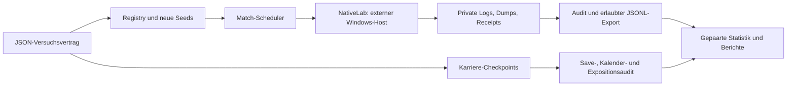

# Forschungsplattform 0.1

Stand 14.11.2026. Python 3.12, kleine lokale Bibliothek ohne Datenbank oder Webdienst.
Die eingefrorenen historischen `analysis/run_attr*.py` und `analyse_attr*.py`
bleiben unverändert. Neue Module teilen Verträge und Audits; ein Karriereversuch
wird niemals durch viele voneinander unabhängige Einzelmatches ersetzt.

## Offline-Präzisionsanalyse TACT-001-P1A

`analysis/analyse_tact001p1a.py` liest ausschließlich das öffentliche P0-Archiv,
prüft historische Identitäten/Abrechnungen und schreibt explorative Effekte sowie
bedingte Kosten-/Powerprognosen nach `data/tact-001-p1a/`.
`analysis/report_tact001p1a.py` erzeugt Bericht und wissenschaftliche PNG-Figuren.
Beide starten weder Host noch Simulation und reservieren keine Matchseeds.
Die negative Resolution-V-Halbfraction ist eine getrennte Planungsfunktion;
das bestehende positive `fractional_design()` und eingefrorene P0 bleiben erhalten.
Der damalige [P1B-Folgeauftrag](../experiments/TACT-001-P1B-order.md) und dessen
`next-study-plan.json` bleiben als ursprüngliche Planung erhalten. Die tatsächliche
P1B-Registrierung, Freigabe und abgeschlossene Ausführung stehen im nächsten Abschnitt.

## TACT-001-P1B – explizite Halbfraction und begrenzte Ausführung

`fractional_design(names, fraction=-1)` wählt ausdrücklich E=−ABCD; der historische
Default `fraction=1` bleibt E=+ABCD. Der gemeinsame Vertrag erlaubt jetzt eine
explizite `design.control_arm`-Kennung, sonst unverändert `baseline`; P1B nutzt D00.
Der experimentbezogene Runner und seine eigene Faktor-/Kontrastanalyse prüfen
dieselbe 16-Zell-Matrix, 64 Setup-Hashes und native Creatorbits. Die generische
Zweiarmstatistik wird dadurch nicht zu einer Fünffaktoranalyse.

`analysis/run_tact001p1b.py` führt getrennte prepare/register/technical/main-Phasen
mit der bestehenden NativeLab aus. `research/study_budget.py` ergänzt die bisherige
Budgetkontrolle um eine unverrückbare UTC-Deadline über sämtliche Phasen hinweg.
2.048 Hauptversuche, 73 technische Versuche, maximal vier Worker, 90 s ohne
Fortschritt, 2.400 s Child-Wall-Time und 40 Minuten Gesamtdeadline; kein Retry.
Keine Upstreamänderung, keine Karriere- oder Holdoutausführung.

Die Serie ist abgeschlossen: 2.048 Haupt- und 72 technische Matches akzeptiert,
acht exakte Wiederholungen, eine erwartete Abweisung mit Exit108.
`analysis/export_tact001p1b.py` prüft private Roh-/Dump-/Startuphashes erneut und
exportiert ausschließlich erlaubte Felder. Der unabhängige
`analysis/verify_tact001p1b.py` prüft die öffentlichen 40 Kontraste/Intervalle,
Holm-5/10/25, 960 Blockkontraste, Kandidatenregel und vollständige Jobabrechnung.
[Ergebnisse und Grenzen](../experiments/TACT-001-P1B-results.md).

## Architektur und tatsächlicher Implementierungsstand



| Datei | Verantwortung / Vertragsgrenze |
|---|---|
| `research/core.py` | Gemeinsames Schema, unveränderliche Registrierung, exklusive Seedreservierung, gegen Archiv und offene Registrierungen disjunkte uint32-Seeds, deterministischer Scheduler, Drift-/Artefaktprüfung |
| `research/native.py` | Bestehenden offiziellen Host nutzen; exakte Engine-/Host-Gates, vollständige absolute Kodierung, native Seed-/Phasen-/Rollen-/Attributaudits, Rohledger, keine versteckten Retries |
| `research/stats.py` | Plausibilität, vollständige gepaarte Blöcke, Seitenmittel innerhalb eines Seeds, gleichgewichtete Szenarien, t-/Bootstrapintervalle, Holm, nichtzentrale t-Powerplanung |
| `research/discovery.py` | Feste IP-4-2-3-1 prüfen, 16-Punkt-Resolution-V-Design, begrenzte Ridge-Vorschläge aus einem endlichen zulässigen Pool; keine automatische Simulation |
| `research/career.py` | Checkpoints importieren, kontrollierte Ableger/Arme/Wochen und tatsächlich absolvierte Exposition prüfen; kein automatischer Spiel-/Trainingskalender-Executor |
| `research/report.py` | Automatischer technischer Markdownbericht und exportierbare Matplotlib-Durchsatzgrafik |
| `research/cli.py` | Explizite CLI, Registrierungsprovenienz gegen GitHub-main, Planung, Buildwarnung und begrenzter nativer A/A-Smoke |
| `research/specs/` | Sechs maschinenlesbare Entwürfe für mehrere Module, einschließlich technischem Smoke; alle zunächst `draft` |

Die tatsächlich ausführbare native CLI ist auf den technischen Vier-Match-Smoke
begrenzt. Die Bibliothek kann Jobpläne für mehrere Forschungsbereiche erstellen;
wissenschaftliche Serien benötigen weiterhin einen **experimentbezogenen** Runner
und eine eingefrorene Analyse. Modulspezifische Endpunkte wie Standardsituationen
oder Trainingsentwicklung werden nicht aus beliebigen Matchstatistiken abgeleitet.

## Konfigurationsschema

`validate()` in `research/core.py` ist die maßgebliche ausführbare Schemadefinition.
Ein Vertrag umfasst `schema_version`, ID/Modul, `kind` (`native`/`career`),
`stage` (`technical`/`discovery`/`confirmation`), Status, Hypothese, Kontrollarm,
Intervention, Versuchsbedingungen, Primär-/Sekundärmetriken, Analyseeinheit,
Arme, Gegner-/Stärkeszenarien, Seiten, feste Blockzahl, Seednamespace, Identität,
Ressourcenbudget und Vorregistrierungsprovenienz.

`science` verlangt Analyse, Ausschlüsse, negative Kontrollen, Readbackfelder,
Stopregel, Auswahlregel, Powergrundlage, α und Testfamilie. Wissenschaftliche
Verträge brauchen Power und praktische Schwelle. Bei mehreren Hypothesen ist
eine Korrektur vorgeschrieben. In `confirmation` müssen die Szenarien als solche
markiert sein; TACT erfordert einen eingefrorenen Kandidaten, gehaltene Gegner
und tatsächliche Punkte als Primärgröße. Hypothesengenerierung und Bestätigung
bekommen getrennte IDs/Namespaces und Reservierungen.

Ein Entwurf lässt unbekannte Setup-/Vorregistrierungshashes zu; er ist damit
**nicht ausführbar**. Registrierung setzt konkrete Hashes voraus. Die CLI prüft,
dass Spezifikation, Dokument und Analyse bereits auf `origin/main` veröffentlicht
sind und zur lokalen Fassung passen. Seedreservierungen sind dauerhaft: auch
abgebrochene Experimente verbrauchen ihre reservierten Seeds. Nach einem Crash
mit verbleibender `.allocation.lock` zuerst prüfen, ob ein anderer Prozess aktiv
ist und ob eine vollständige Registrierung geschrieben wurde; nicht blind löschen.

## Befehle

```powershell
python -m pip install -r requirements.txt
python -m unittest discover -s tests -v
python -m unittest discover -s analysis -p 'test*.py' -v
python -m research validate-config research/specs/TACT-001-draft.json
python -m research watch-build --game '<lokale FM27-Installation>'
python -m research register '<veröffentlichter registrierter Vertrag>' --registry local/registry
python -m research plan '<Registry-Receipt.json>'
python -m research benchmark-figure docs/valid002-workers.svg
```

`watch-build` vergleicht den tatsächlichen DLL-Hash mit VALID-002 und endet bei
Abweichung mit Code 2. Optional prüfen `--runtime` Host und Fixture und
`--check-upstream` neue Tags. `NativeLab` prüft zusätzlich Host und Ressourcenstatus;
`check_identity` bindet den Versuch an alle Identitätsfelder einschließlich
Fixture-/Ressourcenhash. Upstream Releases/Tags vor jeder Migration erneut
abfragen; keine automatische Aktualisierung oder unbeaufsichtigte Wiederaufnahme.

## Vorregistrierter Plattform-Smoke

Der parameterisierte Vertrag `research/specs/MECH-000-smoke.json` wird vor der
Ausführung veröffentlicht. Die CLI bindet konkrete Engine-/Setuphashes und den
veröffentlichten Codecommit in ein lokales Registry-Receipt. Zwei neue Seeds,
eine feste Teamseite, zwei **bytegleiche** Arme `baseline` und `aa_control`,
vier Matches, zwei Worker, 90 Sekunden Fortschrittstimeout. Kein Poweranspruch.

```powershell
python -m research smoke --runtime '<extrahierte v1114.6-Runtime>' `
  --game '<lokale FM27-Installation>' --artifacts local/platform-smoke-001
```

Annahme: gültige Registry, Seeddisjunktheit, passender VALID-002-Kontext, exakt
gleiche A/A-Eingaben, vollständige native Readbacks und natürliche Ergebnisse.
Endstand, Endtick und Teamstatistik müssen je Seed zwischen beiden Labels exakt
gleich sein. Automatischer Bericht ist deskriptiv; keine p-Werte, Ranglisten oder
Wirksamkeitsbehauptungen aus zwei Seedblöcken. Schon benutzte Versuchspfade werden
nicht überschrieben. Der Smoke wird nicht bei jedem normalen Unit-Test gestartet.

## Rohdaten und Veröffentlichung

Private Runtime, Binärsetups, PKM, FMF, volle Dumps, Import-/Exportdateien und
personenbezogene lokale Pfade bleiben unter ignoriertem `local/`. Jeder Versuch
erhält Ledger und Sessiondiagnostik. Eingabe-/Integritätsfehler stoppen den Batch;
fehlende Arme verhindern Analyse. Keine Nullersetzung und keine Ersatzseeds.
Unbegonnene Jobs sind aus Plan minus Ledger feststellbar und explizit zu berichten.
Ein optionaler zukünftiger Retry muss dieselbe Job-/Seed-/Setupidentität behalten
und erhält eine neue Versuchsnummer; er ist in dieser Version nicht automatisiert.

Öffentlich werden nur numerische Messfelder, pseudonyme Szenariokennungen,
Versions-/Code-/Eingabehashes und Fehlerklassifikationen exportiert. Exporter
prüfen vorhandene Belege erneut. Der Hashindex ersetzt weder den privaten Inhalt
noch einen unabhängigen Spiel-im-Spiel-Vergleich. Nach Installation/Änderungen
die alte Forschungsumgebung erhalten; nie Spiel-DLLs oder Saves in Git aufnehmen.

## Noch offene Grenzen

- Gespeicherte PKM-Kapazität, tatsächlicher Fixturekontext und ursprüngliche
  Matchmanagerzustände brauchen einen separaten Adapter. VALID-002 belegt nur
  den Reader und die Zurückweisung des unpassenden Kadertransfers.
- Taktikausführung/Komplexität, jede neue Rolle/PI und Standardsituationszähler
  benötigen interventionsspezifische native Audits vor Forschung.
- `career.py` bietet einen prüfbaren Importvertrag, keine bereits validierte
  automatische Karrierefortschreibung oder Save-Schreibschnittstelle.
- Modellvorschläge sind explorativ. Unsicherheit ist Modellunsicherheit aus dem
  regularisierten Fit, kein gültiges konfirmatorisches Intervall nach Auswahl.
  Robustheit wird anschließend je Gegner/Stärke untersucht und separat bestätigt.
- Für Karriereeffekte sind unabhängige Save-Ableger bzw. Clubs die relevanten
  Cluster. Viele Spieler und Messzeitpunkte ersetzen keine unabhängigen Replikate.

Weitere Planung: [Gesamtroadmap](ROADMAP.md), [externe Evidenz](EXTERNAL_RESEARCH.md),
[TACT-001](../experiments/TACT-001-discovery.md), [VALID-002](../experiments/VALID-002-adapter.md).
