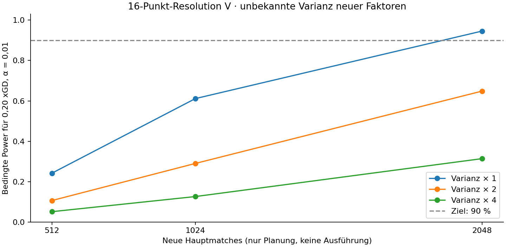

# TACT-001-P1A – Präzision, Suchdesign und Praxisübertragung

**14.11.2026 · Planung auf Basis explorativer P0-Nachanalyse · keine neuen Matches.**

Empfehlung: ein eingefrorenes **16-Punkt-Resolution-V-Screening der fünf Faktoren**,
keine neue Bestätigung der kleinen Pressing×Linie-Interaktion. Das größere
Budget von 2.048 Hauptmatches ist die bevorzugte Variante, wenn 90 % bedingte
Power pro praktisch relevantem Haupteffekt verlangt werden. 1.024 Matches sind
eine brauchbare günstigere Entdeckungsstufe mit ausdrücklich geringerer Power.
Beide Varianten sind Vorschläge, keine bereits registrierten Versuche.

Die [unabhängige P0-Nachanalyse](../experiments/TACT-001-P1A-analysis.md)
und [maschinenlesbaren Berechnungen](../data/tact-001-p1a/design-comparison.json)
liefern alle Zahlen. Der [Folgeauftrag](../experiments/TACT-001-P1B-order.md)
legt fest, was vor einem späteren Start zusätzlich einzufrieren und zu prüfen ist.

## 1. Gleiche Zielgröße, unterschiedliche Forschungsfragen

Für einen festen Kandidaten ist `Kandidat − Baseline` auf xGD die direkte Frage.
Für die Mechanik ist ein über andere Einstellungen gemittelter Haupteffekt
oder eine Differenz-von-Differenzen relevant. Kleine Interaktionen benötigen
mehr Kontrastkoeffizienten und sind nicht automatisch das effizienteste erste
Optimierungsziel. Aus dem unklaren P0-Ergebnis folgt weder Additivität noch
die Notwendigkeit, zuerst 0,10 xGD Interaktion hochpräzise zu bestätigen.

Neue kleinste praktisch relevante Änderung: **0,20 xGD pro Match** für einen
Haupteffekt oder später ein konkretes Taktikpaket. Dies ist eine offen benannte
Projektentscheidung für effizientes Screening, keine aus P0 bestätigte
Relevanzgrenze und kein belegter Gegenwert in Karrierepunkten. 0,10 und 0,15
bleiben als teurere Sensitivitätsziele sichtbar. Keine Attraktivitätswahl anhand
des größten beobachteten P0-Arms.

## 2. Gemessene Varianz und Kosten bekannter Kontraste

Zielgewichte immer high_press=½, deep_block=½, Seiten innerhalb des Seeds=½.
Die folgende Prognose verwendet P0-Kontrastvarianzen unverändert auf neuen Seeds.
95-%-Halbbreite = halbe Intervallbreite; volle Breite ist doppelt so groß.
α=0,05, jeweils **ein** vorab festgelegter Vergleich, Power für 0,20 xGD.
Diese Zeilen sind keine gemeinsame Mehrfachtestfamilie und keine Gewinnerliste.

| Vergleich | Matches je unabh. Block | Allokation H/D bei 1.000 Matches | SE | 95-%-Halbbreite | Power | Modellierte Varianzersparnis ggü. gleichverteilt |
|---|---:|---:|---:|---:|---:|---:|
| Pressing isoliert | 4 | 117/133 | 0,060 | 0,118 | 91,3 % | 0,4 % |
| Linie isoliert | 4 | 185/65 | 0,060 | 0,117 | 91,6 % | 18,7 % |
| Beide Änderungen gegen Baseline | 4 | 154/96 | 0,075 | 0,147 | 76,1 % | 5,0 % |
| Interaktion | 8 | 86/39 | 0,118 | 0,234 | 38,8 % | 12,7 % |
| Pressing marginal im P0-2×2 | 8 | 65/60 | 0,072 | 0,143 | 78,3 % | 0,2 % |
| Linie marginal im P0-2×2 | 8 | 77/48 | 0,061 | 0,121 | 89,9 % | 5,7 % |

Die Zweiarmdesigns schätzen einen anderen Effekt als die marginalen Zeilen.
Alle zweiarmigen Vergleiche gleichzeitig auszuführen kostet mehr als jede Zeile
für sich. Dasselbe Match kann mehrere vorher definierte Faktorfragen informieren.

### Stratifikation und Allokation

Bei festen Kontextgewichten W_h und Kosten c_h ist die kontinuierliche optimale
Verteilung `n_h ∝ W_h·SD_h/√c_h`. Hier sind W und Kosten gleich, daher
`n_H/(n_H+n_D)=SD_H/(SD_H+SD_D)`. Das Zielmittel bleibt gleichgewichtet:
mehr high_press-Matches geben high_press **kein höheres Auswertungsgewicht**.
Der Code sucht zusätzlich das varianzminimierende ganzzahlige n mit mindestens
acht Blöcken je Kontext. Die 1.000-Match-Zeilen enthalten keine versteckten
technischen Läufe; diese kommen bei echter Ausführung hinzu.

Die Allokationsanteile sind unsicher: Bootstrap-Resamplingbereiche für den
optimalen H-Anteil sind Pressing 0,330–0,628, Linie 0,613–0,856, Interaktion
0,528–0,819. Das sind deskriptive Bereiche aus acht Werten, keine Garantie
künftiger Ersparnis. Für fünf neue Kontraste ist nicht derselbe Anteil optimal.
Das nächste DoE bleibt daher **gleichverteilt** und passt seine Fallzahl nicht
nach beobachteten Effekten an. Eine spätere Allokationsstudie kann eingefrorene,
unabhängig geschätzte Varianzen verwenden.

Stratifikation sichert außerdem die Zielpopulation gegen eine zufällige
Verschiebung der Gegneranteile. Ein zusätzlicher Gewinn gegenüber unstratifizierter
zufälliger Kontextziehung lässt sich ohne ein definiertes Mischungsdesign nicht
seriös als empirische Prozentersparnis ausweisen.

### Unabhängige Seeds je Seite

Aus den P0-Randvarianzen berechnete Gegenmodelle bei 1.000 Matches:

| Vergleich | SE bei unabhängigen Seiten-Seeds | Varianz relativ zur bisherigen Seitenpaarung |
|---|---:|---:|
| Pressing isoliert | 0,061 | 1,019 |
| Linie isoliert | 0,061 | 0,844 |
| Beide Änderungen | 0,065 | 0,726 |
| Interaktion | 0,113 | 0,799 |
| Pressing marginal | 0,068 | 0,895 |
| Linie marginal | 0,057 | 0,821 |

Beide Seiten bleiben in der Zielverteilung. Die Zeilen benutzen vier unabhängige
Gegner×Seiten-Strata mit Gewicht ¼ statt derselben Seeds auf beiden Seiten.
Das kann die positive Seitenkovarianz gegen high_press vermeiden, verliert aber
negative Kovarianz gegen deep_block. Die 2–27-%-Unterschiede sind Gegenmodelle
aus kleinen Stichproben, keine gemessenen Gewinne. Ohne eigenen Vergleich und
Übertragungsbeleg für C/D/E wird diese Änderung nicht in die nächste Studie
eingeschleust. Armpaarung innerhalb eines Kontexts bleibt ebenfalls vorab fest.

### Control Variates

Eine Baseline ist keine kostenlos bekannte Konstante. Für einen neuen gepaarten
Kontrast D, Baseline B und unabhängige neue Kalibrierung mit m Baselineblöcken:

`D_adj = mean(D) − β·(mean(B_paired) − mean(B_calibration))`

`Var(D_adj) = (VD − 2βCov(D,B) + β²VB)/n + β²VB/m`.

β muss vor den neuen Daten eingefroren sein. Für m/n=r ist das unter dem
Planungsmodell optimale β gleich `Cov(D,B)/VB · r/(1+r)`.
Kalibrierung kostet zwei Matches je Block; gepaarte Blöcke kosten vier, bei
der DoD acht. Der Code verrechnet beides und optimiert die Kontextverteilung
näherungsweise unter demselben 1.000-Match-Gesamtbudget.

| Kontrast | Bestes geprüftes m/n | Varianz relativ zu gewöhnlich optimal stratifiziert |
|---|---:|---:|
| Pressing isoliert | 0,25 | 1,004 |
| Linie isoliert | 0,25 | 0,993 |
| Beide Änderungen | 0,50 | 0,979 |
| Interaktion | 0,25 | 1,040 |

Geprüft r=0,25/0,5/1/2/4/8; Kosten und β je Zeile im JSON. Maximal etwa 2 %
prognostizierter Gewinn rechtfertigen bei unsicherer Kovarianz keinen neuen
Kalibrierungspfad. Die viel größeren Oracle-R²-Werte setzen eine nicht verfügbare
bekannte Baselineerwartung voraus. P0 als exakte Erwartung zu behandeln unterschlägt
deren Unsicherheit; dieselbe Stichprobe um ihren eigenen Mittelwert zu zentrieren
senkt die Unsicherheit des Gesamtmittels nicht. Cross-Fitting erzeugt keine
bekannte Erwartung. Schüsse, Ballbesitz oder realisiertes xG sind außerdem
Interventionsfolgen; unbedachtes Herausregressieren würde den Leistungseffekt
ändern. Keine solche Bereinigung im empfohlenen Design.

### Robuste Verfahren und Blockmodelle

Die arithmetischen gepaarten Mittel bleiben maßgeblich. Median/Trimmen sind
Sensitivitäten mit anderem Zielparameter; ohne Ausreißerkontaminationsmodell
kein begründeter Präzisionsgewinn. Blockinterzepte ergeben im balancierten
P0-Design dieselben Kontraste. Kontextspezifische Varianzen, Welch-df und
stratifizierter Bootstrap bilden Abhängigkeit transparent ab. Ein gemischtes
Modell kann später partiell poolen, benötigt aber überprüfbare Modellannahmen;
16 Cluster rechtfertigen keinen behaupteten magischen Präzisionszuwachs.

## 3. Vergleich der Suchverfahren für fünf Faktoren

| Verfahren | Erkenntnis und Interaktionen | Präzision/Kosten | Überanpassung und Entscheidung |
|---|---|---|---|
| A: fünf getrennte Zweiarmtests | Lokale Haupteffekte am festen Anker; keine gemeinsamen Interaktionen | Bei zusammen 1.000 Matches je Test nur 200: Pressing SE 0,134, Linie 0,148; marginale 95-%-Halbbreiten 0,270/0,302 | Leicht umzusetzen. Greedy-Ankerwechsel verändert die Frage und erzeugt Pfadabhängigkeit. Nur wählen, wenn exakt ein vorab priorisierter Eingriff interessiert. |
| A+: sechsarmiger Stern, gemeinsamer Anker | Fünf lokale Einzeländerungen, geteilte Baseline | 83 komplette Blöcke kosten 996 Matches; Pressing SE 0,104, Linie 0,115; Halbbreiten 0,208/0,232 | Effizienter als fünf getrennte Baselines für dieselben lokalen Fragen, aber Interaktionen bleiben ungemessen. Neue Faktoren haben keine gemessenen SDs. |
| B: 16 Punkte, Resolution V | Fünf marginale Haupteffekte; zehn Zweifachkontraste getrennt voneinander, jeweils mit höherer Ordnung aliasiert | 32 Matches/Seedblock. Bei 1.024 Matches 32 Blöcke; bedingter SE 0,066 je Haupteffekt | Beste nächste gemeinsame Mechanikstufe. Alle 16 Bedingungen vorab fest; keine Kandidatenadaptation. Annahmen zu hoher Ordnung offenlegen. |
| Vollständiges 2⁵ | Alle 32 Zellen, Aliasfreiheit auch gegenüber Dreifachinteraktionen | 64 Matches/Block, halbe Blockzahl bei gleichem Budget. Im gleichen Rauschmodell gleiche Haupt-SE je Match, weniger unabhängige Blöcke und mehr technische Zellen | Wählen, wenn höhere Interaktionen fachlich unverzichtbar oder ein Foldover begründet ist; nicht pauschal als doppelt präzise darstellen. |
| C: begrenztes Modellverfahren | Vorhersage und gezielte Kandidaten statt unverzerrter globaler Rangliste | Beispiel 496 Matches: 256 initial (16 Zellen×2 Seiten×8 Blöcke), danach 3 Runden à 80 (4 Kandidaten+Anker×2 Seiten×8 neue Blöcke). 992: 512 initial+6×80 | Ausnutzung von Rauschen, Modellfehlanpassung, Winner's Curse. Keine gemessene erwartete Gewinnerverbesserung; kleine Runden sind unsicher. Erst nach B und unabhängigem Vorhersagecheck. |

Bei C sind die acht Rundenblöcke je vier pro Gegner; der Anker läuft neu mit,
keine Wiederverwendung seiner alten Mittel als fehlerfreie Konstante. Die
anfänglichen 256/512 Matches bedeuten 4/8 Blöcke **je** Gegner.
Ein neuer Einzelkandidat mit nur vier Blöcken je Gegner hätte unter den
bekannten P0-Zweiarmstreuungen bereits vor Selektion SE 0,336–0,428 und
marginale 95-%-Halbbreite 0,826–1,099; etwa 7–8 % Power für 0,20 xGD.
Ein Modell kann Informationen teilen, dessen wirkliche Vorhersagepräzision
und Selektionsnutzen sind hier aber nicht gemessen.
Ridge-/Surrogat-SE ist keine Post-Selection-Konfidenzgrenze. Ein begrenzter
Pool legaler Nachbarn und vier Vorschläge je Runde verhindern blindes Enumerieren,
ersetzen aber keine unabhängige Bestätigung. Kosten von Validierung zusätzlich.

### Warum B jetzt?

1. Fünf Faktoren sind ausdrücklich relevant; P0 belegt keine Additivität.
2. Resolution V hält Haupt- und Zweifachspalten getrennt. Ein 8-Punkt-Plan wäre
   bei fünf Faktoren wegen Haupt-/Zweifachaliasen für diese Frage zu schwach.
3. Alle Bedingungen können vor dem Start festgelegt werden. Keine adaptive
   Kandidatenauswahl und kein Effektstopping in derselben Stichprobe.
4. Wenn eine legal kodierbare Zelle scheitert, wird zuerst das Design überarbeitet
   und neu registriert; keine einzelne Zelle nach Ergebnissen austauschen.
5. Wenn das Budget unter 1.024 Hauptmatches liegt, zunächst nur ein separat
   geplantes Zweiarmexperiment für eine konkrete Frage; keine unterreplizierte
   Fünffaktorsuche als präzise Bestätigung verkaufen.

Generator des neuen Entwurfs: **E=−ABCD, I=−ABCDE**. Damit ist der komplette
Standardanker `-----` enthalten. Das ursprüngliche positive Generatorbeispiel
in TACT-001 wird nicht überschrieben. 16 eindeutige Zeilen und orthogonale
Intercept-/Haupt-/Zweifachspalten sind getestet und als
[Designmatrix](../data/tact-001-p1a/resolution-v-design.json) veröffentlicht.
Haupteffekte sind mit Vierfach-, Zweifacheffekte mit Dreifachinteraktionen
aliasiert (mit negativem Vorzeichen). 16 Zellmittel liefern bei Interzept+5+10
ein gesättigtes Modell; Fehlerinformation stammt aus neuen Seedblöcken, nicht
aus erfundenen Lack-of-fit-Freiheitsgraden. Spätere Modellwahl darf diese
Aliasstruktur nicht als gemessene Abwesenheit höherer Ordnung ausgeben.

## 4. Präzisionsmodell und mindestens zwei Budgets

Unbekannt: Streuungen von Tempo, Direktheit, Breite und neuen Kombinationen.
Für eine **bedingte** Kostenprognose wird aus der seitenmittleren P0-Armkovarianz
Σ die mittlere orthogonale Rauschvarianz
`τ_h² = [tr(Σ_h) − sum(Σ_h)/4]/3` berechnet:
high_press 0,748854, deep_block 0,352337.
Übertragung auf neue 16-Zell-Kontraste setzt austauschbares Rauschen im Raum
orthogonal zum Interzept voraus. Sie ist keine empirisch bewiesene Varianzreduktion.
Ein Haupteffekt `mean(Y|F+)−mean(Y|F−)` hat acht Koeffizienten +⅛ und acht −⅛,
damit Blockvarianz τ²/4. Bei n Blöcken je Gegner ist
`Var(θ)= (τ_H²+τ_D²)/(16n)` und M=64n Hauptmatches.

Ein physischer Zweifach-DoD über die übrigen drei Faktoren hat Koeffizienten
±¼ und viermal diese Varianz, SE also doppelt so groß. Die übliche ±1-Regressions-
Koeffizientenskala darf nicht als physischer DoD ausgegeben werden.

Die **primäre Zielgröße ist xGD** mit fünf vorab definierten Hauptkontrasten,
Holm-Familie α=0,05. Power konservativ pro Kontrast mit α=0,01 geplant;
kein Anspruch auf 90 % Wahrscheinlichkeit, alle fünf Effekte zugleich zu finden.
Zehn Zweifachkontraste einschließlich Pressing×Linie und Tempo×Direktheit bilden
eine separate explorative Holm-10-Familie. Tatsächliche Punkte/GF/GA/xGF/xGA
werden vollständig berichtet; kein nachträgliches Endpunktwechseln.

| Variante | Blöcke je Gegner / gesamt | Hauptmatches | SE pro Hauptkontrast | Marginale 95-%-Halbbreite | Konservative simultane Halbbreite (Bonferroni 5) | Power 0,20, α=0,01 |
|---|---:|---:|---:|---:|---:|---:|
| Klein: Entdeckung | 16 / 32 | 1.024 | 0,0656 | 0,1347 | 0,1819 | 61,1 % |
| Empfohlen: Präzision | 32 / 64 | 2.048 | 0,0464 | 0,0929 | 0,1238 | 94,6 % |

Gewünscht: 90 % Power pro 0,20-Haupteffekt und marginale volle 95-%-Breite
≤0,30 xGD (Halbbreite ≤0,15). Die große Variante erreicht diese Ziele unter
dem Transfermodell, sogar die konservative simultane Halbbreite bleibt <0,15.
Die kleine erfüllt das marginale Präzisionsziel, aber nicht das Powerziel.
512 Matches ergäben nur 24,2 % konservative Power und Halbbreite 0,201 marginal;
kein empfehlenswerter Ersatz für ein belastbares Screening.

Bei doppelter übertragener Varianz sinkt die Power der großen Variante auf
64,8 %, bei vierfacher auf 31,4 %. Bei der kleinen sind es 29,0 % bzw. 12,6 %.
Für 90 % pro 0,20-Kontrast benötigt das Modell 1.792 Matches (28 Blöcke/Gegner),
bei doppelter Varianz 3.456, bei vierfacher 6.720. Für 0,10 sind es bereits
6.720/13.248/26.368. **Das sind keine Startaufträge.** Auch diese Studie sollte
nicht versuchen, jede kleine Interaktion teuer zu bestätigen.

### Rechenbudget und technische Kosten

Vorab vorgeschlagen: 64 Readbackprüfungen (16 Zellen×2 Gegner×2 Seiten),
acht exakte Wiederholungen bereits geprüfter Zellen, eine geplante Negativprobe.
Somit **72 technische Vollmatches und eine Negativabweisung**, maximal 73
technische Startversuche, keine Retries/Ersatzversuche. Exakte acht Wiederholungs-
zellen und deren technische Seeds müssen vor dem Start im Vertrag stehen.

| Variante | Haupt-/Technik-Startversuche gesamt | Erwartete volle Matches bei Erfolg | Kumulative Child-Wall-Time-Obergrenze | Gesamtdeadline ab erstem nativen Aufruf |
|---|---:|---:|---:|---:|
| Klein | 1.024+73 = 1.097 | 1.096 | 1.200 s | 20 min |
| Groß | 2.048+73 = 2.121 | 2.120 | 2.400 s | 40 min |

Maximal vier Worker, 90 s ohne Fortschritt pro Worker. Beide Zeitgrenzen und
alle Startversuche dauerhaft vor jedem Start reservieren; aktive/nicht sauber
beendete Reservierungen konservativ verrechnen. Vorbereitung, Audits und
Negativprozesse zählen zur Child-Wall-Time. Neustart darf weder Zähler noch
Deadline neu setzen. Native Fehler stoppen die Serie; unvollständige Blöcke
erlauben nur technischen Status, keine Rangfolge oder Leistungsinferenz.

Historischer P0-Amortisationswert: 108,478 s verrechnete Child-Wall-Time /
151 Vollmatches ≈0,718 s einschließlich damaliger Zusatzprozesse.
Damit grob 787/1.523 s für die geplanten Vollmatches, **keine garantierte Laufzeit**
der neuen Eingaben. Die Caps geben etwa 50 % Reserve; ein zukünftiger technischer
Gate prüft diese Erwartung, ohne automatisch Budget zu erweitern. Bei vier
Workern ist Child-Wall-Time nicht dasselbe wie verstrichene Kalenderzeit.

### Informationsgewinn pro 1.000 Hauptmatches

Als überprüfbarer statistischer Proxy definieren wir `I=1/Var(θ)` und normieren
`I_1000=1000/(M·Var(θ))`. Einheiten xGD⁻²; kein Entropiemaß und kein erwarteter
Karrieregewinn. Bei B unter Transferannahme **227 je Hauptkontrast**, fünf
gleichzeitig orthogonale Fragen ≈1.135 als Spur der Kontrastinformation.
Die Summe ist kein Nutzenmaß, wenn Fragen unterschiedlich wichtig sind.
Bei doppelter/vierfacher Varianz: 114/57 je Kontrast. Einschließlich technischer
Versuche sinkt der Proxy auf etwa 212 (klein) /219 (groß).

Zum Vergleich: P0-DoD mit optimaler Allokation ≈71 je 1.000 Matches; isoliertes
Pressing ≈278, aber nur eine andere Frage. Fünf getrennte lokale Tests mit je
200 Matches liefern beim Pressing I≈55 und bei Linie≈46 **pro 1.000 Gesamtmatches**;
der gemeinsame Stern ≈92/75. Diese Vergleiche trennen unterschiedliche Zielparameter
und dürfen nicht als bewiesener 4-facher Entdeckungsgewinn interpretiert werden.
Vollfaktoriell erhält im Transfermodell dieselbe Hauptinformation je Match,
aber mehr Aliasauflösung; Modelloptimierung hat ohne neue Daten keine seriös
bezifferbare erwartete Kandidatenverbesserung oder Information über alle Faktoren.
Beim vollen 32-Punkt-Plan liefert dieselbe Rechnung bei 1.024/2.048 Matches
dieselben SE 0,0656/0,0464, aber wegen nur 8/16 Blöcken je Gegner konservative
Halbbreiten 0,1992/0,1287 und Power 52,7/92,8 %. Weitere technische Eingabezellen
kosten zusätzliche Prüfungen. Das ist ein expliziter Preis für Aliasauflösung.

## 5. Auswahl, Stoppen und unabhängige Bestätigung

Feste Fallzahl, kein vorzeitiges Stoppen wegen großer Effekte oder p-Werte.
Nach vollständigem Screening: alle fünf Schätzungen, simultane/marginale Intervalle,
Gegnerheterogenität und zehn Alias-Kontraste veröffentlichen. Höchstens zwei
vorläufige Taktikpakete für eine **neue** Studie vorschlagen. Eine vorab eingefrorene
Regel kann positive, ≥0,20 große Haupteffekte mit Holm-p≤0,05 als Einstellungs-
hinweise nutzen; das ist keine Bestätigung des zusammengesetzten Pakets.
Bei keinem klaren Signal bleibt der Standardanker erhalten, keine künstliche
Siegerbenennung. Gegenläufige große Kontexteffekte oder starke Zweifachsignale
führen zu gezielter neuer 2×2-Prüfung/Foldoverplanung, nicht blindem Addieren.

Für Kandidatenvorschläge: maximal zwei aus den 16 tatsächlich geprüften Zellen,
geordnet nach kleinstem kontextspezifischem mittleren xGD-Abstand zur Baseline,
dann gleichgewichtetem Abstand, dann lexikographischer Design-ID. Nur Zellen mit
positivem Abstand in beiden Kontexten; falls keine, kein Kandidat. Diese robuste
Rangregel ist weiterhin selektionsverzerrt und hat keine konfirmatorischen CIs.
Keine Bewertung ungespielter Zellen als gemessene Taktik.

Danach eigene Vorregistrierung: gefrorener Kandidat gegen Anker, neue Seeds und
unbenutzte Gegner-/Stärkeprofile, tatsächliche Punkte primär sowie GF/GA/xGD,
eigene Relevanz- und Powerplanung aus Punktkontrastvarianz. Simultane Auswahl
mehrerer Kandidaten verlangt eigene Fehlerkontrolle. Die existierenden Holdouts
bleiben bis dahin versiegelt; P0 und künftige Entdeckung gehen nicht in die
Bestätigungsstatistik ein. Keine automatische Bestätigung nach P1B.

## 6. Grenzen des Fixtures und technischer Transferplan

P0 schreibt identische synthetische Kaderstärken; Feldspieler sind in allen
Feldpositionen voll geeignet und haben weitgehend dieselben Fähigkeiten
(Rohwert 60 in Attributslots 15–68, Alter 25, CA120, Fitness/Schärfe10000,
Moral20, feste Größe/Gewicht). GK-Slots sind separat positioniert, Fähigkeitsschema
aber ebenfalls künstlich. Dadurch fehlen typische Positionsspezialisierung,
Leistungsstreuung, Alterung, Fußpräferenzen/Traits, Kaderselektion und dynamische
Ermüdung. CA ist keine Garantie gleichwertiger Rollenprofile.
Zwei Gegner sind gebündelte Anweisungsprofile, kein kausal isolierter
Pressingfaktor der Gegner. Supplied-Plan-Einzelmatches enthalten keinen validierten
vollständigen Karriere-, Trainings-, KI-Coaching- oder Transferprozess.

| Priorität | Technische Erweiterung | Kontrolle und eigene Validierung | Neue spätere Entdeckungsstudie |
|---|---|---|---|
| T1 | Positionsspezifische Profile für GK/IV/AV/DM/AMC/Flügel/ST, geringe/mittlere/hohe Ausprägung je Positionsgruppe | Eigene synthetische JSON-Profile; Rohwert-/UI-Skalen, CA-Kosten, Positions-/Fußeignung, Traits und beide Seiten nativ vollständig lesen. Gleiche rollenspezifische Verteilungen für beide Teams, feste Elf/Bank | Profil×Taktik-Übertragbarkeit bei mittlerer Stärke; nicht gleichzeitig alle Attribute/Rollen verändern |
| T2 | Drei relative Stärken schwächer/gleich/stärker | Feste Fähigkeitvektoren, gleiche übrige Bedingungen; beide Seiten. Stärke nicht allein über CA setzen. A/A, Repeats und monotone Plausibilität als Diagnose, keine Ergebnisgarantie | Neues Discovery-Register mit Kontextgewichten und eigener Stichprobenplanung |
| T3 | Größere Gegnerdiversität | Neue IDs etwa `discovery2_width`, `discovery2_possession`, `discovery2_transition`; IP/OOP/Rollen/PI/Management vollständig hashen | Balanciertes oder vorher festgelegtes stratifiziertes Panel; Profil als feste Zielpopulation, nicht unbegründet zufällige repräsentative FM-Population |
| T4 | Gespeicherte Karriere-Matchadapter | Separates VALID mit Kapazitäten, IDs/Zuordnung, Startzeit, Fatigue, Form, Seedreadback, Coach-/Substitutionspolitik, A/A/Wiederholung/Negativtest und Driftgate | Erst nach Freigabe eingefrorene Kandidaten über mehrere echte Fixtures prüfen; keine Vermischung mit synthetischer Effektgröße |
| T5 | Karriere-Längsschnitt und reale Anwendung | Identische Startdateien, Kalender, Kader/Coaches; tatsächliche Exposition, Trainings-/Managementänderungen und Verletzungen erfassen | Eigene TRAIN/TACT-Studie, kurzfristige Matchleistung getrennt von Entwicklung |

Bestehende `holdout_midblock` und `holdout_direct_counter` sowie Holdout-Seeds
werden weder zur Erweiterung des Entdeckungspanels noch zur Modellabstimmung
verwendet. Neue Discovery-IDs, Profile und Seeds erhalten einen eigenen Namespace
und eine vorab veröffentlichte Zuordnung. P1B bleibt zunächst im alten freigegebenen
synthetischen Kontext; Profile, Stärke, OOP, Rollen, PI und Standards werden danach
in getrennten faktorgruppenweisen Studien geöffnet. So bleibt eine Leistungsänderung
einem kontrollierten Eingriff zuordenbar.

## Methodische Quellen

- [NIST: Auflösung und Aliasstruktur fraktioneller Designs](https://www.itl.nist.gov/div898/handbook/pri/section3/pri3344.htm)
  und [Auswertung faktorieller Designs](https://www.itl.nist.gov/div898/handbook/pri/section4/pri43.htm):
  methodische Referenzen, keine FM-Evidenz. Resolution V trennt Haupt-/Zweifachspalten,
  nicht alle höheren Interaktionen.
- [Art Owen: Variance reduction](https://artowen.su.domains/mc/Ch-var-basic.pdf),
  Abschnitte 8.4/8.6/8.9: Hintergrund zu Stratifikation, gemeinsamen Zufallszahlen
  und Kontrollvariaten. Unsere P0-Kovarianzen und Kosten werden separat eingesetzt;
  der Methodenname allein belegt keinen Effizienzgewinn.
- [Wesołowski et al., Statistics Canada 2024: Neyman allocation under box constraints](https://www150.statcan.gc.ca/n1/pub/12-001-x/2024002/article/00003-eng.htm):
  Kontext für Allokation unter festen Gewichten/Beschränkungen. Unsere zwei-Strata-
  Ganzzahlsuche ist direkt überprüfbar und benötigt keinen fremden Solver.

Externe Methodenquellen liefern keine nachgewiesene optimale FM27-Taktik.
