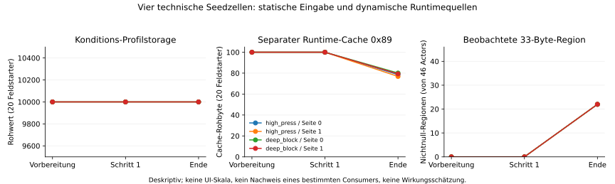

# VALID-005 – bestandene passive technische Beobachtung

14.11.2026. **16Vollmatches in vier technischen Seedzellen, zwei Loaderchecks und
zwei erwartete Negativabweisungen vollständig abgeschlossen.** Keine Ausfälle,
Wiederholungen, Ersatzseeds, Ausschlüsse, Holdouts oder Karriereaktionen.
Das ist eine enge technische Abnahme im gebündelten D00-Fixture, keine
wissenschaftliche Leistungsstudie oder allgemeine Nichtbeeinflussungsgarantie.

Vorab veröffentlicht: voller Source-/Inputcommit
`39b6af5422b160ae9bd4fa82d0c987c947f6916a`, erfolgreiche
[CI43627888504](https://github.com/Matchekk/FM-27-Research/actions/runs/43627888504),
[Codeprüfung](OBSERVER-RUNNER-REVIEW.md),
[konkreter Input-/Seedreview](OBSERVER-INPUTS-REVIEW.md), danach
Registrierungsreceipt `5ed8bd8`. Der ursprüngliche Host, die DLL und fremde
Quellen blieben unverändert. Alle technischen Seeds sind für spätere Studien
verbraucht und ausgeschlossen.

## Was tatsächlich bestanden ist

- Originalhost, neuer Host ohne Recorder sowie zwei Läufe mit Recorder liefern
  in jeder der vier Zellen exakt gleiche natürliche Resultate einschließlich
  Teamstatistiken, Tick und Clock. Auch die identifizierten Recorder-Rohfelder
  und Cachebytes stimmen innerhalb der wiederholten On-Läufe überein.
- Alle16Vollmatches haben je3.174Attribute,1.058Profilfelder,44Phasenzellen und
  748PI-Gruppen nativ verifiziert. Der separate Reviewer rekonstruiert diese
  Werte zusätzlich direkt aus Binärrecords und Dumps.
- Acht On-Läufe liefern je drei Stages und46Actors:24Snapshots und1.104Actor-
  Stage-Beobachtungen. Darunter sind vier deterministische Wiederholungen,
  keine zusätzlichen unabhängigen experimentellen Replikate.
- Invalid-Opt-in wird mit252 und tatsächlichem `invalid_opt_in` abgewiesen;
  die ungültige Binärdatei mit108 und `scenario_rejected`. Kein Matchende bei
  Negativproben. Alle20Prozessbäume sind mit Capsule-Exit und KernelActive0
  bestätigt; kein Cleanupmarker oder globaler Lease bleibt aktiv.

Inneres Budget60,0570184von180s einschließlich Vorbereitung; äußerer
NIGHT-Zähler60,5217007von1800s. Ein Worker, keine90s-Fortschrittsüberschreitung,
Studienfenster900s eingehalten. Die dauerhaften Budgets bleiben erhalten und
können nicht für eine Wiederholung zurückgesetzt werden.

## Neue technische Beobachtungen, begrenzte Bedeutung

In sämtlichen On-Snapshots bleiben Profilstorage-Kondition, beide
Schärfespeicherwerte bei10000 und der gelesene Fatigue-Speicher bei0.
Gleichzeitig verändert sich ein gesonderter Runtime-Akkumulator von1.000.000
bis auf637.489 und Cachebyte0x89 von100 bis auf63. Cachebyte0x8a bleibt100.
40von46Actors besitzen den gelesenen Cache; sechs fehlende Pointer werden
erhalten und nicht als Nullwerte ausgegeben. **Statische Profilfelder allein
belegen den laufenden Runtimezustand nicht.** Keine UI-Prozentkalibrierung oder
präzise Funktionsgleichung aus diesen Werten behauptet.

Die33-Byte-Rohregion ist nach Vorbereitung und erstem Schritt bei allen46Actors
null; am natürlichen Ende sind pro Lauf22Regionen nichtnull. Matchversion
`0x1b000000` ist tatsächlich gelesen und überschreitet den statisch gefundenen
Versionszweig. Weder Versionsschwelle noch veränderte Region beweisen bereits
einen bestimmten während des Matches ausgeführten Consumer oder einen
kalibrierten Tactical-Familiarity-Effekt.

Die ergänzende [Offlinezusammenfassung](../../analysis/summarize_passive005.py)
verwendet vier eindeutige On-Läufe. Für Kondition/Cache werden ausschließlich die
20tatsächlichen Feldstarter per eingefrorenem Lineup gejoint; der Rohregionzähler
bezieht sich auf alle46Actors. Die verschiedenen Nenner bleiben getrennt.

## Provenienz und nächste enge Gates

[Messungen und vollständige20Jobplätze](../../data/valid-005-observer-v1/README.md),
[technische Zusammenfassung](../../data/valid-005-observer-v1/technical-summary.json),
[Budget](../../data/valid-005-observer-v1/budget.json),
[unabhängige Rekonstruktion aus115privaten Belegen](OBSERVER-RESULTS-REVIEW.md).
Rohspielmaterial, Dumps und private Arbeitsartefakte bleiben lokal.

Die eingefrorene Sourcegeneration bleibt im Gitcommit39b6af5 unverändert
rekonstruierbar. Der Router wurde erst nach beendetem Lauf um einen separaten
zukünftigen Technikauftrag erweitert; das ändert keine alten Belege und
autorisiert keinen erneuten Observerlauf.

Freigegeben ist ausschließlich passive Beobachtung dieses Builds/Hosts/Fixtures
mit den geprüften23/23-D00-Eingaben. Nicht freigegeben: Warmworker des neuen
Hosts, aktive Setter, Schärfehauptstudie, UI-Skalen, Consumerdeutung oder
Karriere-Replays. Nächster kleiner Schritt ist der getrennt registrierte
Nachweis, ob die ursprünglichen opt-in-Schärferecords bereits ohne neue
Hostsetter nach Originalvorbereitung, erster Fortschreibung und im Runtimecache
ankommen. Jede Abweichung stoppt dieses technische Gate.
