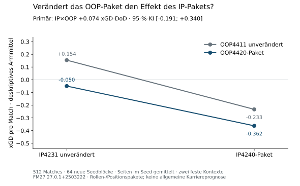

# NIGHT-002 – konsolidierter Forschungsbericht

15.11.2026 · Europe/Berlin · Ausgangscommit062fa7e.
**Ein vollständiger neuer IP/OOP-Pilot; eine terminal abgebrochene Schärfeserie.**

Das konkrete stürmerlose IP-Paket verschlechtert im geprüften synthetischen
Kontext marginal über beide OOP-Pakete xGD um **−0,350 pro Match**,
95-%-KI **[−0,502;−0,198]**, Holm7-p=0,000162. Die primäre IP×OOP-Wechselwirkung
bleibt mit **+0,074 [−0,191;+0,340]**, p=0,577 unklar. Damit ist weder ein
allgemeiner stürmerloser Vorteil noch ein isolierter Rollenmechanismus belegt.
Der Schärfe-Hauptlauf liefert wegen eines Directorfehlers keine Wirkungsschätzung.

## A. Neue Forschungsfragen und Quellenabgleich

[Zehn konkret geprüfte Kandidaten](NOVELTY_MATRIX.md) enthalten Hypothese,
Originalquellen-IDs, lokalen Überlapp, Novelty-Entscheidung, Kontrolle, Eingriff,
Einheit, Zielgröße, Confounder, Aufwand und Nutzen. Beste drei:

1. Getrennte C90/C7A-Startfeldattribution statt Wiederholung ihres gemeinsamen Effekts.
2. Gekreuzte stürmerlose IP/OOP-Pakete bei denselben Spielern/Profilen.
3. Nettoertrag je tatsächlich ausgeführter Ecke einschließlich Konterverlust.

[Primärquellenaudit](LITERATURE_AUDIT.md) und
[maschinenlesbare Belege](../../research/night002-source-audit.json) aktualisieren
Mac-Studien01–21 einschließlich neuer13b/14b/15b/19-Seiten, Purity, FMAX,
Harvestgreen, Training und offizielle SI-Quellen. MacHEAD blieb bei e92cf141;
23 Studienseiten plus README geprüft. Purity ergänzt eine laut Autor eigene
200.000-Match-Keeperkampagne. FMAX-Livedaten unterscheiden sich vom Suchcache.
Externe Zahlen sind keine hier unabhängig reproduzierten Rohmessungen.

[Zusätzliche Originalquellen](STLESS003-SOURCE-PREFLIGHT.md) zu Harvestgreens
Effectiveness-Dosen und einer3-4-3-0-Kreatortaktik wurden vor den neuen Seeds
geprüft. Sie überschneiden sich thematisch, identifizieren aber keine gleiche
kontrollierte IP×OOP-Paketinteraktion. Beide gewählten Fragen sind
`NOVEL_HYPOTHESIS` innerhalb der tatsächlich geprüften Literatur, kein Anspruch
weltweiter Erstmaligkeit. Gemeinsame Sharpness-Wiederholung und alter
Staminavertrag bleiben `DUPLICATE_STOP`; unklare Shout-/Crowdquellen
`UNCERTAIN_SOURCE`. Native Profile/Prognosetransfer brauchen eigene Gates.

## B. Tatsächlich ausgeführte Studien

Beide Studien verwenden FM27 **27.0.1+2503222**, den unveränderten passiven
Observerhost, Tactics Lab v1114.6/91f2eba und das hashgebundene synthetische
D00-Fixture. DLL, Host, Katalog, Fixture und Ressourcen wurden tatsächlich erneut
geprüft. Kein automatischer Adapterwechsel, Karriereadvance oder UI-Eingriff.

| Studie | Main | Technik | Wissenschaftlicher Status |
| --- | --- | --- | --- |
| MECH-004-SPLIT-R0 |224/512 akzeptiert,1 Fehler vor Engine,287 unbegonnen |32 Vollmatches+1 erwartete Abweisung |terminal, keine Teilserien-Leistungsanalyse |
| TACT-003-STLESS-R0 |512/512 akzeptiert,64 vollständige neue Blöcke |32 Vollmatches+1 erwartete Abweisung |vorregistrierter Paketpilot vollständig, unabhängig nachgerechnet |

### TACT-003: neue kausale Paketmessung, begrenzte Übertragung

[Vorregistrierung](../../experiments/TACT-003-stless-preregistration.md),
[Ergebnisbericht](../../experiments/TACT-003-stless-results.md),
[unabhängige Roh-/Ergebnisprüfung](STLESS003-RESULTS-REVIEW.md).

IP4240 verschiebt den ursprünglichen AMC nach AMCL mit gleicher AM-Rolle und den
ursprünglichen ST nach AMCR mit SecondStriker. OOP4420 setzt dieselben Akteure
nach AMCL/AMCR, beide OPAttackingMidfielder. Vier gekreuzte Arme, nur0/3/3/6
Positions-/Rollenrecords geändert. Identitäten, Anzahl, Attribute, Eignungswerte,
explizite PI und sonstige Instructions bleiben konstant. Intrinsische Rollenwirkung
und laterale Neuordnung gehören ausdrücklich zum Paket; Laufwege wurden nicht gemessen.

32 neue Seeds je festem Gegner, vier Arme und beide Seiten pro Seed. Seiten im
Seed gemittelt, feste Kontextgewichte je1/2.512 Matches sind **64** unabhängige
Blöcke. Ein primärer Welch-Test und20.000 stratifizierte Blockbootstraps;
alle sieben vorab benannten Sekundärtests gemeinsam Holm-korrigiert.

| Vorregistrierter Kontrast |Schätzer |marginales95-%-KI |p / Holm7-p |
| --- | ---: | --- | ---: |
| IP×OOP:xGD, primär |+0,074 |[−0,191;+0,340] |0,577429 |
| IP:xGD, marginal |−0,350 |[−0,502;−0,198] |0,000162 |
| OOP:xGD, marginal |−0,167 |[−0,300;−0,033] |0,091433 |
| IP×OOP:tatsächliche Punkte |+0,273 |[−0,122;+0,669] |0,860592 |
| IP×OOP:Tore |+0,109 |[−0,223;+0,442] |1,000000 |
| IP×OOP:Gegentore |−0,188 |[−0,516;+0,141] |1,000000 |
| IP×OOP:xGF |+0,002 |[−0,202;+0,206] |1,000000 |
| IP×OOP:xGA |−0,072 |[−0,298;+0,154] |1,000000 |

Nur IP:xGD besteht Holm7. Sein oberes Intervallende−0,197784 garantiert nicht
mindestens0,20 Verschlechterung. OOP hat trotz negativem unadjustiertem Intervall
keinen korrigierten Nachweis. Die primäre volle Intervallbreite0,530562 verfehlt
das Pilotziel0,50. Eine praktisch positive Moderation+0,20 bleibt möglich;
−0,20 liegt knapp außerhalb des marginalen Intervalls. **Keine Äquivalenz und
keine Schlussfolgerung „OOP spielt keine Rolle“.** Bootstrap[−0,186;+0,329]
und Leave-one-seed-out0,040–0,116 bestätigen die verbleibende Unschärfe.

Deskriptive tatsächliche Punkte/Match der vier Arme I0O0/I1O0/I0O1/I1O1:
1,508/1,102/1,227/1,094. Tore und Gegentore stehen vollständig im Ergebnisbericht.
Keine zusätzlichen nachträglichen marginalen IP-Punktetests oder Siegerauswahl.
Die Grafik zeigt Armmittel, keine vier neuen inferentiellen Paarvergleiche.

545/545 eigene Jobs vollständig abgerechnet:544 Vollmatches,1 erwartete Exit108-
Negativprobe;0 unerwartete Ausfälle, Ausschlüsse, offene Jobs, Retry/Ersatz oder
Holdouts. Alle15 deskriptiven Felder vollständig,0 Missing Values,0 Nullimputation.
Alle512 Originalresultate und Kernelbereinigungen sowie sämtliche Claimbelege
unabhängig geprüft. [Öffentliche statistische Nachrechnung](../../analysis/review_stless003.py)
benötigt keine privaten Spielressourcen.

Preregistrierung8fe0c56/CI43654313116, Jobplan315eac1/CI43654718507 und
Technikfreigabebae2e15/CI43655940573 waren vor ihren jeweiligen Aufrufen erfolgreich
veröffentlicht. Die Ergebnisdaten werden durch denselben öffentlichen
Mainverifier in der Repository-CI geprüft.

### MECH-004: gültiges Transfergate, verlorene wissenschaftliche Hauptserie

[Technik](../../experiments/MECH-004-split-validation.md),
[permanenter Stopp](../../experiments/MECH-004-split-stop.md),
[unabhängige Abschlussprüfung](SPLIT004-TERMINATION-REVIEW.md).

Alle vier C90/C7A-Roharme überstehen Vorbereitung und Erstfortschritt getrennt.
In allen32 Technikmatches/16 A/A-Paaren folgt Cache8A C90:70 bei7000,100 bei10000,
unabhängig von C7A. Das ist ein technischer Transferbefund; keine UI-Skala,
Consumerinterpretation oder Fußball-Feldattribution folgt daraus.

Die Hauptserie stoppte nach224 gültigen Matches, einem prä-nativen Fehler und
287 unbegonnenen Jobs.28 komplette Blöcke betreffen ausschließlich deep_block;
die geplante Zweikontextserie fehlt. Der Director versuchte, abgeschlossene
Privatbelege während des wachsenden Pfadscans zu komprimieren. Das löste das
Gate `Mission artifact path escaped` aus; eine tatsächliche Pfadflucht ist nicht
belegt. Dieser vermeidbare Speicherablauffehler ist keine wissenschaftliche
Wirkung und wird nicht als negatives oder nicht signifikantes Ergebnis ausgegeben.

Alle1024 archivierten Dateien sind bytegleich wiederhergestellt, alle257 echten
Nativeaufrufe bereinigt. Rohbelege bleiben privat erhalten; der ausgeführte eigene
Hilfsquellstand liegt unter `archive/night-002/`. Kein Effektarchiv aus der Teilserie,
kein Retry, keine Ersatzseeds, keine Umbenennung. Alle545 alten Reservierungen,
68 Seeds und589,7353507 globale Sekunden bleiben belastet; eigener Etat `halted`.

## C. Tatsächlich geprüfte Technik und Gesamtabrechnung

Native Splitidentifikation und neue Positions-/Rollen-/Akteurtransportgates sind
bestanden. Die Livearchivierung war ein Fehler; nur ihre Wiederherstellung war
erfolgreich. Sie wurde in der zweiten Studie nicht wiederholt.

Der neue Controller zählt mit geprüfter Scandir-Traversierung statt einzelnen
Windows-Pfadauflösungen dieselben146.920.935Bytes im Lesebenchmark0,633s→0,013s
(etwa48fach, ein Messdurchlauf). Das ist kein FM-Leistungsbefund. Link-/Reparse-
verbote und Bytecaps bleiben erhalten. Alle545 neuen Aufrufe liefen damit ohne
Dateiumstrukturierung durch. Eine veröffentlichte, separat geprüfte einmalige
Administration nach d143d3e/CI43653104526 erlaubte ausschließlich TACT-003:
alte Zeiten/Jobs/Fehloperation unverändert, MECH dauerhaft auf beiden Ebenen verboten.

| Mission gesamt |Tatsächlicher Stand |feste Grenze |
| --- | ---: | ---: |
| wissenschaftliche Mainmatches |736 akzeptiert, davon224 terminal ohne Analyse |2048 |
| Mainreservierungen, keine Rückerstattung |1024 |2048 |
| technische Vollmatches |64 plus2 erwartete Negativaufrufe |192 Vollmatches; konservativ66 Slots belegt |
| beaufsichtigte globale Phasenchildzeit |1310,219s |3600s |
| zusätzlich konservativ begrenzte summierte Native-Callzeit |2553,090s /802Calls |3600s |
| neue private Artefakte am Abschlussmesspunkt |445.429.523Bytes |4GiB |
| gleichzeitig zugelassene Callplätze |maximal4 |4 |

Die beiden Zeitgrößen werden **nicht addiert**.512 neue Mainbereinigungen und
alle vorherigen Calls bestätigt, keine Pendingmarker oder gemeinsame NativeLease.
PID-Peak nicht gemessen; Workerobergrenze aus Dispatcher, unverändertem Host und
Kernel-Jobpolicy. Erste neue Mainadmission767,628s Rest, eigene unveränderte
UTC-Frist01:19:09,243151Z und globale07:00Z eingehalten.

[545er-Abrechnung](../../data/night-002-stless003/complete-job-accounting.jsonl),
[globaler Etat](../../data/night-002-stless003/main-program-budget.json),
[Callsummen](../../data/night-002-stless003/native-call-time.json),
[Analysisprovenienz](../../data/night-002-stless003/analysis-provenance.json).

Abschlussprüfung:432 Tests erfolgreich durchlaufen (430 bestanden,2 übersprungen),
zusätzlich5 Analysetests bestanden. Zehn historische Statistik-/Archivverifier
bestanden, darunter272 unveränderte Runde3-Dateien und340 NIGHT-001-Dateien.
Öffentliche TACT-Mainnachrechnung und terminaler MECH-Verifier bestanden.
Erneute Produzentenauswertung und Renderlauf erzeugen alle sechs wissenschaftlichen
JSON/JSONL-/Provenienz-/Grafikartefakte bytegleich. Keine dieser Prüfungen startet
native Matches. Der öffentliche CI-/Commitnachweis folgt im Publikationsbeleg.

[SET-Readiness](SET-READINESS.md): Drei vorhandene Logs und Originalcode zeigen
fehlende echte Kontakt-/Retake-/Shot-xG-/Finaltor-/Besitzketten, konkurrierende
Stats-/Eventhooks und verschiedene Tor-/xG-Zeitfenster.11 bestehende SET-Tests
bestanden.0 neue SET-Läufe,0 Wirksamkeitsmatches; Parser-Synthetik bleibt keine
native Nennerfreigabe. VALID-003-Profile/Meta-Score-Transfer bleiben eigene Gates.

## D. Praktische Konsequenzen

- **Taktik:** Das konkret getestete IP-Paket verschlechtert hier die marginale
  xGD gegenüber dem ursprünglichen IP-Paket. Vollständige öffentliche Spitzentaktiken
  wurden nicht repliziert. Ein zusätzliches OOP4420-Paket liefert keinen bestätigten Reparaturmechanismus.
  Das erklärt nicht sämtliche anderen stürmerlosen Taktiken und isoliert keine
  einzelne Rolle, Bewegung oder bloße ST-Abwesenheit.
- **Spielerauswahl/Meta-Score:** Keine neuen marginalen Attributgewichte gemessen.
  Scorev0.1 bleibt unverändert und kein validiertes Punkteprognosemodell.
- **Zustände/Training:** C90 steuert den beobachteten Startcache im Fixture;
  Fußballanteile von C90/C7A bleiben wegen des Abbruchs offen. Keine natürliche
  Schärfe-Prozentskala oder neue Rotations-/Trainingsregel behauptet.
- **Echte Karriere:** Nicht untersucht. Synthetische omnipotente Positionsratings,
  Rohattribute60, zwei bekannte Gegner, feste Managementpolitik und Buildbindung
  begrenzen Übertragung. Kein privater Save verändert oder Kalender vorgerückt.

## E. Kritische Bewertung

Neue im Test numerisch abgesicherte Information: ein Holm-korrigierter negativer
IP-Paketeffekt im vorregistrierten Seedpilot. Die primäre Moderationshypothese
wurde nicht bestätigt; ihre praktische positive Wirkung bleibt teilweise offen.
Keine allgemeine OP-Regel oder externe/karriereweite Bestätigung. Neue bestätigte
Technik: getrennte Rohfelder/Cachekopplung und native IP/OOP-Paketzuweisung.

Ein realer Forschungsverlust sind224 gültige Schärfematches ohne erlaubte
Gesamtauswertung durch den Directorfehler. Ein zweiter, unabhängig konzipierter
Versuch wurde vollständig abgeschlossen. Der Erfolg wird nicht aus Code-/Commit-
oder Matchzahlen abgeleitet. Unabhängige Nachrechnung ist Reproduzierbarkeits-
prüfung, keine zweite externe Ausführung desselben Experiments.

Keine dritte Hauptserie wurde zur Budgetfüllung gestartet. Die dritte priorisierte
Frage SET besitzt keinen validierten Ereignisnenner; Role-/Scouting-Transfer braucht
noch native Profil-/Skalengates. Schon eine gleichartige unabhängige0,30-DoD-
Bestätigung benötigt unter beobachteter Pilotvarianz1072 Matches: mehr als die
1024 verbleibenden Mainreservierungen. Bei beobachteten1609,884/512=3,1443s je
Maincall wären bedingt etwa3371 Callsekunden zu erwarten; übrig sind1046,910s.
Eine0,20-Bestätigung benötigt bedingt2384 Matches. Keine automatische Vergrößerung
wegen knapp verfehlter Präzision oder eines nicht signifikanten Primärtests.

## F. Höchstens drei nächste Experimente

1. **VALID-003-Profiltransfer → Role×Profil-Pilot:** Positionseignung, alle69
   Rohattribute, Körper-/Zustandsfelder und Actorjoins positionsspezifischer
   Profile nativ abnehmen. Danach gezielte Transferfrage zum negativen IP-Paket;
   tatsächliche Punkte berücksichtigen, keine neue globale Attributrangliste.
2. **SET-Expositionsgate:** echte Kontaktlegalität/Retakes, einzelne Schuss-/Finaltor-
   und Besitz-/Konterbindung instrumentieren und gegen unabhängige reale Goldfälle
   validieren.0 Wirkungsmatches bis zum bestandenen Nenner-/Kettengate.
3. **Neue passive Schärfesemantik-Brücke:** natürliche UI-/Profil-/Runtimequellen
   identitygebunden lesen und Consumerannahmen prüfen. Kein identischer Neustart
   des terminalen MECH-004-Vertrags, keine alten Seeds und keine Karriereadvances.
