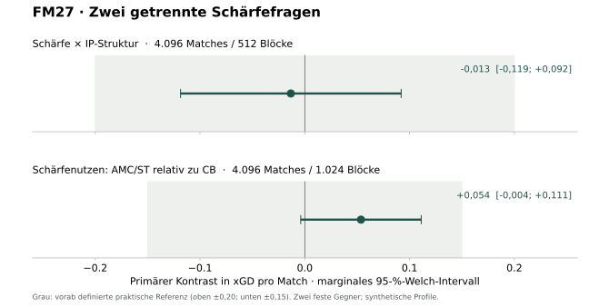

# NIGHT-003 – Forschungsbericht, 15. November 2026

**Zwei vollständig ausgewertete Hauptstudien: 8.192 neue wissenschaftliche
Matches und 1.536 unabhängige Kontext-Seedblöcke.** Eine dritte Frage bestand
16 technische Matches, erhielt wegen des vorab festen Restzeit-/CI-Gates keine
wissenschaftliche Zulassung. Alle nativen Prozesse sind bereinigt.

## Was wissen wir über FM27 jetzt, was wir vorher nicht wussten?

1. Volle gegenüber niedriger gemeinsamer Startschärfe verändert den relativen
   xGD-Effekt des konkreten STLESS-IP-Pakets im geprüften Kontext um
   **−0,013 xGD/Match, 95-%-KI [−0,119; +0,092]**. Eine Interaktion der vorab
   als praktisch relevant definierten Größenordnung ±0,20 wird nicht gestützt.
2. Der marginale Nutzen derselben Schärfeänderung bei zwei AMC/ST-Spielern
   gegenüber zwei Innenverteidigern beträgt **+0,054 xGD/Match,
   95-%-KI [−0,004; +0,111]**. Größere Gruppenunterschiede von ±0,15 werden
   eingegrenzt; ein kleinerer Vorteil der Angriffsgruppe bleibt möglich.
   Tore und xGF reagieren sekundär relativ stärker zugunsten der Angriffsgruppe.

Dies sind neue Interaktions-/Gruppenfragen. Die bekannten allgemeinen MECH-002-
Schärfe- und TACT-003-Paketeffekte werden damit nicht als neue Entdeckungen ausgegeben.
[Kurzzusammenfassung](WHAT_WE_LEARNED.md).

## Tatsächliche Ausführung

| Studie und neue Frage | Hauptmatches | Unabhängige Mainblöcke | Technische Vollmatches / A/A-Paare | Stand |
|---|---:|---:|---:|---|
| N3-SHARPSTRUCT-C1: Schärfe×IP, OOP konstant | 4.096 | 512 | 32 / 16 | vollständig |
| N3-SHARPPOS-C1: marginaler Zweispieler-Schärfenutzen AMC/ST gegen CB | 4.096 | 1.024 | 16 / 8 | vollständig |
| N3-AMCSHIFT-C1: AMC→AMCL allein, Rolle und ST konstant | 0 von 2.048 geplant | 0 | 16 / 8 | terminal geschlossen, Main unbegonnen |

Zusätzlich drei erwartete Exit108-Negativabweisungen. **8.256 vollständige
Simulationen einschließlich 64 technischer Matches**, insgesamt 8.259 native
Aufrufe; 2.048 geplante dritte Mainjobs sind ausdrücklich unbegonnen.
Keine unerwarteten nativen Fehler, wissenschaftlichen Ausfälle, Ausschlüsse,
Retries, Ersatzseeds oder fehlenden Ergebnis-/Deskriptivwerte der beiden
vollständigen Serien. Technische Daten gehen nicht in ihre Effektschätzungen ein.

Die 8.192 Mainmatches sind **1.536**, nicht 8.192 unabhängige Beobachtungen.
Seiten werden innerhalb des Seeds gemittelt, die zwei festen Gegnerkontexte
je zur Hälfte gewichtet. Alle wissenschaftlichen Kohorten und Technikseeds
sind disjunkt; auch terminale und unbenutzte Reservierungen bleiben gesperrt.

## Primäre Ergebnisse, Präzision und Unsicherheit

| Vorregistrierter Primärkontrast | xGD/Match | Marginales 95-%-Welch-KI | p | Volle KI-Breite / Ziel |
|---|---:|---|---:|---|
| [STLESS10000−BASE10000]−[STLESS7000−BASE7000] | −0,013320 | [−0,118593; +0,091953] | 0,803779 | 0,210546 / ≤0,25 |
| DEFENCE_LOW−ATTACK_LOW, Differenz marginaler Schärfenutzen | +0,053613 | [−0,003894; +0,111120] | 0,067629 | 0,115014 / ≤0,15 |

Beide Präzisionsziele erreicht. Beide Intervalle liegen innerhalb ihrer vorab
festgelegten praktischen Referenz. Das begrenzt große Effekte im Testkontext;
kleinere Wirkungen und eine Übertragung auf andere Kontexte bleiben offen.
Eine universelle Wirkungsfreiheit oder Gleichwertigkeit folgt daraus nicht.

Stratifizierter 20.000-Seedblock-Bootstrap: Studie1
[−0,118783; +0,090835], Studie2 [−0,003663; +0,111098]. Welch und Bootstrap
liefern eine vergleichbare Einordnung. Die Analysen, primären Vorzeichen,
Endpunkte, Fallzahlen und Referenzen waren vor den jeweiligen wissenschaftlichen
Matches festgelegt. Keine Interim-Leistungsanalyse oder p-Wert-gesteuerte Erweiterung.

**Sekundär:** Studie1 hat keinen Holm6-Nachweis. In Studie2 bestehen erzielte
Tore **+0,133789 [ +0,064005; +0,203573 ], Holm-p0,000890** und xGF
**+0,085995 [ +0,046569; +0,125420 ], Holm-p0,000123**. Tatsächliche Punkte
**+0,075684 [ +0,000659; +0,150708 ]** bestehen Holm6 mit p0,192100 nicht.
Alle übrigen Sekundärtests einschließlich Kontextunterschied sind vollständig
in den Einzelberichten und Effektdateien enthalten. Positive GA/xGA bedeuten
mehr Abgabe in DEFENCE_LOW, nicht automatisch größeren Nutzen.

Je Studie: ein einzelner Primärtest, eine vorregistrierte Holm6-Sekundärfamilie;
Intervalle sind marginal. Eine zusätzliche **nicht vorregistrierte**
[Holm14-Sensitivität](mission-multiplicity-sensitivity.json) über alle formalen
Tests der beiden vollständigen Studien lässt ebenfalls nur Tore und xGF aus
Studie2 bestehen. Für die ungestartete dritte Serie wurde kein p-Wert imputiert.

## Abgrenzung und praktische Konsequenzen

Die erste Studie kombiniert die bereits geprüften Eingriffe und identifiziert
ihre Wechselwirkung bei fester ursprünglicher OOP-Struktur. Das konkrete
STLESS-Paket hat deskriptiv bei beiden Schärfestufen einen ähnlich negativen
Abstand zum Originalsystem. Volle gemeinsame Startschärfe liefert hier keinen
belegten relativen Gewinn von 0,20 xGD für dieses Paket.

Die zweite Studie verändert in jedem Arm genau zwei ursprüngliche Akteure mit
beiden gemeinsamen Rohfeldern7000 statt10000. Ein gemeinsamer Hochschärfe-
Kontrollwert kürzt sich im Unterschied der marginalen Nutzen heraus.
**Separate absolute Gruppeneffekte sind nicht identifiziert.** Die sekundären
Angriffsindikatoren liefern einen kontextspezifischen Hinweis; der primäre
Netto-xGD- und korrigierte Punktenachweis erlauben keine allgemeine Einsatz-
oder Trainingspriorität für Angreifer gegenüber Innenverteidigern.

Scouting-Attributgewichte bleiben unverändert: Attribute wurden nicht variiert.
Die Studien messen Startzustände, keine Lernraten, Trainingsminuten oder
Karriereentwicklung. Aussagen gelten für **FM27 27.0.1+2503222**, ein gebündeltes
Fixture, zwei bekannte feste Gegner, synthetische Profile mit omnipotenten
Positionsratings und originale konstante Managementpolitik. Keine globale
STLESS-, Rollen-, Positions- oder Keeperrangliste. Karriere, Urlaub und Instant
Result wurden nicht gleichgesetzt. Roh7000/cache70 ist keine neu kalibrierte UI-Skala.

## Prüfung, Builds und Ressourcen

Unveränderter passiver Observer, Tactics Lab v1114.6/91f2eba57fac0b7fbd3dff616056907e3ce461be;
DLL-SHA256 und vollständige Host-/Fixture-/Katalog-/Ressourcen-/Codehashes in den
Inputmanifesten. Die tatsächliche DLL-Produktversion und der geladene Hash
wurden geprüft. Keine neuen nativen Setter, Clamps oder Originalhoständerungen.

Je vollständigem Lauf: volle native Actor-/Phasenbindung, 3.174 Attribute,
1.058 Profilfelder, 44 Phasenzellen und 748 PI-Gruppen sowie Startrohwerte,
Startercaches und Nichtschärfe-/Raw-TF33-Kontrollen. Alle nativen Original-
Legalitätsprüfungen aktiv. Nach Bereinigung wurden unveränderte Rohlogs und
Inputdumps in einem zweiten Pass vollständig gegen den Export geprüft.

Primär- und sämtliche Sekundär-Welchschätzer einschließlich Holm6 wurden
zusätzlich aus ursprünglichen Scores/Team-xG über getrennte skalare Momente
rekonstruiert, ohne die ursprünglichen Analyse-/Statistikmodule. **Gleicher
Analyst, kein separater Gutachter behauptet.** Bootstrap-Reproduktion separat
über die eingefrorenen Analysen und portable Archivtests. Keine geschützten
Originaldateien oder Spieleridentitäten veröffentlicht.

Maximal vier kalte Enginecalls, eine exklusive NativeLease, unverändertes
Windows-Job3-Containment je Call und absolut30s plus begrenzte Bereinigung.
Ein Engine-PID-Peak wurde nicht separat gemessen. Keine laufende Komprimierung,
Verschiebung, Löschung oder Änderung geprüfter Pfade. Alte terminale Studien
und ihre Ressourcen/Seeds blieben unverändert.

Beaufsichtigte Phasenzeit: Studie1 **3.360,474s**, Studie2 **3.438,230s**,
dritte Technik **15,357s**; insgesamt **6.814,061s / 113,568min**, einschließlich
Python-Audits innerhalb der Phasen. Die erste wissenschaftliche Serie begann
rund17Minuten nach Missionsstart, innerhalb der30-Minuten-Vorbereitungsgrenze.
Native Simulationen und Analyse bildeten den Schwerpunkt. Eine separate genaue
Messung aktiver Denk-/Literaturzeit liegt nicht vor; die Phasen sind im
[Fortschrittsprotokoll](PROGRESS.md) dokumentiert.

## Fehler und nicht abgeschlossene Arbeit

1. Vor Studie1-Main dokumentiert: der bestehende Dispatcher sortiert die
   gemischte Planliste erneut. Tatsächliche Blockreihenfolge sortiert; Arme,
   Seeds, Fallzahl und Analyse unverändert. [Vor-Main-Änderung](TECHNICAL_RELEASE.md).
2. Encoding-Tippfehler im neuen Archivtest auf0f997d5 führte zu einer CI-
   Fehlermeldung; vor Main in f57c193 korrigiert und CI erfolgreich. Keine
   native Serie oder Reservierung deshalb zurückgesetzt.
3. **N3-AMCSHIFT-C1 hat keine wissenschaftlichen Resultate.** Die technischen
   16Matches/achtA/A bestanden. Der vorab feste späteste Mainstart war
   **10:31:21UTC**, um mindestens2.400s bis11:11:21UTC zu erhalten. Beim
   Prüfpunkt10:31:27UTC lief die erforderliche Veröffentlichungs-CI noch.
   Die Freigabe wurde später grün; das Zeitgate wurde nicht verändert.
   [Terminale Abrechnung](../../data/night-003-amcshift/termination.json) und
   [alle2.048unbegonnenenJobs](../../data/night-003-amcshift/unbegun-main-jobs.jsonl)
   bleiben erhalten. Sämtliche512Mainseeds bleiben gesperrt. Kein Nullbefund
   und keine vollständige Bestätigungsstudie aus nicht ausgeführten Matches.

Nutzerfenster: **nur diese aktive Sitzung**. Keine Automatisierung oder
Hintergrundfortsetzung nach ihrem Ende eingeplant.

## Veröffentlichung und nachvollziehbare Belege

| Abschnitt | Commit | Erfolgreiche exakte CI |
|---|---|---|
| Erste Vorregistrierung | [ac5b993](https://github.com/Matchekk/FM-27-Research/commit/ac5b993330b49734d49088045ea55fd6a6a3385d) | [43693138863](https://github.com/Matchekk/FM-27-Research/actions/runs/43693138863) |
| Erste Mainfreigabe | [f57c193](https://github.com/Matchekk/FM-27-Research/commit/f57c193489a4824dc76f4cb5ead828408e5fc84c) | [43693487274](https://github.com/Matchekk/FM-27-Research/actions/runs/43693487274) |
| Zweite Vorregistrierung | [0a2089e](https://github.com/Matchekk/FM-27-Research/commit/0a2089e758fceb51033f7fd3161c111d4e29107f) | [43695266210](https://github.com/Matchekk/FM-27-Research/actions/runs/43695266210) |
| Erstes Ergebnis / zweite Mainfreigabe | [a58e11d](https://github.com/Matchekk/FM-27-Research/commit/a58e11d59cf8b75f366197e56282c471247f2bc8) | [43699039037](https://github.com/Matchekk/FM-27-Research/actions/runs/43699039037) |
| Dritte Vorregistrierung | [ad7ef1d](https://github.com/Matchekk/FM-27-Research/commit/ad7ef1dcf5b892aebe3a14108672f9936a9e5cf8) | [43701873476](https://github.com/Matchekk/FM-27-Research/actions/runs/43701873476) |
| Zweites Ergebnis / dritte Technik | [e7efa27](https://github.com/Matchekk/FM-27-Research/commit/e7efa277960b747499e51a01da03374f39077528) | [43704319489](https://github.com/Matchekk/FM-27-Research/actions/runs/43704319489) |

Der finale wissenschaftliche Archivstand und seine erfolgreiche CI werden in
[publication.json](publication.json) gebunden. Kein Force-Push.

- [Studie1: vollständiger Bericht](../../experiments/N3-SHARPSTRUCT-C1-results.md),
  [Messungen](../../data/night-003-sharpstruct/main.jsonl),
  [Abrechnung](../../data/night-003-sharpstruct/execution-provenance.json),
  [Skalarprüfung](../../data/night-003-sharpstruct/independent-statistics-review.json).
- [Studie2: vollständiger Bericht](../../experiments/N3-SHARPPOS-C1-results.md),
  [Messungen](../../data/night-003-sharppos/main.jsonl),
  [Abrechnung](../../data/night-003-sharppos/execution-provenance.json),
  [Skalarprüfung](../../data/night-003-sharppos/independent-statistics-review.json).
- [Quellenabgleich](LITERATURE.md), [Positionsquellen](LITERATURE_POS.md),
  [Komponentenquellen](LITERATURE_AMC.md): Atlas/Index und Originalquellen geprüft;
  gemeinsame Autoren-/Spiegelfamilien zählen nicht als unabhängige Replikationen.



Abbildung aus akzeptierten Messungen/Skalarprüfungen; visuell geprüft,
SVG bytegleich reproduziert. [Figurprovenienz](figure-provenance.json).

## Drei wertvollste nächste Forschungsfragen

1. **Übertragung auf neue Gegner, Stärken und natürliche Positionsratings:**
   bleiben die eingegrenzten Schärfe×IP- und Zweispieler-Effekte bestehen?
   `REPLICATION_WITH_TRANSFER`; Überlappung MAC-06/17, Purity und beide N3-Studien.
2. **Positionsgruppe×IP-Struktur:** verändert sich die Differenz der beiden
   marginalen Zweispieler-Schärfenutzen zwischen klassischem und STLESS-IP-Paket?
   `NOVEL_HYPOTHESIS` im geprüften Bestand; uniformer Zehnspieler-Moderator
   identifiziert diese Frage nicht. Überlappung MAC-05/06 und beide N3-Studien.
3. **Komponenteninteraktion statt unzerlegtem Paket:** wie wirken seitliche
   AMC-Verschiebung und ST→AMCR/SecondStriker-Schritt gemeinsam gegenüber
   ihren einzelnen Eingriffen? Neuer vollständiger2×2-Komponentenvertrag,
   `NOVEL_HYPOTHESIS` im geprüften Bestand; MAC-07/08/17, TACT-003 und N3.

Vor einem neuen Auftrag erneut Originalquellen, Adaptergates, Varianz/Power
und verfügbare Laufzeit prüfen. Keine Wiederaufnahme oder Umetikettierung des
terminalen N3-AMCSHIFT-C1 und keine Wiederverwendung seiner Reservierungen.

## Öffentliche Nachrechnung und Teststatus

452 lokale Testfälle:449 bestanden,3 erwartete Skips; zusätzlich5Analysetests
bestanden. Die Skips betreffen zwei bestehende bedingte Fälle und die nie
begonnene AMC-Hauptserie. Seed-/Cleanup-Audit:
[alle Reservierungen und fehlende NativeLease](seed-and-cleanup-audit.json).
Öffentliche Nachrechnung ohne geschützte Spielressourcen:

```powershell
python analysis/analyse_night003.py
python analysis/analyse_night003_pos.py
python analysis/review_night003_results.py structure
python analysis/review_night003_results.py positions
python analysis/render_night003.py
```

Die terminale AMC-Serie hat keine Wirkungsdaten und wird bei diesen Befehlen
nicht als fertige Serie behandelt. Native Wiederholung benötigt legale lokale
Ressourcen und eine eigene neue Freigabe; keine automatische Fortsetzung.
