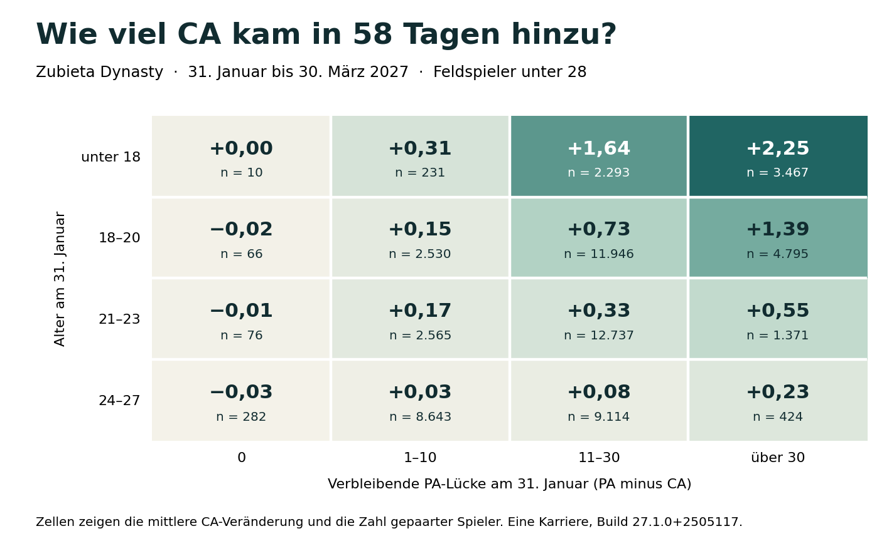

# Wachstum nach Alter und verbleibender PA

**Zubieta, 31. Januar bis 30. März 2027.** Bei 60.550 gepaarten Feldspielern unter 28 Jahren stieg die gespeicherte CA in 58 Tagen durchschnittlich um 0,559. Bei 43.777 blieb sie an den beiden Stichtagen gleich. Geburtsdatum, CA und PA wurden an beiden Spieltagen gegen die jeweiligen separat im Spiel ausgelesenen Werte bestätigt. Gleiche Datenbank-ID, Geburt und nichtleerer Namensprüfwert waren Voraussetzung. Ein Saisonendpunkt fehlt. [Datenherkunft](LONGITUDINAL_ANALYSIS.md) · [Vollständige Zubieta-Auswertung](../../research/pa-reach-001/manifests/zubieta-associations.json)

Die Zellen zeigen die mittlere Änderung in CA-Punkten mit der Spielerzahl in Klammern. Die Lücke ist die am ersten Stichtag gemessene PA minus CA.

| Ausgangsalter | Lücke 0 | Lücke 1–10 | Lücke 11–30 | Lücke >30 |
|---|---:|---:|---:|---:|
| <18 | 0,000 (10) | +0,307 (231) | +1,637 (2.293) | +2,249 (3.467) |
| 18–20 | −0,015 (66) | +0,154 (2.530) | +0,728 (11.946) | +1,391 (4.795) |
| 21–23 | −0,013 (76) | +0,174 (2.565) | +0,333 (12.737) | +0,549 (1.371) |
| 24–27 | −0,032 (282) | +0,028 (8.643) | +0,076 (9.114) | +0,231 (424) |

Bei mehr als 30 Punkten Spielraum beträgt der beobachtete Altersgruppenunterschied zwischen den Jüngsten und den 24- bis 27-Jährigen 2,018 CA-Punkte in 58 Tagen. Die Gruppen unterscheiden sich auch in der genauen Größe ihrer Lücke, ihren Spielbedingungen und ihrer Zusammensetzung. Es gab keinen zulässigen Fall mit negativer Ausgangslücke in dieser Auswertung. Auf eine Saison hochgerechnete Zuwächse wären durch die Messdauer nicht gedeckt.

### Historischer Kontrollarm

**TRAIN005-A, 16. Januar bis 4. Februar 2027.** Der Abgleich auf 27.0.1+2503222 umfasst 59.704 gepaarte Feldspieler unter 28 Jahren. 26 weitere Ausgangsspieler aus dieser Zielgruppe fehlen am Endtag. 53.206 gepaarte Spieler behielten ihre CA. Bei einer Lücke über 30 wuchsen die Unter-18-Jährigen im Mittel um 0,623 CA (n=3.089), die 24- bis 27-Jährigen um 0,079 (n=419). Die Differenz beträgt 0,544 Punkte in 19 Tagen. Die Zeitfenster überschneiden sich teilweise mit dem Zubieta-Verlauf. Ein gemeinsamer Karriereursprung ist möglich. [Alle Alters- und Abstandszellen](../../data/pa-reach-001/summary.json)

Bei am Anfang und an allen beobachteten Folgezeitpunkten gleicher PA und gleichem Kandidatenbyte 1–5 lag ΔCA bei mehr als zehn Punkten Platz bis zur postulierten Stufengrenze bei +0,378 (n=16.019), in einem Band von ±2 Punkten bei +0,021 (n=12.428) und mehr als zwei Punkte oberhalb bei −0,002 (n=18.014). Selbst oberhalb dieser Grenze gewannen 72 Spieler CA. Der effektive Zustand zwischen den Messungen, eine monatliche Ausnahme und der Wachstumsspielraum eines einzelnen Spielers bleiben unbekannt. Die Auswahl stabiler Verläufe verwendet Folgedaten und eignet sich ausschließlich für diesen rückblickenden Vergleich. [Feldprüfung](PROGRESSION_FACTOR_VALIDATION.md)

Für beide Zeitfenster stammen die Fallzahlen von Spielern innerhalb eines Karriereverlaufs. Die Unsicherheit gegenüber anderen Karriereursprüngen lässt sich damit nicht messen. Innerhalb der Zubieta-Karriere erklärt auch die Kombination aus Alter, Ausgangs-CA, Lücke und Position nur einen Teil der beobachteten Unterschiede. [Adjustierte Ergebnisse und Unsicherheit](CORRELATION_REPORT.md)
