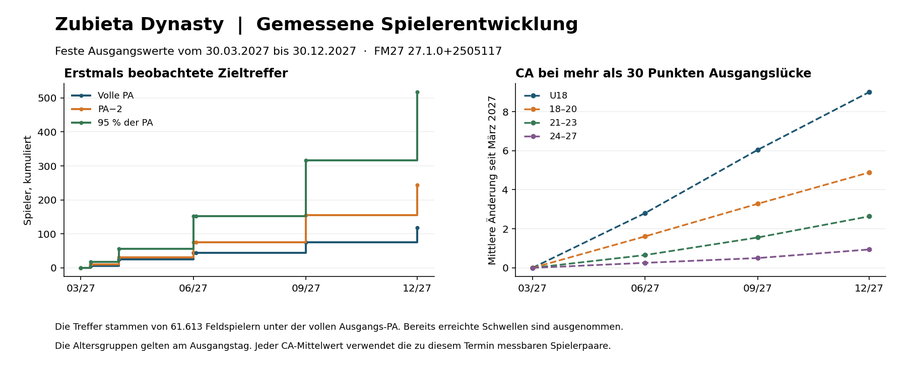

# PA-REACH-001 · Zubieta Dynasty

**FM27 27.1.0+2505117.** Die Zubieta-Saves liefern einen echten Längsschnitt, das als `ProgressionFactor` identifizierte Savefeld bei CA+7 und direkt gemessene Attribut-/Meta-Verläufe. Ein individuell kalibrierter PA-Erreichungsscore ist noch nicht freigegeben. Die Daten zählen als ein Zubieta-Ausgangsuniversum. Der frühere TRAIN-005-Bestand überschneidet sich auch bei den jungen Spielern so stark, dass er als unabhängiger Test ausscheidet.

| Evidenz | Ergebnisstand |
|---|---|
| Extern berichtet | Fünf Stufen, postulierte Caps und Ereignisregeln. Die FM24-Codeanalyse und die FM27-Savebeobachtungen haben unterschiedliche Beweiskraft. [Originalquellen und Buildzuordnung](LITERATURE_REVIEW.md) |
| Selbst in FM27 überprüft | Zwei Kalenderjahre CA/PA und Attribute, zeitliche Stufenwechsel, Vertragslaufzeiten und Zieltreffer. Der Faktor wurde stichprobenweise mit dem benannten Spielwert abgeglichen. [Feldprüfung](PROGRESSION_FACTOR_VALIDATION.md) |
| Empirisch geschätzt und an zeitlich späteren Daten geprüft | Fehler der Jahres-CA, Intervallabdeckung der maximalen CA an fünf Stichtagen sowie bedingte Genauigkeit der PA-Meta-Projektion im selben Karriereuniversum. [Punktprognosen](PROSPECTIVE_CA_PERSONALITY.md) · [Intervalltest](PROSPECTIVE_PEAK_CA.md) |
| Unabhängige Karrierevalidierung | Null unberührte Testkarrieren. Eine persönliche Prozentprognose für volle PA und erwartetes Karriere-Peak-Meta bleiben offen. [Kalibrierungsstand](CALIBRATION_REPORT.md) |
| Offene Mechanismen | Auslöser eines tatsächlichen Neuwurfs, temporäre monatliche Freigabe und kausaler Einfluss eines Trainingsfokus. Eine mögliche historische Mod-Exposition der Ausgangskarriere begrenzt die Übertragung. [Kausale Befunde](CAUSAL_EFFECTS.md) · [Mod und Build](NATIVE_BRIDGE_VALIDATION.md) |

## Wer erreichte die volle PA?

Am 30.03.2027 hatten 61.613 Feldspieler unter 28 ihre PA noch vor sich. 434 weitere hatten sie bereits erreicht. Die Auswertung hält für jeden Spieler die März-PA fest und berücksichtigt spätere Treffer höchstens bis einschließlich seines 28. Geburtstags. In 731 Spieltagen wurden **308 erstmals beobachtete Treffer auf die volle PA** gemessen.

| Bis zum Stichtag | Volle Ausgangs-PA | Mindestens PA−2 | Mindestens 95 % der PA |
|---|---:|---:|---:|
| 30.06.2027 | 45 | 76 | 152 |
| 30.09.2027 | 75 | 155 | 317 |
| 30.12.2027 | 118 | 244 | 517 |
| 30.03.2028 | **153** | **320** | **673** |
| [30.06.2028](../../research/pa-reach-001/manifests/retention-pa-hits-20280630.json) | 184 | 394 | 829 |
| [30.09.2028](../../research/pa-reach-001/manifests/retention-pa-hits-20280930.json) | 222 | 469 | 1.016 |
| [30.12.2028](../../research/pa-reach-001/manifests/retention-pa-hits-20281230.json) | 263 | 573 | 1.205 |
| [30.03.2029](../../research/pa-reach-001/manifests/retention-pa-hits-20290330.json) | **308** | **667** | **1.375** |

Jede Spalte zählt erstmals beobachtete Treffer unter diesen 61.613 Feldspielern. Für PA−2 lagen 1.201 und für die 95-%-Schwelle 3.280 von ihnen bereits am Start über oder auf dem jeweiligen Ziel. Von den 308 vollen Treffern starteten 64 mit 1–2, 47 mit 3–5, 87 mit 6–10, 81 mit 11–20 und 29 mit 21–30 Punkten Rückstand. Bei keinem der 10.728 mit einer Ausgangslücke über 30 Punkten wurde ein voller Treffer beobachtet. Insgesamt waren 14 der 308 am Start unter 18. Bei 53.508 endete die Messung vor dem Altershorizont, bei 7.707 war die Beobachtungsdichte am Horizont unzureichend und bei 90 fehlte eine geeignete Folgebeobachtung. Zwischen den Stichtagen können Treffer unerkannt bleiben. [Zweijahresabrechnung nach Alter, Ausgangslücke und Ziel](../../research/pa-reach-001/manifests/retention-pa-hits-20290330.json) · [Messweg und frühe Zielzählung](RETENTION_PA_HITS_0630.md)

## Welche CA-Prognose traf die Zukunft besser?

Die folgenden Punktprognosen und ihre Spielerlisten waren vor dem jeweiligen Zieldatum festgeschrieben. In jeder Zeile beziehen sich die beiden Fehler auf dieselben am Zieldatum bestätigten Personen. Kleinere Werte bedeuten weniger CA-Punkte durchschnittlicher absoluter Abweichung. Die Zeitfenster und Grundgesamtheiten unterscheiden sich zwischen den Zeilen.

| Ausgang → Ziel | Vergleich zu unveränderter Ausgangs-CA | Gepaarte Spieler | MAE unveränderte CA | MAE Vergleich |
|---|---|---:|---:|---:|
| April → Juni 2027, 61 Tage | Letzten individuellen Trend fortschreiben | 60.863 | **0,396** | 0,532 |
| März 2027 → März 2028, 366 Tage | Individuelle 58-Tage-Rate fortschreiben | 55.079 | **2,932** | 4,108 |
| September 2027 → März 2028, 182 Tage | Beobachtete Rate der Alters- und Lückengruppe | 67.050 | 1,995 | **1,814** |
| März 2028 → März 2029, 365 Tage | Grundmodell / zusätzlich fünf Attribute und Alter × Professionalität | 63.054 | 3,728 | 3,196 / **3,146** |

Im zweiten Jahr war der Nutzen der zusätzlichen Persönlichkeits- und Attributwerte je nach Gruppe unterschiedlich. Bei U18 mit mehr als 30 Punkten offener PA fiel der Fehler von 9,641 mit unveränderter CA über 6,248 im Grundmodell auf 5,869. Bei den 2.375 U18-Spielern mit höchstens zehn offenen Punkten stieg er von 0,692 auf 1,086 und 1,635. Die drei Vorhersagen wurden für dieselben Personen vor dem Zieltermin eingefroren. [Vollständiger Test einschließlich im Fit ungesehener Spieler](PROSPECTIVE_CA_PERSONALITY.md)

Eine weitere Vorhersage galt dem höchsten CA-Wert auf fünf festen Stichtagen von März 2028 bis März 2029. Bei 61.365 vollständigen Verläufen lag die Medianprognose im Mittel um 2,701 Punkte neben dem beobachteten Maximum. Übernahme der Start-CA ergab einen Fehler von 3,486. Das vorab gespeicherte P10–P90-Intervall enthielt 89,50 % dieser beobachteten Maxima und war im Mittel 8,95 CA-Punkte breit. Bei U18 mit großer Lücke waren es 78,52 % bei 20 Punkten Breite. Die Abdeckung bezieht sich auf dieses Jahr und diese Stichtage innerhalb einer Karriere. [Intervallprüfung und Ausfälle](PROSPECTIVE_PEAK_CA.md)

Der individuelle Jahrestrend schnitt über alle Spieler schlechter ab, bei U18 mit mehr als 30 Punkten Ausgangslücke allerdings besser (8,049 gegenüber 10,553 CA). Beim Halbjahrestest verbesserte die gruppenbasierte Rate den MAE in drei der zwölf Alters-/Lückenzellen, am stärksten bei U18 mit großer Lücke (4,131 gegenüber 5,610). In den übrigen neun Zellen war unveränderte CA im Mittel genauer. Hinter den Zahlen steht eine Karriere. Unabhängige Kalibriermaße für eine individuelle PA-Wahrscheinlichkeit fehlen. [61-Tage-Test](CALIBRATION_REPORT.md) · [Jahrestest](PROSPECTIVE_CA_YEAR.md) · [Halbjahrestest und Gruppengrößen](PROSPECTIVE_CA_GROUPS.md)

### Beobachtungsumfang

Zwischen dem 30.03.2027 und dem 30.03.2029 sind **68.369** Spieler aller Altersgruppen an beiden Terminen nativ und strukturell bestätigt. Unter den 62.047 ursprünglichen U28-Feldspielern wurden 54.394 am Endtag wiedergefunden. Für **47.014** lag der exakte Zweijahreswert spätestens am 28. Geburtstag. Bei keinem der 68.369 Paare änderte sich die PA zwischen den beiden Endpunkten. [Datierte Stichtage und Abdeckung](../../research/pa-reach-001/manifests/zubieta-retention-year-two.json)

In der bereits gespielten Zubieta-Historie vom 31.01.–30.03.2027 sind 94.585 Personen gepaart. Die separat fortgeschriebene Monatskontrolle bis April umfasst 97.062. Im Retentionszweig sind März 2027 und März 2028 für 75.239 Personen aller Altersgruppen nativ und im Save gepaart. Die 57.315 gepaarten März-U28-Feldspieler umfassen auch diejenigen, die bis März 2028 schon 28 wurden. Für 53.438 liegt der exakte Jahreswert innerhalb des primären Altershorizonts. Die verschiedenen Spielergruppen und Kopien dürfen nicht als unabhängige Karrierewurzeln addiert werden. [Archiv und Leser](LONGITUDINAL_DATA_AUDIT.md) · [Jahresmessung mit Abdeckung](RETENTION_SEASON_FOLLOWUP.md) · [Brücke und Originalschutz](NATIVE_BRIDGE_VALIDATION.md)

### Welche Spieler legten zu?

Bei mehr als 30 Punkten Ausgangslücke gewannen die an beiden Terminen beobachteten U18-Spieler in zwei Jahren im Mittel **18,99 CA** (Median 18, n=4.372). Die 18–20-Jährigen gewannen 9,45 (Median 9, n=4.277), die 21–23-Jährigen 5,54 (Median 4, n=1.194). Bei den 24–27-Jährigen sank der Mittelwert um 3,99 (Median 0, n=309). Die Alterseinteilung gilt am Start. In der ältesten Gruppe waren am Endtag 309 von ursprünglich 432 messbar. [Zweijahresbefunde, Streuung und Fehlende](RETENTION_SEASON_FOLLOWUP.md)

Von den im April 2027 als stagnierend klassifizierten Hoch-PA-Spielern lagen am Zweijahresstichtag **145 von 298** wiedergefundenen mindestens drei CA höher als im April. Unter den zuvor wachsenden waren es **238 von 261**. [Entwicklung der festen Kohorten](STAGNATION.md)

Über das volle Jahr gewannen U18-Feldspieler mit mehr als 30 Punkten offener PA im Mittel **11,38 CA** (Median 11, n=4.407), die 18–20-Jährigen 5,99 (Median 5, n=4.351) und die 21–23-Jährigen 2,99 (Median 1, n=1.280). Bei den 24–27-Jährigen lag die mittlere Jahresänderung bei **−1,40** (Median 0, n=353). Bei 49 dieser Spieler sank CA um mindestens zehn Punkte. Ihre Endwerte waren durch zwei Lesewege bestätigt. Eine Erklärung durch Ruhestand ist nicht belegt. Der mittlere Zuwachs im Jugendalter und die Chance, eine weit entfernte PA in einem Jahr tatsächlich zu erreichen, beantworten verschiedene Fragen. [Jahresdaten, Abdeckung und Sensitivität](RETENTION_SEASON_FOLLOWUP.md)

Am 30.03.2028 hatten 94 der 299 vorab als stagnierend klassifizierten Hoch-PA-Spieler mindestens drei Punkte mehr CA als im April 2027. In der zuvor wachsenden Gruppe waren es 226 von 262. Alle 562 klassifizierten Spieler wurden am Endtermin gefunden. [Feste Kohorte über die Zeit](STAGNATION.md)

Bei einer Ausgangslücke von mehr als 30 CA-Punkten gewann ein Feldspieler unter 18 in 58 Tagen durchschnittlich **2,249 CA** (n=3.467), mit 24–27 Jahren **0,231 CA** (n=424). Das Vorzeichen der Zusammenhänge mit Alter und Lücke blieb bei gegenseitiger Kontrolle sowie Berücksichtigung von Position und Start-CA erhalten. Bei einem 20-Jährigen waren fünf Punkte mehr Professionalität mit rund **0,28 zusätzlicher CA in 58 Tagen** verbunden. Ehrgeiz und Zielstrebigkeit waren ebenfalls positiv assoziiert. Die beobachtete Dauer, Klubselektion und fehlende unabhängige Wurzeln begrenzen die Übertragung. Keiner der Koeffizienten misst die Wirkung eines Eingriffs. [Altersanalyse](AGE_GROWTH_ANALYSIS.md) · [Regressionskoeffizienten und Unsicherheit](CORRELATION_REPORT.md) · [Kausale Evidenz](CAUSAL_EFFECTS.md)

Für 38.633 Spieler im historischen Fenster und 40.451 im Kontrollmonat ließen sich teamgleiche, explizite Einsatzminutenzähler verfolgen. Die mittlere CA-Änderung nahm über die Minutengruppen in den beiden Fenstern nicht konsistent zu. Spielpraxis hängt auch von Alter, Können, Gesundheit und Aufstellung ab. Dokumentierte Verletzungsereignisse belegen keine vollständige Zahl ausgefallener Tage. [Minuten, Verletzungen und Ausschlüsse](LONGITUDINAL_ANALYSIS.md)

Bei hoher PA und erheblicher verbleibender Lücke hatten 299 von 562 dreifach gemessenen Feldspielern im Retentionsverlauf von Januar bis April fast unveränderte CA. Unter den 18- bis 20-Jährigen betraf dies 28 von 29 nahe der postulierten Stufengrenze und 48 von 164 mit mehr als zehn Punkten Spielraum. [Stagnationskohorte und Ausfälle](STAGNATION.md)

### Was spricht für einen Entwicklungszustand?

Der kontrollierte Trainingsversuch ergab eine praktisch wichtige Grenze. In zwei bytegleichen Ausgangskopien trainierte der Zielspieler bereits Schnelligkeit. Nach einer Woche mit identischen Vorgaben und beibehaltenem Fokus wichen bei vier von 13 Spielern die CA und bei fünf die Rohattribute ab. Die zwei gespeicherten Wochen zeigen die Hintergrundvariation realer Karrierefortschreibung. Der vorab definierte Wirkungstest wurde daraufhin beendet. [Trainingsversuch und Abbruchregel](../../experiments/PA-REACH-001-TRAIN-WITHDRAW.md)

Zwischen dem 30. Juni und dem 2. Juli veränderte sich der gespeicherte Faktor bei neun von 16 angekündigten Transfers, für die auch die numerischen Klub-IDs vor und nach dem Wechsel unabhängig bestätigt waren. Vier Stufen stiegen, fünf sanken. In der stabilen Klubvergleichsgruppe änderte sich der Faktor bei 64 von 28.128. Der mögliche Vertragsbeginn überlagert den Klubwechsel. Der Vergleich erfasst sichtbare Stufenübergänge und liefert keine isolierte Neuwurfwahrscheinlichkeit. [Transferfenster und Gegenproben](RETENTION_TRANSFER_WINDOW.md)

Das Byte am extern berichteten Ort änderte sich in der historischen Zubieta-Stichprobe bei **2.382 von 94.585** Spielern. In 653 Fällen mit niedrigerem Endbyte blieb die CA oberhalb der postulierten neuen Grenze. Mehr Spielraum zur angenommenen Grenze ging mit mehr Wachstum einher. Das Muster repliziert mehrere Beobachtungen aus dem FM-Arena-Thread auf dem aktuellen Build. In einer separaten Stichprobe traf das Savebyte bei allen zwölf Identitäten den vom Spiel benannten Wert `ProgressionFactor`, je zweimal für 0 bis 5. Welches Ereignis einen Neuwurf verursacht und wann die monatliche Ausnahme greift, ist weiterhin offen. [Benannter Feldvergleich](NAMED_PROGRESSION_READBACK.md) [Lokale Prüfung](PROGRESSION_FACTOR_VALIDATION.md) · [Externe Befunde](LITERATURE_REVIEW.md)

Ein Vergleich im selben Verein grenzt die Vertragshypothese ein. Von 712 Spielern mit neuem Datum in der Vertragskette und unabhängig bestätigter längerer Laufzeit zeigten 442 nach 58 Tagen einen Bytewechsel. In der Vergleichsgruppe mit stabilen Vertragsdaten waren es 238 von 34.677. Im prospektiven Kontrollmonat wiederholte sich das Muster (388/650 gegenüber 142/35.348). Verbleibende gleichzeitige Ereignisse, die Semantik des Kettenstartdatums und unveränderte Ergebnisse trotz Neuwurf begrenzen die Kausalaussage. [Ereignisgruppen und Unsicherheit](CONTRACT_BYTE_TRANSITIONS.md)

### Was bedeutet das für PA-Meta?

Über den gesamten Zweijahresabstand stieg der gemessene Meta-v2.1 bei 53.226 vergleichbaren Feldspielern im Mittel um 0,205 Punkte. Von 27.885 CA-Gewinnern hatten **2.588 trotz höherer CA einen niedrigeren Meta-Score**. Im separat vorab festgeschriebenen Test der PA-Meta-Projektion erreichten 253 auswertbare Spieler am Märztermin 2029 exakt ihre Ausgangs-PA aus März 2028. Der Endtermin lag für alle spätestens auf ihrem 28. Geburtstag. Die Original-App hatte hier einen MAE von 0,294 gegenüber 0,368 bei Übernahme des Ausgangs-Meta. Diese Zielgruppe war durch den Eintritt des PA-Treffers definiert. Die Wahrscheinlichkeit des Treffers und die Verteilung des zukünftigen Karriere-Meta bleiben offen. [Beide Jahresprüfungen der App](OBSERVED_META.md)

Bei 129 Feldspielern entsprach die CA am Jahresstichtag genau ihrer Ausgangs-PA und der Stichtag lag spätestens auf ihrem 28. Geburtstag. Für diese Spieler lag das theoretische PA-Meta der Original-App im Mittel um 0,229 Meta-Punkte neben dem gemessenen Wert. Beim unveränderten Ausgangs-Meta betrug der Fehler 0,324. Die App unterschätzte das erreichte Meta im Mittel um 0,197 Punkte. Dieser Vergleich beantwortet, wie genau die App das Leistungsniveau bei eingetretener PA-Erreichung abbildet. Für die Wiederholung im zweiten Jahr sind 51.381 Ausgangsprofile vorab festgeschrieben. [Auswahl, Vergleichsregeln und Stichtagsprüfung](OBSERVED_META.md)

Im gemessenen Jahr stieg die CA bei 24.573 auswertbaren Feldspielern. Ihr Meta stieg im Mittel um 0,390 auf der Skala von 1 bis 20, **bei 2.106 sank er trotz CA-Zuwachs**. Über alle 56.346 Paare auf derselben Position betrug die Änderung +0,125 Meta-Punkte. Unter den 14 positionsgleich bewertbaren Feldspielern des Jugendjahrgangs stieg der Index von April bis März im Mittel um 0,700 bei +9,43 CA. Der gemessene Attributverlauf erklärt, weshalb ein künftiger Meta-Score zusätzlich zur CA eine eigene Prognose und Prüfung braucht. [Meta-Verlauf und fehlende Werte](OBSERVED_META.md)

Nach 275 Tagen betrug die mittlere Änderung des gemessenen Feldspieler-Meta bei 58.538 Spielerpaaren auf derselben Bewertungsposition **+0,087**. Unter den 22.983 CA-Gewinnern sank der Index bei 1.918. Im eigenen Jahrgang stieg die CA der 15 Feldspieler zwischen April und Dezember im Mittel um 7,47 Punkte, ihr Meta um 0,609. Vierzehn verbesserten ihren Meta-Wert, einer blieb gleich. [Gemessene Indexwerte, Positionswechsel und Ausfälle](OBSERVED_META.md)

Über dieselben 58 Tage stieg bei 14.793 qualifizierten Feldspielern die CA. Der unveränderte Meta-v2.1-Score stieg bei 10.248, blieb bei 3.164 exakt gleich und sank bei 1.381. Bei der Auswertung wurde dieselbe Einsatzposition vorausgesetzt und jedes erforderliche Anzeigeattribut an beiden Tagen gegen einen unabhängigen Readback geprüft. Die Gesamtkohorte dieses eigenen Messwegs umfasst 61.483. Dies liefert eine reale Zielgröße für spätere Prognosen über Attributpfade. Eine künftige Peak-Verteilung wurde noch nicht geschätzt. [Beobachtete Meta-Veränderung](OBSERVED_META.md) · [Modellplan](MODEL_DESIGN.md)

### Vertragsbindung und Abschluss

Nach dem gesicherten Primärendpunkt vom 30.03.2029 wurde ausschließlich in der sechstägigen Anschlusskopie die neue Aufnahme abgeschlossen. Alle 16 Kandidaten des Jahrgangs 2029 erhielten ein bestätigtes individuelles Angebot. Ihre spätere Unterschrift wurde in dieser Runde nicht gemessen. Von 15 bis Juni fälligen Bestandsverträgen gehörten 14 zu früheren offenen Fällen. Der einzige neu zu bearbeitende Fall erhielt einen Versuch ohne bestätigten Verhandlungsauftrag. Zum Abschluss war die private Rückkehrkopie des ursprünglichen Spielzustands am 30.03.2027 geladen und pausiert. Alle drei persönlichen Originaldateien wurden erneut erfolgreich gegen ihre Ausgangshashes geprüft. [Jahrgang 2029](../../research/pa-reach-001/manifests/zubieta-intake-2029-april-baseline.json) · [Abschlussquittung](../../research/pa-reach-001/manifests/zubieta-session-closeout.json)

Im Jahrgang 2028 erhielten alle 16 Kandidaten ein Angebot und besaßen am 30. Juni einen laufenden Vertrag beim selben Klub. Nach 359 Tagen waren alle 16 wieder messbar. 15 gewannen CA, die mittlere Änderung betrug +10,625 (Median +8,5, Spannweite 0 bis +31). Bei den drei bis Juni 2028 auslaufenden Ausnahmefällen gab es im September einen bestätigten Vertrag bei einem anderen Klub, einen Spieler ohne registrierten Klub und einen weiter bei Zubieta registrierten Spieler ohne bestätigten laufenden Vertrag. [Zweiter Jugendjahrgang](../../research/pa-reach-001/manifests/zubieta-intake-2028-march-2029-followup.json) · [Passiver Abgleich nach Ablauf](../../research/pa-reach-001/manifests/zubieta-retention-september-2028.json)

Die einmalige Beobachtungspolitik für offene Fälle und die Nachwuchsbindung sind dokumentiert. Am 30.04.2027 hatten alle 16 Jugendkandidaten einen laufenden Vertrag, bei 64 von 83 Bestandsspielern war das gespeicherte Ende später als im März. Unter den 28 im April verlängerten fälligen Verträgen blieb der Faktor unmittelbar nach Verhandlung gleich, bei 19 war er sieben Tage später verändert (14 höher, fünf niedriger). Von 52 länger gebundenen Vergleichsspielern mit unveränderter Laufzeit zeigte keiner einen Wechsel. Die betroffenen Problemverträge werden gemäß der geänderten Nutzerentscheidung seit dem 15. Juni auslaufen gelassen. [Vertragsbericht](CONTRACT_RETENTION.md) · [Zeitgleicher Interventionstag](IMMEDIATE_RENEWALS.md)

Bei allen 16 Jugendkandidaten gelang erstmals ein echter zeitlicher Doppelnachweis. Am 31. März hatten alle im Save und im benannten Spielwert den Faktor 0. Am 7. April lagen zwei bei 3, acht bei 4 und sechs bei 5. Die CA war bei 14 unverändert, ein Spieler gewann zwei und einer drei Punkte. In der zusätzlichen Zwölfergruppe blieben zwei Diskrepanzen trotz korrekter Identität. Für individuell validierte Stufen verknüpft das Forschungspanel eine exakte native Quittung mit der gespeicherten Spielerzeile. [Zeitbeleg und Fehlmessungen](NAMED_PROGRESSION_READBACK.md)
