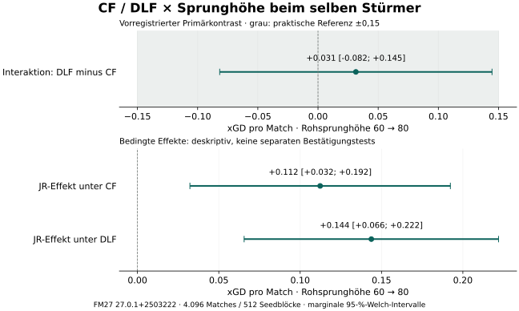

# Rollenabhängiger Attributwert

**PD-ROLE-001 vollständig:4.096Hauptmatches/512unabhängige Seedblöcke.**
FM27 27.0.1+2503222, ein identitätskonstanter ST, JR-Roh60→80,
IP-CentreForward gegen DeepLyingForward; OOP-ST und sämtliche übrigen
Attribute/Positionen/Profile/PI unverändert. Zwei bekannte feste Gegner,
beide Seiten innerhalb des Seeds gemittelt, Kontexte gleich gewichtet.
[Vorregistrierung](../../experiments/PD-ROLE-001.md), [Neuheit](LITERATURE.md).

## Primärer neuer Befund

`(DLF80−DLF60)−(CF80−CF60)` auf xGD:
**+0,031461**,95-%-Welch-KI **[−0,081658;+0,144580]**,p=0,585028.
Stratifizierter20.000-Block-Bootstrap[−0,081990;+0,143865].
Beide Intervalle liegen innerhalb der vorab festgelegten praktischen Referenz
±0,15. Große mittlere Interaktionen dieser Größenordnung werden im geprüften
Kontext eingegrenzt; kleinere Rollenunterschiede bleiben möglich. Kein
Nachweis universeller Wirkungslosigkeit, kein optimaler Spieler und kein
pauschaler CF/DLF-Sieger. Volle KI-Breite0,226238 verfehlt das gewünschte
Präzisionsziel≤0,20. Die feste4.096-Grenze wurde trotzdem nicht erweitert.

## Vollständige Holm6-Sekundärfamilie

| Interaktionsendpunkt | Schätzer/Match | Marginales95-%-KI | Holm-p |
|---|---:|---|---:|
| Tatsächliche Punkte | +0,084961 | [−0,075594;+0,245516] | 1,000000 |
| Tore für | +0,110352 | [−0,036984;+0,257687] | 0,817770 |
| Gegentore | −0,002930 | [−0,140026;+0,134167] | 1,000000 |
| xGF | +0,005951 | [−0,072356;+0,084257] | 1,000000 |
| xGA | −0,025510 | [−0,103237;+0,052217] | 1,000000 |
| Kontextdifferenz der xGD-Interaktion | +0,171822 | [−0,054416;+0,398060] | 0,817770 |

Kein korrigierter Sekundärnachweis. Kontextmittel der Primärinteraktion:
high_press+0,117372(SD1,301426), deep_block−0,054450(SD1,304251).
Das sind zwei feste Kontexte, keine allgemeine Gegnerpopulation.
Die praktische Eingrenzung betrifft nur ihr gleichgewichtetes Mittel,
nicht jeden Gegner einzeln.
Positive xGA bedeutet mehr Chancenabgabe; hier ist der Schätzer negativ.

## Bedingte Schätzungen, ausdrücklich deskriptiv

| Kontrast auf xGD | Schätzer | Marginales95-%-KI |
|---|---:|---|
| JR80−60 unter CF | +0,112286 | [+0,032249;+0,192324] |
| JR80−60 unter DLF | +0,143747 | [+0,065566;+0,221928] |
| DLF−CF, über beide JR-Stufen gemittelt | −0,073549 | [−0,129149;−0,017948] |
| JR80−60, über beide Rollen gemittelt | +0,128017 | [+0,072698;+0,183336] |

Diese Ansichten teilen dieselben Blöcke und sind keine vier zusätzlichen
vorregistrierten Bestätigungen. Insbesondere wird das unadjustierte negative
Rollenintervall nicht zur Siegerauswahl verwendet. Alle sechs Endpunkte und
Arm-/Kontextmittel stehen in [effects.json](../../data/player-development-001-role/effects.json).

## Abnahme, Einordnung und Übertragungsgrenzen

32Technikmatches/16exakteA/A plus erwartete Exit108-Negativprobe bestanden.
Pro Hauptmatch3.174Attribute,1.058Profile,44Phasenzellen/748PI-Gruppen,
Actor-/Phasen-/Seedbindung und Startkontrollen nativ geprüft. Nach Cleanup
erneut alle Originalbelege geprüft;0Ausfälle/Retry/Ersatzseeds/Ausschlüsse/
unbegonnene Jobs und0fehlende Deskriptivwerte. Separate skalare Rekonstruktion
von Primär- und allen sechs Sekundärschätzern einschließlich Holm stimmt.
Gleicher Analyst, kein separater menschlicher Gutachter behauptet.

Positionsgruppen-/Stilstudien von Mac13B und Purity haben diesen kontrollierten
CF/DLF×JR-Kontrast nicht identifiziert. Die positiven bedingten JR-Schätzungen
sind mit der vorhandenen Evidenz vereinbar, bestätigen aber keine universelle
Attributrangliste. Kein öffentliches allgemeines Attributresultat wurde hier
widerlegt. Die neue Information ist die eingegrenzte Rolleninteraktion.

Das Setting bleibt synthetisch mit omnipotenten Positionsratings und einem
gebündelten Fixture. Die Rolle einschließlich intrinsischer Anweisungen ist
ein **Rollenpaket**. Keine FM-Karriere-UI-Kalibrierung von Roh60/80, keine
reale CA-Gleichheit trotz konstantem nominalen CA120, keine Trainingswochen,
keine Vorhersagegenauigkeit für reale Spieler. Andere Profile/Rollen/Gegner
oder Attribute sind nicht identifiziert.

Abbildung aus vollständigen Messungen, visuell geprüft; getrennte Achsen.
[Messungen](../../data/player-development-001-role/main.jsonl) ·
[Skalarprüfung](../../data/player-development-001-role/independent-statistics-review.json) ·
[Vollständige Ressourcenabrechnung](../../data/player-development-001-role/execution-provenance.json).
