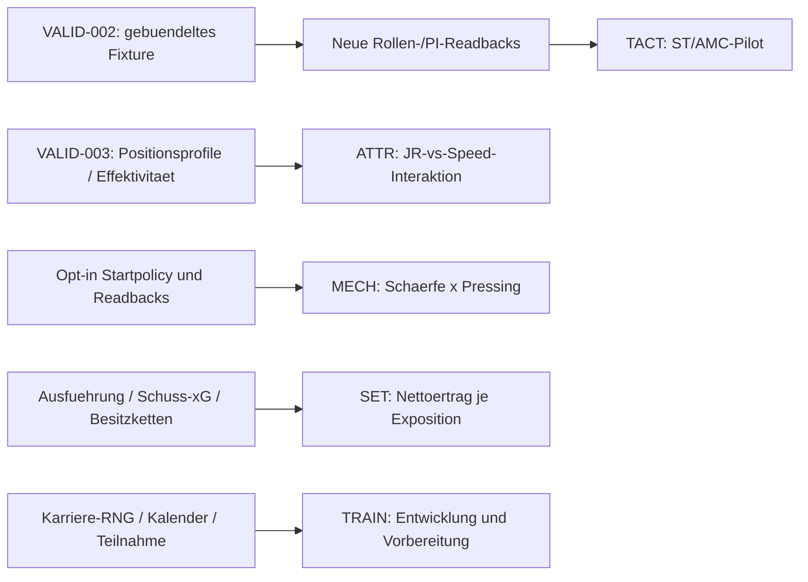

# Multi-Agent Scientific Program – Gesamtauswertung des Research Director

14.11.2026. Echte Codex-Subagents mit getrennten Verantwortungsdateien,
parallel in mehreren Wellen. Drei Fach-/Reviewagenten gleichzeitig neben dem
Director; weitere Aufträge in Warteschlange. Das Nutzermaximum von vier
Subagents wird eingehalten. Keine neue native Serie innerhalb dieses Programms.

## Ergebnis der ersten Ausführung

Die produktivste nächste Forschung fragt nach **neuen kausalen Mechanismen**,
nicht nach einem weiteren globalen Attributranking oder unbegrenzter D15-Wiederholung.
Der unmittelbar vorher autorisierte [P1C-Seedpilot](../../experiments/TACT-001-P1C-results.md)
ist mit512 Hauptmatches/128 Blöcken vollständig: tatsächliche Punkte+0,098,
95-%-KI[−0,137;+0,333],p0,412. Die vorregistrierte Relevanz-/Präzisionsregel ist
nicht erfüllt. D15/D09 bleiben archiviert; keine Kandidatenneuwahl oder Holdoutserie.

Getrennte Spezialistenberichte:

| Agent | Bericht | Konkreter Beitrag |
|---|---|---|
|1 TACT | [TACT](TACT.md) |32 Offline-Katalogprüfungen; kleiner ST/AMC-2×2-Rollenpilot statt erneutem Instruktionspakettest. Neue Rollen noch nicht nativ freigegeben. |
|2 ATTR | [ATTR](ATTR.md) |ATTR-004 unabhängig aus3360 Zeilen reproduziert; internationale Unterschiede als Kontext-/Dosisfrage; Positionseignung×Attribut-Brückenpilot. |
|3 TRAIN | [TRAIN](TRAIN.md) |Bestehende Karrierebelege, echte Save-/Clubcluster und getrennte kurzfristige Vorbereitung/langfristige Entwicklung. |
|4 SET | [SET](SET.md) |Vorhandene Full-event-Logs geprüft; Auswahlzustände sind keine validierte Standardexposition; Goldtrace-/Quellenvalidierung vor Leistung. |
|5 MECH | [MECH](MECH.md) |Isolierbare Mechanikfragen und technische Eingriffe statt unbelegter JSON-Interventionen. |
|6 VALID | [VALID](VALID.md) |Konkrete Normalisierungs-/Kapazitäts-/Profil-/Kalenderlücken; optionale Offline-Exklusivlease mit echten Subprozesstests. |
|7 Review | [unabhängiger Review](REVIEW.md), [P1C-Review](P1C-review.md) |Direkte Nachrechnung und kritische Prüfung der Designs, Power, Quellenreichweite und technischen Grenzen. |

Jeder Bericht nennt Frage, geprüfte Evidenz, Forschungslücke, Design,
Informationsgewinn, technische Voraussetzungen, Stichproben/Kosten,
Implementierungs-/Teststatus, Unsicherheiten und nächste Schritte.

## Gemeinsame wissenschaftliche Entscheidungen

- **Rollen vor weiteren Instruktionsbestätigungen.** P1C-Punktestreuung verlangt
  unter unverändertem Kontext3384 neue Matches für90% Power auf+0,15gegen Null,
  mit modellbasierten SD-Obergrenzen4960. Das ist kein Nachweis einer Mindestwirkung
  von0,15 und keine kostengünstige allgemeine Karrierebestätigung.
- **ATTR-Diskrepanz gezielt zerlegen.** Mac Study2 berichtet eine ähnliche
  qualitative Verschiebung im generischen Sample. Mehrere Fixturebestandteile
  wechseln gemeinsam; daraus keine Ursache behaupten. Neue Frage: verändert
  ungenutzte Positionseignung den relativen JR-/Speed-Nutzen bei gleichen aktiven
  IP/OOP-Fähigkeiten? Dosis-/Rollen-/Stärkefragen später getrennt.
- **Messgates haben Vorrang.** Der gewöhnliche Normalisierer setzt Fitness,
  Schärfe, Moral und weitere Startzustände erneut fest. Gespeicherte PKM brauchen
  kapazitätserhaltenden Adapter. Standardauswahl ist keine ausgeführte Exposition.
  Saveklone mit gleichem RNG sind keine unabhängigen Trainingsreplikate.
- **Keine Familiarity-Scheinintervention.** Die aktuelle experimentelle Dict-Policy
  schreibt aggregierte Werte, nicht die24 Bereichsbytes; die Scalar-Policy
  überschreibt dagegen alle33Bytes. Beides ist kein isolierter Karriere-
  Understanding-/Lerneffekt. [MECH](MECH.md) trennt diese Pfade ausdrücklich.
- **Externe Evidenz abgestuft.** Hersteller-/Tooldokumentation erklärt Fähigkeiten,
  Eigenberichte ohne Rohseeds liefern Hypothesen, öffentliche Analyseprogramme
  allein sind keine unabhängig reproduzierten Matchdaten. Alte FM-Versionen,
  Mac-Adapter und xPts-Rankings sind keine Windows-FM27-Karrierebestätigung.

## Priorisierte Entwürfe und konkrete Budgetobergrenzen

Alle folgenden Zahlen sind **Vorschläge für getrennte zukünftige Verträge**,
keine Reservierung oder Ausführungsfreigabe. Technische Gates können die
wissenschaftlichen Studien weiterhin blockieren. Maximal4Worker/90s ohne
Fortschritt, neue zentrale Seeds, persistente Gesamtzähler, keine Ersatzseeds.

| Priorität / Entwurf | Wissenschaftliche Last | Technik separat | Vorgeschlagene Child-/UTC-Caps | Freigabekriterium |
|---|---|---|---|---|
|1 TACT-002-R0 klein |512 Hauptmatches,32Seeds/Gegner,64 unabhängige Blöcke; vier Rollenarme und beide Seiten |32 Vollmatches+1Negativprobe |900s/1800s,2GiB privat |Alle16 Zellen nach Vorbereitung: Rollen/Duties/PI/Phasen/Records;16exakte A/A-Paare; veröffentlichtes Kontrast-/Seed-/Budgetpaket. |
|Alternative R0 groß |1024 Hauptmatches,64Seeds/Gegner,128 Blöcke |gleiche32+1, keine automatische Erweiterung |1200s/2400s,2GiB |Eigenständig vorab gewählte Variante; keine fallzahlabhängige Ergebnisverlängerung. |
|2 VALID-003A/B/C |≤48 technische Vollmatches; keine Leistungsinferenz |≤6 negative Probes, Gates getrennt |900s/1800s,4GiB |Profile, Stärke, Kapazität/Identität und native Originalzustände; nicht lesbare Felder blockieren entsprechende Aussagen. |
|3 ATTR-009-bridge-P0 klein |512 Hauptmatches,16Seeds/Gegner,32 unabhängige16-Match-Blöcke |40 Vollmatches+1Negativprobe |600s/1200s |Positionsratingmasken/GK/OOP-Mapping und abgeleitete Effektivität auditieren; Uniform-/Executionüberschreibung ausschließen. |
|Alternative ATTR groß |1024 Hauptmatches,32Seeds/Gegner,64 Blöcke |gleiche40+1 |1200s/2400s |Keine90-%-Garantie; neue Interaktions-SD unbekannt. |
|Sparalternative ATTR |384/768 Hauptmatches bei denselben Seedzahlen |Technik neu dimensionieren, nicht pauschal übernehmen |Neuer Vertrag erforderlich |Baselinearme entfallen algebraisch aus Primärkontrast; dafür sechs Baseline-Sekundärtests streichen.25% weniger Hauptjobs, kein bewiesener Varianzgewinn. |
|MECH-002-sharpness-P0, blockiert |512/1024Hauptmatches,32/64Seeds je Gegner,64/128Achtmatchblöcke |32Vollmatches+3Negativprobes |900/1800s klein;1200/2400s groß |Eigener opt-in Startpolicy-Encoder/Runner/Auditor, beide Schärfefelder nach Vorbereitung; Default binärgleich, keine permanente Clamp-/Executionpolicy. |
|SET-Zählergate |keine Leistungsserie |≤16 Vollmatchversuche+4Negativprobes nach eigenem Vertrag |600s/1200s |Ausgeführte Situationen und Attribution/Konterketten gegen unabhängige Quelle/Goldannotation validieren. |
|SET-002-R0 nach Messgate |256/512 Hauptmatches,32/64Seeds je Gegner,64/128 unabhängige Viermatchblöcke |16Vollmatches+genau festzulegende≤4Negativprobes |900/1800s klein;1200/2400s groß |Netto-xG je100 tatsächlich ausgeführte Ecken; Schuss-xG/Besitz/Counterketten und Ratio-/Clusteranalyse vollständig vorab validieren. Keine aktuelle Primärpower. |
|TRAIN-Technik vor Karriereforschung |≤2 unabhängige A/A-Paare×2Wochen=8Armwochen |Reader/Einheiten/RNG/Kalender/Teilnahme zuerst |30Minuten Gesamtcap,ein serieller Karriereexecutor |Neue unabhängige RNG-Streams oder echte Save-/Clubcluster; bytegleiche Starts innerhalb Paare; keine ungeprüften Checkpointflags. |
|TRAIN-002-P0 klein/groß, blockiert |8/16 unabhängige Paare je Altersstratum;32/64Karrierearme,192/384Armwochen |Eigener validierter Karrierebenchmark |120/240Minuten Child;180/360Minuten UTC erst nach Benchmark |Zwei primäre Alterskontraste Holm2,kalibrierter Entwicklungsindex; sekundäre20er-Familie erst nach Endpunkt-/Modellgates registrierbar. |

Beim kleinen Rollenpilot liegt die erwartete volle95-%-Breite bei **angenommener**
Seedkontrast-SD0,8/1,2/1,8 bei0,400/0,600/0,900; Power für0,30xGD etwa84/50/26%.
Der Pilot schließt eine Varianz-/Mechanismuslücke; er ist keine garantierte
Bestätigungsstudie. ATTR-Bridge streut unbekannt: bei SD1/1,5/2 liefert der kleine
Pilot volle Breiten0,722/1,083/1,444, Power für0,30etwa38/20/13%.
Primär-/Sekundärkontraste und multiplicity stehen vollständig in den Fachberichten.
Keine Werte als gemessene Effizienzgewinne ausgeben.

TRAIN-SDs sind Savepaar-Kontraste, keine Spielervarianzen. Bei bloß angenommener
Index-SD0,10/0,20/0,30 liefert der kleine8-Paar-Pilot je Altersstratum marginale
volle95-%-Breiten0,167/0,334/0,502 und konservative Power für+0,10 von53/14/7%.
Karriere-Laufzeit ist unbekannt und darf nicht aus Einzelmatchdurchsatz abgeleitet
werden. SETs Eckrate und Clusterstreuung sind unbekannt; die vorhandenen52
Selektionszeilen sind keine Rate. Deshalb kein vorgetäuschter90-%-Nachweis aus
256/512Matches. Alle Zeit-/Expositionsszenarien bleiben bedingte Planungswerte.

## Was jetzt bereit ist, was blockiert bleibt

**Sofort offline ausführbar:** historische Rohdatenreproduktion, Rollen-
Katalogmitgliedschaft und Kontrastarithmetik, Lease-Konkurrenz-/Crashtests,
Quelle-/Kapazitäts-/Kalenderinventur ohne neue native Simulation.
**Als Nächstes vorregistrierbar:** kleiner Rollen-Technikaudit mit eigenem
Manifest-/PI-/Recorddiff-Code, neue konservative Seed-/Zeitplanung.
**Keine neue Leistungsstudie wird hier als bereits freigegeben erklärt.**

Blockiert: tatsächliche neue Rollen-/PI-Bindung, Profilinteraktionsaudits,
interventionsfähige Startzustände, PKM-Kapazitäts-/Identitätsadapter,
vollständige Standardexposition und unabhängige Karriere-RNG-/Teilnahmeerfassung.
[VALID-003-Plan](../../experiments/VALID-003-plan.md) und [VALID-Bericht](VALID.md)
benennen getrennte Gates; VALID-002 wird weder erweitert noch überschrieben.

## Technische Abhängigkeiten der nächsten Studien

Die zusätzlichen Gates unten sind geplant, noch nicht nativ abgenommen:

## Implementierte sichere Vorarbeit

Neue `research/coordination.py` / `tests/test_coordination.py`: freiwillige lokale
Exklusivlease für kooperierende Supervisoren,1..4 deklarierte Worker, dauerhafte
Crashsperre statt automatischem PID-Stealing. Vier echte Offline-Tests, keine
Engine-/Registryaktionen. **Nicht in bestehende Runner integriert**, kein
bereits implementiertes globales Prozess-, Seed- oder Zeitlimit. Zentrale
Serialisierung durch den Director hält dieses Programm kontrolliert.

Die [Koordinationsregeln](COORDINATION.md) trennen Agentdateien, Registry,
Nativfreigabe und Review. `QUEUE.json` dokumentiert die tatsächliche Bearbeitung.
Historische Daten/Vorregistrierungen bleiben erhalten. Nach integrierter Prüfung,
CI und Push endet diese Ausführung; keine automatische weitere Optimierung.
