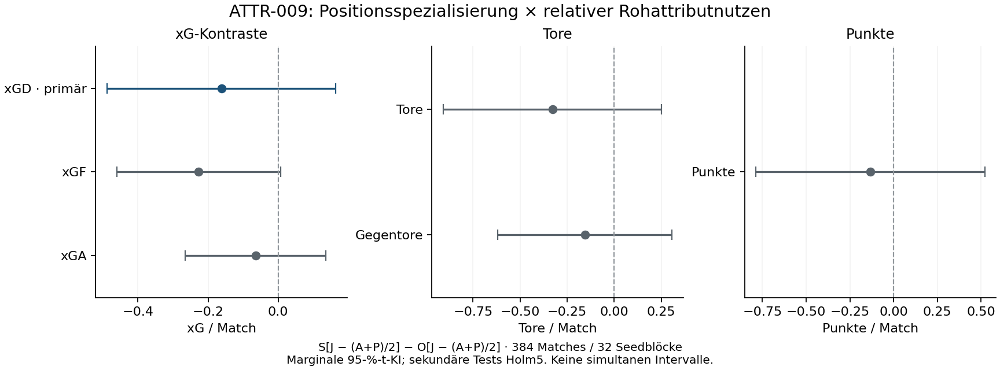

# ATTR-009-Bridge – Ergebnisse des Positionsmaskenpiloten

14.11.2026 · Build **27.0.1+2503222** · **384 gültige Hauptmatches,
32 unabhängige Seedblöcke**, keine Ausfälle oder Exklusionen.

**Die Moderatorhypothese bleibt unklar:** Spezialisierung verändert den relativen
JR-gegen-Acceleration/Pace-Kontrast um **−0,162 xGD**, 95-%-KI
**[−0,488; +0,164]**, p=0,31885. Die gewünschte volle Intervallbreite0,50
wurde mit0,65282 nicht erreicht. Kein Beweis von Wirkungslosigkeit, Äquivalenz,
einer globalen Attributrangfolge oder Karriereübertragbarkeit.

[Vorregistrierung](ATTR-009-preregistration.md) ·
[native Technik](ATTR-009-validation.md) ·
[Messungen und Provenienz](../data/attr-009-bridge/README.md) ·
[unabhängiger Ergebnisreview](../docs/round3/RESULTS-REVIEW.md).

## Was tatsächlich untersucht wurde

Sechs Arme OJ/OA/OP/SJ/SA/SP: ungenutzte Feldpositionsratings20(omni) versus1
(spezialisiert), jeweils dieselbe native Fähigkeit60→80 bei zehn Startfeldspielern.
Aktive IP-/OOP-Familien bleiben20; GK/Sweeper, Bank, Gegner, Profile und D00-Taktik
bleiben unverändert. J=JumpingReach54, A=Acceleration49, P=Pace53.
Die native Dosis ist keine empirisch kalibrierte FM-Anzeige12→16.

Nur die beiden bekannten Discoverygegner `high_press`/`deep_block`, je16neue
Seeds und beide Seiten. Erst Seitenmittel im Seed, dann Gegnergewichte je½.
Primär `[J−(A+P)/2]S−[J−(A+P)/2]O`; keine absoluten Effekte gegenüber einem
unveränderten Attribut-Baselinearm. Gemeinsame Baselines entfallen algebraisch.
Die384 Spiele sind keine384 unabhängigen Replikate. Technische Seeds sind
disjunkt und fließen nicht in die wissenschaftliche Rechnung ein.

Passive abgeleitete Effektivität bleibt ohne verbotenen experimentellen Eingriff
unmessbar. Gemäß expliziter Vorregistrierung wird die totale Eingriffswirkung
geschätzt; kausale Mechanismuszerlegung bleibt unidentifiziert.

## Vorgegebene Kontraste und Unsicherheit

| Endpunkt desselben Kontrasts | Schätzer | Marginales95-%-t-KI | Roh-p | Holm5-p |
|---|---:|---|---:|---:|
| xGD, primär |−0,162010|[−0,488421; +0,164401]|0,318851|—|
| Tatsächliche Punkte |−0,132813|[−0,786684; +0,521059]|0,679444|1|
| Tore |−0,328125|[−0,907895; +0,251645]|0,256719|1|
| Gegentore |−0,156250|[−0,619997; +0,307497]|0,495430|1|
| xGF |−0,226436|[−0,459456; +0,006583]|0,056403|0,282016|
| xGA |−0,064427|[−0,265006; +0,136152]|0,516388|1|

Welch-/Satterthwaite-Primär-SE0,159826, df29,9943. Der stratifizierte
20.000-Ziehungen-Seedblock-Bootstrap ergibt primär [−0,465728; +0,142482].
Kein sekundärer Test besteht Holm5. Die Intervalle in Tabelle und Grafik sind
marginal, keine simultanen95-%-Familienintervalle.

xGF hat ein marginales Bootstrapintervall [−0,441033; −0,008345], während das
t-Intervall null einschließt. Dieser Methodenunterschied wird erhalten:
das günstigere Intervall wird nicht nachträglich ausgewählt. Der vorgegebene
sekundäre Holm-p=0,282 liefert keinen familienkorrigierten Nachweis.
Punkte und tatsächliche Tore bleiben ebenfalls unklar; xG ersetzt diese nicht.

## Kontextstreuung, Teamseiten und einzelne Seeds

| Kontext | Kontrastmittel | SD der Seitenmittel | Einseitige95-%-SD-Obergrenze | SD Heim / Auswärts | Seitenkovarianz |
|---|---:|---:|---:|---|---:|
| high_press |−0,311251|0,910349|1,308449|1,623851 /0,947532|−0,109884|
| deep_block |−0,012768|0,897833|1,290460|1,182100 /1,388123|−0,049916|

Diese Kontext-/Seitendiagnostik ist deskriptiv, kein zusätzlicher Moderator-
oder Heimvorteilstest. Die SD-Obergrenzen sind je Kontext marginal und beruhen
auf einem Normalmodell mit15df. Die beobachteten Kontextstreuungen sind ähnlich;
aus diesem Pilot folgt kein großer belegter Gewinn durch asymmetrische Allokation.
Seiten werden innerhalb des Seeds gemittelt und nicht als unabhängige Blöcke gezählt.

Leave-one-seed-out liefert Gesamtschätzer von−0,226771 bis−0,091661;
größte Änderung0,070349. Kein Seed wurde ausgeschlossen. Die negativen
Punktschätzer sind kein Ersatz für die weiterhin breite Unsicherheit.
Alle deskriptiven Armmittel stehen in `effects.json`; daraus wird kein Sieger
oder neues Attributranking ausgewählt.

## Bedingte Planung einer späteren unabhängigen Studie

Neue Seeds in beiden gleichgewichteten Kontexten, vollständige zwölfmatchige Blöcke, zweiseitig
α0,05,90-%-Power gegen0; nichtzentrale Welch-t-Näherung. Diese Tabelle benutzt
vorgegebene Effekte, keine „beobachtete Power“ aus dem Punktschätzer.

| SD-Grundlage | Wahrer angenommener Effektbetrag | Neue Seeds je Gegner | Unabhängige Blöcke | Neue Hauptmatches |
|---|---:|---:|---:|---:|
| beobachtete SD |0,20xGD|109|218|2616|
| beobachtete SD |0,30xGD|49|98|1176|
| simultane95-%-SD-Obergrenzen |0,20xGD|259|518|6216|
| simultane95-%-SD-Obergrenzen |0,30xGD|116|232|2784|

Die konservativen SDs1,408939/1,389568 verwenden je97,5-%-einseitige
Chi-Quadrat-Grenzen, gemeinsam mindestens95% unter dem Normalmodell.
Alle Fallzahlminima sind unabhängig durch lineare Ganzzahlsuche geprüft.
Keine Übertragung auf andere Profile/Builds und kein automatischer Start dieser
1176–6216Matches. Eine bloße Vergrößerung derselben unklaren Interaktion hat
derzeit niedrigere Priorität als realistischere Profil- und Mechanikmessung.

## Technik, vollständige Abrechnung und Veröffentlichung

**384Main+32Technik=416Vollmatches; zusätzlich eine erwartete Negativabweisung.
Alle417 Versuchsplätze erhalten.** Keine fehlgeschlagenen oder unbegonnenen
registrierten Jobs am Ende, keine Retries, Ersatzseeds, Ausschlüsse oder Holdouts.
34neueSeeds disjunkt zu2418historischen/reservierten Seeds. MECH hatte0neue
native Starts/Seeds; TRAIN0Advances/Seeds. Deren blockierte Hauptstudien wurden
nicht durch andere Simulationen ersetzt.

Preregistration `fc14746685f0a1f6475b1968912317d9ffabdfb6`, Technikrelease
`06f1aeb22c88eb1188c35cae5a7cdb3b453c7740` mit erfolgreicher CI43617519052
und unabhängigem Technikreview vor Main; öffentlicher Gateverweis in
`e9ac9393a09565366ba249c35aa9142ff13dc507` ebenfalls vor Main.
Code-/Inputhashes unverändert, native Originalbelege privat.

Verbrauch **231,557556/600Child-Sekunden**, festes Studienfenster
**753,168374/1200s**, Ende vor der unveränderten Frist18:00:36,423CET.
Vorbereitung11,189784s, Technik19,769941s, Main200,597832s. Ein Supervisor,
höchstens4Worker, kein verbleibender aktiver Lease/Prozess. Private Artefakte
191.302.779Bytes (≈182,44MiB), unter2GiB. Kein geschütztes Spielmaterial veröffentlicht.

Ein eigener unabhängiger Rechenkern rekonstruiert alle sechs Endpunkte,
Welch-/Bootstrapintervalle, Holm5, Kontext-SDs, zukünftige Fallzahlen und192
Blockwerte aus Rohzeilen ohne Projektanalyse-/Statistikimporte. Der separate
Reviewer prüft zusätzlich Originaldumps, Logs, Startup-, Budget-, Archiv- und
Publikationsbelege. Schlussfreigabe/Integrations-CI im verlinkten Ergebnisreview.

## Wissenschaftlicher nächster Schritt

Die Diskrepanz zu internationalen Attributstudien ist damit nicht kausal erklärt.
Es gibt weder eine neue globale Rangliste noch den Nachweis, dass ungenutzte
Positionsratings irrelevant sind. Als Nächstes Messbarkeit und realistische
positionsabhängige Profile abnehmen; danach gezielt Ausgangsniveau×Position oder
Rollen-/OOP-Kontexte planen. Keine unbegrenzte Wiederholung dieser sechs Arme.
[Modulprioritäten](../docs/round3/PRIORITIES.md). Nach Runde3 stoppen.
