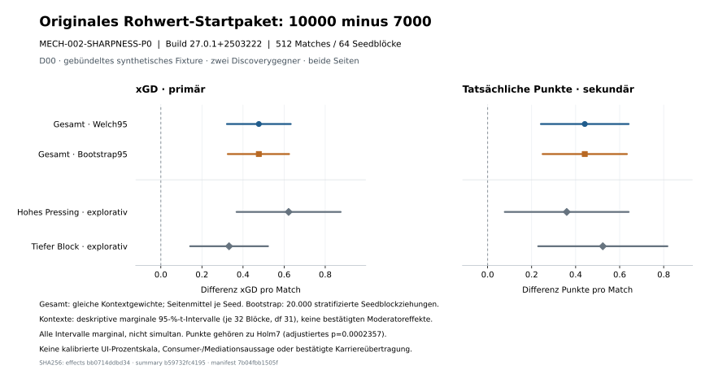

# MECH-002-SHARPNESS-P0: Ergebnisse des unabhängigen Seedpiloten

14.11.2026 ·512 gültige Hauptmatches,64 unabhängige Seedblöcke.
**Effekte und Rohbelege unabhängig reproduziert; keine allgemeine Karrierebestätigung.**

Das originale gemeinsame C90/C7A-Startpaket10000 gegenüber7000 bei zehn
Startfeldspielern verbessert das mittlere xGD im geprüften synthetischen Kontext
um **+0,477 pro Match**,95-%-Welch-KI **[+0,322;+0,632]**,p=7,83×10⁻⁸.
Stratifizierter20.000-Seedblock-Bootstrap: [+0,326;+0,624]. Tatsächliche Punkte
steigen sekundär um **+0,441**,95-%-KI[+0,242;+0,641],Holm7-p=0,000236.
Das sind Paketeffekte im festen Testkontext, keine kalibrierte UI-Prozentskala,
allgemeine Karrierebestätigung oder optimale Trainings-/Taktikempfehlung.

## Vorregistrierter Gegenstand

Der [ursprüngliche Vertrag](MECH-002-sharpness-pilot.md),
[registriertes Manifest](../data/mech-002-sharpness-p0/manifest.json) und
[konkreter Inputreview](../docs/night-001/SHARPNESS-REVIEW.md) bleiben unverändert.
Vier Arme: raw7000/10000 × Standard/MoreOften-Pressing. Zehn getestete
Startfeldspieler erhalten beide Rohfelder gemeinsam; Keeper, Bank, Gegner und
andere Felder bleiben gleich. Stamina52 bleibt bei allen46 aktiven Spielern60.
D00-IP4-2-3-1/OOP4-4-1-1, beide bekannten Discoverygegner, identische synthetische
Kaderstärke, beide Seiten und originale native Managementpolitik.

32 neue Seeds je Kontext; jeder unabhängige Block enthält vier Arme auf beiden
Seiten. Seitenmittel innerhalb des Seeds, Kontextgewichte je1/2.512 Matches
sind **64**, nicht512 unabhängige Replikate. TECH32+1 hatte vier getrennte neue
Seeds; technische Daten werden nicht in die Effektschätzung aufgenommen.
Keine Ersatzseeds, Holdouts, Karriere-Replays oder automatische Erweiterung.

Die parallele neue Atlasvorgabe wurde vor dem ersten Hauptmatch in einer
[Duplikatprüfung](../docs/night-001/SHARPNESS-DUPLICATE-PREFLIGHT.md) und
[unabhängigen Abnahme](../docs/night-001/SHARPNESS-DUPLICATE-REVIEW.md) umgesetzt:
`REPLICATION_WITH_TRANSFER`. MAC-05 verändert einen anderen Kaderumfang und
vergleicht andere Startdosen mit natürlichen gespeicherten Zuständen.
Primärtest und Holm7-Familie wurden dabei nicht geändert.

## Effekte und Unsicherheit

Alle folgenden95-%-Intervalle sind marginal, nicht simultan. Primär ein
vorregistrierter Test; sieben Sekundärkontraste mit Holmkorrektur.

| Kontrast | Differenz pro Match |95-%-Welch-KI |p / Holm7-p |
| --- | ---: | --- | ---: |
| Startpaket: xGD, primär |+0,477 |[+0,322;+0,632] |7,83×10⁻⁸, unadjustierter Primärtest |
| Startpaket: tatsächliche Punkte |+0,441 |[+0,242;+0,641] |0,000236 |
| Startpaket: erzielte Tore |+0,445 |[+0,231;+0,659] |0,000517 |
| Startpaket: Gegentore |−0,359 |[−0,556;−0,162] |0,001701 |
| Startpaket: xGF |+0,270 |[+0,171;+0,370] |0,0000101 |
| Startpaket: xGA |−0,207 |[−0,311;−0,102] |0,000846 |
| Pressing: xGD |+0,097 |[−0,059;+0,253] |0,438707 |
| Startpaket×Pressing: physische xGD-DoD |−0,089 |[−0,452;+0,274] |0,624880 |

Die primäre Intervallbreite0,310 erfüllt das gewünschte Präzisionsziel≤0,50.
Auch die Untergrenze liegt im geprüften Kontext über der vorab genannten
praktischen Referenz+0,30xGD. Der Versuch war dennoch als Varianzpilot ohne
vorab garantierte90-%-Power angelegt. Die Pressingwirkung und Interaktion bleiben
unklar; weder Äquivalenz noch ein optimaler Pressingplan sind nachgewiesen.

| Explorative Kontextbeschreibung, primärer Paketeffekt |Mittel xGD |Block-SD |einseitige95-%-SD-Obergrenze, Normalmodell |
| --- | ---: | ---: | ---: |
| high_press |+0,622 |0,702 |0,890 |
| deep_block |+0,332 |0,525 |0,666 |

Beide Kontextmittel sind positiv. Sie stammen aus zwei festen Discoveryprofilen,
keiner unabhängigen Gegnerpopulation. Leave-one-seed-out-Mittel reichen von
0,459 bis0,506; maximale Änderung0,029. Seitenkovarianzen sind0,0718 und−0,1897.
Gemeinsame Seeds garantieren keine gleichen Ereignisse. Alle15 vorregistrierten
deskriptiven Größen sind vollständig vorhanden; keine Nullimputation oder
Ergebnisausschlüsse. Raw-/Cacheverläufe sind keine Mediations- oder UIbeweise.

Graue Zeilen beschreiben die beiden **Gegnerprofile**, nicht die eigene
Pressingintervention. Ihre Kontextintervalle sind explorativ und nicht simultan.
Die tatsächliche Grafik wurde visuell geprüft und über den unveränderten
Standalone-CLI bytegleich reproduziert.

## Bedingte Planung für neue unabhängige Seeds

Diese Tabelle plant nur denselben synthetischen Kontext, keine reale Karriere.
Zweiseitigesα0,05,90% Power, nichtzentrale Welchapproximation. Feste gleiche
Kontextgewichte; n neue Seeds je Kontext kosten2n Blöcke und16n Matches.
Die konservative Variante verwendet simultane95-%-Normalmodell-SD-Obergrenzen
0,933/0,698, je97,5% bei31 Freiheitsgraden. Keine garantierte Power außerhalb
dieser Modell-/Kontextannahmen und kein neuer Ausführungsauftrag.

| Planungsvarianz |Zieleffekt xGD |neue Seeds je Kontext |unabhängige Blöcke |Matches |
| --- | ---: | ---: | ---: | ---: |
| beobachtete SD |0,20 |52 |104 |832 |
| beobachtete SD |0,30 |24 |48 |384 |
| simultane SD-Obergrenzen |0,20 |91 |182 |1456 |
| simultane SD-Obergrenzen |0,30 |41 |82 |656 |

Keine weitere gleichartige Serie automatisch starten. Neue Information erfordert
zuerst validierte realistischere Profile, Mess-/UIsemantik oder einen begründet
neuen Kontext. Die Punktschätzung allein rechtfertigt weder eine globale Meta
noch eine weitere Optimierungsschleife.

## Technische Abnahme und vollständige Abrechnung

Build27.0.1+2503222, DLL-SHA256
`8c6971ce0b1c8afe6529ea3f46205a5175aea988a97d7421a980da42e23fe340`;
unveränderter Observerhost
`58e05a46ca65014a227ed1bd61da090d326848d20f39744b59e175c8b7c13d32`;
Tactics-Lab-Quelltagv1114.6/Commit91f2eba57fac0b7fbd3dff616056907e3ce461be.
Fixture, Ressourcen, Katalog und27 Quellen sind im Inputmanifest gehasht.

TECH32+1 und sein unabhängiger Rohreview lagen vor Main vor. Veröffentlichung
`0adf47b5a431fd15e9274e12fd470ac113e60a29` mit erfolgreicher
[CI43643614021](https://github.com/Matchekk/FM-27-Research/actions/runs/43643614021)
ging jedem Hauptmatch voraus. Ein Supervisor, höchstens vier Aufrufplätze,
separate Job3-Begrenzungen,90s ohne Fortschritt. PID-Peak nicht gemessen;
Obergrenze durch geprüfte Host-/Jobpolicy, keine Behauptung eines PID-Messwerts.

545/545 vorab geplante Jobs:544 gültige Vollmatches (32 Technik/512 Main), eine
erwartete Negativabweisung,0 unerwartete Ausfälle,0 unbegonnen,0 Retry/Ersatz.
Alle512 Mainbereinigungen bestätigt, keine NativeLease/Pendingmarker verblieben.
Main498,5933394s, kumuliert560,5738462/900 eigene Childsekunden;
global792,1520872/1800. Sofortige erste Mainadmission792,625864s Rest.
Beide festen UTC-Fristen eingehalten; keine Verlängerung oder Rückerstattung.
Der zuvor terminal geschlossene Staminaversuch bleibt unverändert geschlossen.

[Mainmessungen](../data/mech-002-sharpness-p0/main.jsonl) ·
[545er-Abrechnung](../data/mech-002-sharpness-p0/complete-job-accounting.jsonl) ·
[Effekte](../data/mech-002-sharpness-p0/effects.json) ·
[512 abgeleitete Kontrastzeilen aus64 Blöcken](../data/mech-002-sharpness-p0/seed-contrasts.jsonl) ·
[Analyseprovenienz](../data/mech-002-sharpness-p0/analysis-provenance.json) ·
[Mainbudget](../data/mech-002-sharpness-p0/main-budget.json) ·
[unabhängiger Ergebnisreview](../docs/night-001/SHARPNESS-RESULTS-REVIEW.md).
Native Dumps, Spieleridentitäten, Rohspielmaterial und die Testkarriere bleiben
privat. Keine Computerbedienung, Kalenderfortschreibung oder neue Serie.
