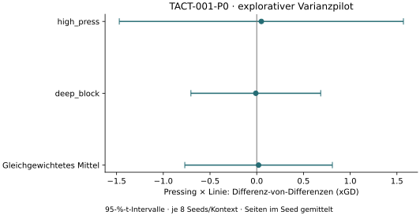

# TACT-001-P0 – Ergebnis des Varianzpilots

**14.11.2026 · explorativ · FM27 27.0.1+2503222 · kein Taktiksieger ausgewählt.**

Alle **128 Hauptmatches** und **23 technische Matches** wurden akzeptiert. Die negative Binärprobe wurde wie erwartet mit Code 108 verworfen. 16 unabhängige Hauptseedblöcke, keine Ausfälle, Ausschlüsse, Ersatzseeds oder Retries. Keine Holdoutmatches.

Die vorregistrierte Pressing×Linie-Interaktion auf xGD beträgt **+0,020**, 95-%-t-Intervall **[-0,770; +0,809]**, zweiseitiges p = 0.9565. Das Primärintervall enthält null; die Richtung der Interaktion bleibt offen.

Das stratifizierte Seedblock-Bootstrapintervall reicht von -0,617 bis +0,680. Es bleibt ein kleiner Varianzpilot und keine Bestätigung einer optimalen 4-2-3-1.

## Durchführung und technische Integrität

Vorregistrierung, Eingaben, Seeds und Analyse wurden in `650a89af4deada6feb4ea1164e3fc963280d90ed` vor dem ersten Match veröffentlicht. Die technische Freigabe wurde in `c9a4353d9ecd61b78bccdadb4a57d613d4e285e3` vor dem ersten Hauptmatch gepusht.

Dauerhaft reserviert: 24 technische Versuche und 128 Hauptjobs. Konservativ verrechnete gesamte Child-Wall-Time **108.478 / 900 Sekunden**, einschließlich Vorbereitung, Preflights, Audits und erhaltenem Supervisorfehler vor dem ersten Engineaufruf. Maximal vier Worker, 90 Sekunden ohne Fortschritt; kein Neustart zur Budgeterweiterung.

Alle 16 Eingabezellen durchliefen `rules=game`, feste IP-4-2-3-1/OOP-4-4-1-1, beide Seiten, vollständige native Attribut-/Rollen-/PI-/Anweisungsreadbacks und je Match 1.058 Profilfeldbelege. Die sieben technischen Wiederholungspaare waren exakt gleich. Jeder Hauptlauf endete natürlich mit verifiziertem Seed und passender Identität.

Engine-SHA256 `8c6971ce0b1c8afe6529ea3f46205a5175aea988a97d7421a980da42e23fe340`, Host `2d5b5f3a49860faa091141e265554e70fd7f41eaced6aab5d263df548fc8500e`, Tactics Lab v1114.6. Rohspielmaterial bleibt privat; öffentliche Messfelder und Hashes wurden vor Export erneut geprüft.

## Primärer Kontrast und Streuung

Pro Seite und Seed: `combined − press − line + baseline`. Danach Seitenmittel im Seed und gleiches Gewicht beider Gegner. Der Kontrast ist eine Differenz-von-Differenzen in xGD-Einheiten; eine einzelne Armsteigerung ist etwas anderes.

| Kontext | Unabhängige Seeds | Mittlere xGD-DoD | Kontrast-SD | Einseitige 95-%-SD-Obergrenze |
|---|---:|---:|---:|---:|
| high_press | 8 | +0,049 | 1.818 | 3.268 |
| deep_block | 8 | -0,010 | 0.831 | 1.493 |

Gepoolte SD innerhalb der Kontexte: **1.414**, einseitige 95-%-Obergrenze **2.063**. Die gepoolte Grenze setzt Normalität und gemeinsame Varianz voraus; je Kontext stehen nur acht unabhängige Werte zur Verfügung.

Kontextintervalle in der Grafik sind marginale deskriptive t-Intervalle; daraus wurden keine zusätzlichen konfirmatorischen Tests oder Gewinner abgeleitet.

## Sekundäre Familie

Alle Endpunkte verwenden dieselbe vorregistrierte DoD und Blockstruktur. Holm-Korrektur über genau zehn Tests. Intervalle sind marginal und nicht für gleichzeitige Abdeckung korrigiert.

| Endpunkt | Mittlere DoD | 95-%-t-Intervall | Roh-p | Holm-p |
|---|---:|---|---:|---:|
| points | -0,188 | [-1,137; +0,762] | 0.6755 | 1.0000 |
| gf | -0,125 | [-0,648; +0,398] | 0.6156 | 1.0000 |
| ga | -0,094 | [-1,182; +0,995] | 0.8551 | 1.0000 |
| xgf | -0,307 | [-0,695; +0,081] | 0.1072 | 0.9649 |
| xga | -0,326 | [-0,893; +0,240] | 0.2308 | 1.0000 |
| shots_for | -2,312 | [-4,482; -0,143] | 0.0385 | 0.3852 |
| shots_against | -1,719 | [-4,731; +1,294] | 0.2300 | 1.0000 |
| sot_for | -1,344 | [-3,230; +0,542] | 0.1483 | 1.0000 |
| sot_against | -0,688 | [-3,118; +1,743] | 0.5367 | 1.0000 |
| possession_for | +0,007 | [-0,015; +0,030] | 0.4953 | 1.0000 |

Keiner der zehn Sekundärtests erreicht die Holm-Schwelle von 0,05.

## Neue Bestätigungsfallzahlen

Die Planung betrifft eine **neue Bestätigung desselben xGD-Interaktionskontrasts** unter gleichgewichteten Kontexten. Zielpower 90 %, zweiseitiges α=0,05, vier Arme und beide Seiten. Ein Block entspricht acht Matches. Es ist keine Punkte-Powerplanung für die Auswahl einer fertigen Taktik.

| Angenommene wahre DoD | Blöcke pro Kontext / gesamt mit beobachteter SD | Hauptmatches | Blöcke pro Kontext / gesamt mit SD-Obergrenzen | Hauptmatches |
|---:|---:|---:|---:|---:|
| 0.10 xGD | 1052 / 2104 | 16832 | 3392 / 6784 | 54272 |
| 0.15 xGD | 468 / 936 | 7488 | 1509 / 3018 | 24144 |
| 0.20 xGD | 264 / 528 | 4224 | 850 / 1700 | 13600 |

Nichtzentrale t-Näherung mit Satterthwaite-df; die SD-Schätzungen aus acht Seeds pro Kontext sind unsicher. Die zwei individuellen 95-%-SD-Grenzen sind keine gemeinsame 95-%-Grenze. Diese Zahlen sind Planungsszenarien und kein Auftrag, die angegebenen Matches jetzt auszuführen.

## Grenzen und nächster Vorschlag

Synthetische gleich starke Spielerprofile, natürliche Feldspieler in allen Feldpositionen, ein gebündeltes Fixture, zwei Gegnerstilbündel, fester Supplied-Plan-Pfad. Native Identitäten und übriger Fixturekontext werden beim Seitenwechsel nicht in einen identischen Karriereablauf verwandelt. Keine externe Replikation, keine neue Buildverallgemeinerung und keine validierte Karriere-/Live-Coaching-Aussage.

Der Pilot endet hier. Als nächster separater Auftrag ist ein abgegrenztes, vorregistriertes Präzisionsdesign für denselben Interaktionskontrast sinnvoll: Zielunterschied und gewünschte Intervallbreite festlegen, die instabilen SD-Annahmen prüfen und ein eigenes Rechenbudget veröffentlichen. Die zwei Holdoutprofile bleiben für spätere unabhängige Bestätigung unangetastet. Keine automatische DoE-Großserie, Optimierung oder finale Taktikauswahl.

[Vorregistrierung](TACT-001-P0-preregistration.md) · [Technische Freigabe](TACT-001-P0-validation.md) · [Manifest](../data/tact-001-p0/manifest.json) · [Hauptmessungen](../data/tact-001-p0/main.jsonl) · [Effekte und Planung](../data/tact-001-p0/effects.json) · [Jobabrechnung](../data/tact-001-p0/job-accounting.jsonl) · [Budget](../data/tact-001-p0/budget.json).
