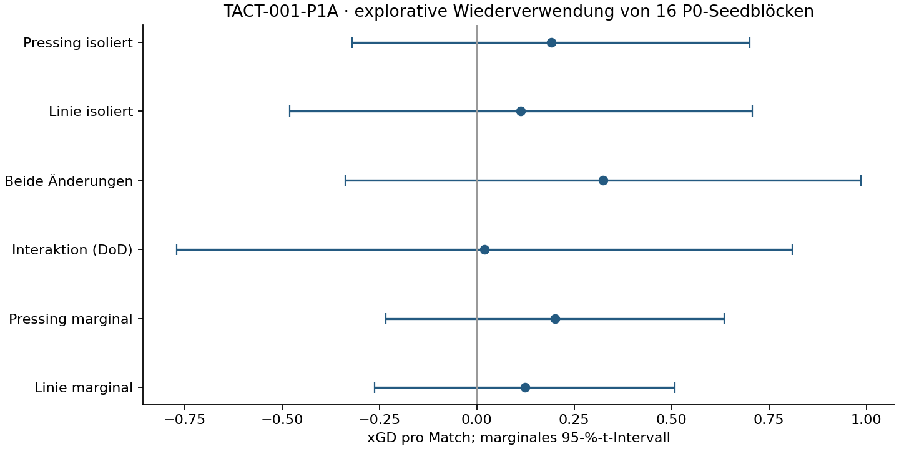

# TACT-001-P1A – unabhängige Präzisionsanalyse von P0

**14.11.2026 · ausschließlich offline · alle neuen Analysen explorativ.**

Die ursprüngliche Interaktion ist reproduziert. P0 liefert weder einen
Taktiksieger noch einen Nachweis fehlender Interaktion. Für weitere Entdeckung
sind größere, praktisch relevante Haupteffekte und mehrere gemeinsam untersuchte
Faktoren sinnvoller als die präzise Bestätigung einer sehr kleinen DoD.
Die endgültige Designentscheidung und ihre Kosten stehen im
[Designvergleich](../docs/TACT-001-P1A-design.md); der
[Folgeauftrag](TACT-001-P1B-order.md) ist hiermit **nicht gestartet**.

## Daten, Provenienz und Reproduktion

Quelle: unveränderte [P0-Messungen](../data/tact-001-p0/main.jsonl) und sämtliche
öffentlichen P0-Eingaben, Technikbelege, Jobabrechnungen und Ergebnisdateien,
Stand `873799a4eb4f233d2b894a579e53e409f64140fb`. 128 gültige Hauptmatches,
16 unabhängige Seedblöcke (acht je Gegner), vier Arme und zwei Seiten je Block.
Alle 152 damaligen Versuchsplätze sind abgerechnet: 128 Hauptmatches,
23 technische Matches, eine erwartete Negativabweisung; keine Ausschlüsse/Retry.
Diese technischen Matches gehen nicht in die Leistungsanalyse ein.

Historischer Build: FM27 `27.0.1+2503222`, Tactics Lab `v1114.6`, Commit
`91f2eba57fac0b7fbd3dff616056907e3ce461be`. Die Engine-SHA256 ist
`8c6971ce0b1c8afe6529ea3f46205a5175aea988a97d7421a980da42e23fe340`.
Der lokale DLL-Dateihash und die Dateiversion wurden in P1A lesend abgeglichen;
kein nativer Start und keine neue technische Freigabe. Vollständige historische
Host-/Fixture-/Ressourcenidentität: [P0-Manifest](../data/tact-001-p0/manifest.json).

`analyse_tact001p1a.py` liest die Rohzeilen direkt und baut die Identitäts-, Setup-,
Seed-, Seiten- und Armzuordnung erneut auf. Es importiert weder den alten
Analysepfad noch den nativen Runner. Der Test berechnet alle 30 neuen
Effekt-/Intervallschätzungen zusätzlich mit skalarer Arithmetik nach.
Der ursprüngliche unabhängige P0-Verifier prüft weiterhin alle elf damaligen
Kontraste, Bootstrapintervalle, Holm, SD-Grenzen und sechs Fallzahlminima.

```powershell
.venv/Scripts/python.exe analysis/verify_tact001p0.py
.venv/Scripts/python.exe analysis/analyse_tact001p1a.py
.venv/Scripts/python.exe analysis/report_tact001p1a.py
.venv/Scripts/python.exe -m unittest discover -s tests -v
```

Neue Ausgaben: [Effekte](../data/tact-001-p1a/exploratory-effects.json),
[Designprognosen](../data/tact-001-p1a/design-comparison.json),
[Seed-Einfluss](../data/tact-001-p1a/seed-influence.jsonl),
[Quellprüfsummen](../data/tact-001-p1a/source-manifest.json).
Python 3.12.10, NumPy 2.3.5, SciPy 1.16.3, Matplotlib 3.10.7;
vorhandene `requirements-lock.txt`, keine neue Abhängigkeit.
**Neue native Matches: 0; neue Seedreservierungen: 0; Holdoutzugriffe für Leistung: 0.**

## Schätzgrößen und unabhängige Einheiten

Armreihenfolge B=baseline, P=press, L=line, C=combined:

| Kontrast | Koeffizienten B/P/L/C | Bedeutung |
|---|---|---|
| Pressing isoliert | −1, +1, 0, 0 | Pressing bei Standardlinie |
| Linie isoliert | −1, 0, +1, 0 | Linie bei Standardpressing |
| Beide Änderungen | −1, 0, 0, +1 | konkretes Paket gegen Baseline |
| Interaktion | +1, −1, −1, +1 | Differenz-von-Differenzen |
| Pressing marginal | −½, +½, −½, +½ | Mittel über beide Linien |
| Linie marginal | −½, −½, +½, +½ | Mittel über beide Pressingstufen |

Erst Kontrast pro Seite, dann Seitenmittel im Seed, dann Gegnergewicht je ½.
Standardfehler² = ¼·(s_H²/n_H+s_D²/n_D); Satterthwaite-df,
zweiseitiges t-Intervall. Seedblöcke sind zwischen Kontexten unabhängig.
128 Matches sind **keine 128 unabhängigen Replikate** dieser Kontraste.
Bootstrap: 20.000 Ziehungen kompletter Blöcke, getrennt je Gegner,
deterministischer Analyse-RNG `2026111401`. Das ist kein neuer FM-Matchseed.
P1A-Bootstrapziehungen unterscheiden sich bewusst vom eingefrorenen P0-RNG;
die alten Bootstrapgrenzen werden separat unverändert verifiziert.

Primärreproduktion: +0,0197562342 xGD, SE 0,353394354, df 9,798918,
95-%-KI [−0,769851195; +0,809363664], p=0,956541550.
SD_H=1,818398035 und SD_D=0,830560536. Keine materielle Abweichung von P0.

## Explorative Effekte auf xGD

| Vergleich | Mittel | 95-%-KI | Roh-p |
|---|---:|---|---:|
| Pressing isoliert | +0.191 | [-0.320; +0.701] | 0.4354 |
| Linie isoliert | +0.113 | [-0.481; +0.708] | 0.6751 |
| Beide Änderungen | +0.324 | [-0.337; +0.985] | 0.3062 |
| Interaktion (DoD) | +0.020 | [-0.770; +0.809] | 0.9565 |
| Pressing marginal | +0.201 | [-0.233; +0.635] | 0.3378 |
| Linie marginal | +0.123 | [-0.262; +0.509] | 0.4984 |



Alle Intervalle sind marginal; die sechs Vergleiche sind abhängig. Zusätzlich
Holm über die vollständig berichtete explorative Familie von 6 Kontrasten ×
5 Endpunkten (xGD, GF, GA, GD, Punkte) = 30 Tests, ohne positiven Nachweis.
Diese neue Familie ändert die ursprüngliche P0-Familie nicht.
Kein nachträglicher Primärtest und keine Bestätigungsbehauptung.

## Gegner- und Seitenstreuung

| Vergleich | high_press: Mittel / SD | deep_block: Mittel / SD |
|---|---:|---:|
| Pressing isoliert | +0.307 / 0.890 | +0.074 / 1.008 |
| Linie isoliert | -0.049 / 1.395 | +0.276 / 0.491 |
| Beide Änderungen | +0.308 / 1.453 | +0.340 / 0.909 |
| Interaktion (DoD) | +0.049 / 1.818 | -0.010 / 0.831 |
| Pressing marginal | +0.332 / 0.836 | +0.070 / 0.781 |
| Linie marginal | -0.024 / 0.849 | +0.271 / 0.523 |

Die Interaktion streut gegen hohes Pressing etwa 4,79-mal so stark in Varianz.
Beim isolierten Pressing ist dagegen deep_block etwas variabler.
Es gibt daher keine für jeden Kontrast optimale Gegnerallokation.
Für die Interaktions-SD lauten die zweiseitigen 95-%-Normalmodellintervalle
[1,202; 3,701] bzw. [0,549; 1,690]. Das zeigt die erhebliche Unsicherheit
aus je acht Seeds; Normalität selbst ist damit nicht belegt.

| Vergleich und Kontext | Heim: Mittel / SD | Auswärts: Mittel / SD |
|---|---:|---:|
| Pressing isoliert, high_press | +0.366 / 1.119 | +0.248 / 1.236 |
| Pressing isoliert, deep_block | +0.191 / 1.256 | -0.042 / 1.735 |
| Linie isoliert, high_press | +0.054 / 1.563 | -0.153 / 1.629 |
| Linie isoliert, deep_block | +0.679 / 1.104 | -0.128 / 1.029 |
| Beide Änderungen, high_press | +0.559 / 1.977 | +0.057 / 1.219 |
| Beide Änderungen, deep_block | +0.619 / 0.986 | +0.062 / 1.470 |
| Interaktion (DoD), high_press | +0.138 / 1.897 | -0.039 / 2.237 |
| Interaktion (DoD), deep_block | -0.251 / 1.358 | +0.232 / 1.557 |
| Pressing marginal, high_press | +0.435 / 1.142 | +0.229 / 0.664 |
| Pressing marginal, deep_block | +0.066 / 1.210 | +0.074 / 1.213 |
| Linie marginal, high_press | +0.123 / 1.293 | -0.172 / 0.719 |
| Linie marginal, deep_block | +0.553 / 0.698 | -0.012 / 0.780 |

Die Seiten sind feste native Fixtureplätze einschließlich Trägeridentität,
kein kausal isolierter Heimvorteil. Die Vorzeichenunterschiede und SDs rechtfertigen
kein leistungsabhängiges Weglassen einer Seite.

## Paarungsabhängigkeit

Die Tabelle vergleicht die gemessene gepaarte Varianz mit der aus den
Randvarianzen berechneten **kontrafaktischen** Varianz bei unabhängigen Seeds.
Ein Wert unter eins begünstigt die Paarung; ein Wert über eins benachteiligt sie.
Die hypothetischen unabhängigen Läufe wurden nicht ausgeführt.

| Vergleich und Kontext | Korr. Heim/Auswärts | Varianzverhältnis Seitenpaarung | Verhältnis Armpaarung |
|---|---:|---:|---:|
| Pressing isoliert, high_press | +0.141 | 1.140 | 0.912 |
| Pressing isoliert, deep_block | -0.120 | 0.886 | 0.909 |
| Linie isoliert, high_press | +0.527 | 1.526 | 1.202 |
| Linie isoliert, deep_block | -0.578 | 0.423 | 0.413 |
| Beide Änderungen, high_press | +0.631 | 1.564 | 1.478 |
| Beide Änderungen, deep_block | +0.058 | 1.053 | 0.982 |
| Interaktion (DoD), high_press | +0.544 | 1.537 | 1.291 |
| Interaktion (DoD), deep_block | -0.357 | 0.646 | 0.432 |
| Pressing marginal, high_press | +0.692 | 1.601 | 1.092 |
| Pressing marginal, deep_block | -0.168 | 0.832 | 1.530 |
| Linie marginal, high_press | +0.373 | 1.316 | 1.125 |
| Linie marginal, deep_block | -0.000 | 1.000 | 0.686 |

Für Seiten gilt Var((D_home+D_away)/2)=(V_home+V_away+2Cov)/4.
Für Arme gilt Var(c'Y)=c'Σc; der unabhängige Gegenwert ist Σ c_j²Σ_jj.
Die vollständigen 4×4-Armkovarianz-/Korrelationsmatrizen stehen im JSON.
Gemeinsame Seeds garantieren weder dieselben Ereignisse noch positive Kovarianz
zwischen Ergebnissen verschiedener Taktiken. Eine generelle CRN-Ersparnis wäre
mit diesen Daten unbegründet. Ein späterer unabhängiger Paarungsversuch müsste
selbst vorregistriert werden; P1A ändert keine Seedpolitik eines laufenden Versuchs.

## Einfluss einzelner Seeds und robuste Sensitivität

Leave-one-out entfernt jeweils nur einen Seed im betroffenen Kontext und lässt
beide Zielgewichte bei ½. Keine Zeile wird aus dem eigentlichen Ergebnis entfernt.

| Vergleich | Bereich der 16 Leave-one-out-Mittel | Größte absolute Verschiebung |
|---|---|---:|
| Pressing isoliert | [+0.068; +0.294] | 0.123 |
| Linie isoliert | [-0.033; +0.234] | 0.146 |
| Beide Änderungen | [+0.187; +0.465] | 0.141 |
| Interaktion (DoD) | [-0.187; +0.194] | 0.207 |
| Pressing marginal | [+0.094; +0.296] | 0.107 |
| Linie marginal | [+0.023; +0.197] | 0.100 |

Die Interaktion kann allein durch Weglassen eines Blocks zwischen −0,187 und
+0,194 liegen. Beim isolierten Linieneffekt reicht der Bereich über null.
Diese Empfindlichkeit ist ein Argument für neue Replikation, kein Ausschlussgrund.
Alle 96 xGD-Sensitivitätsläufe einschließlich Seedkennungen und Intervalle
sind öffentlich. Kontextmediane und 20-%-getrimmte Mittel stehen im JSON:
beispielsweise Linie −0,068 bzw. +0,078 gegenüber arithmetisch +0,113.
Sie schätzen andere Lagegrößen; kleinere Streuung wäre kein Beweis für höhere
Präzision des unveränderten mittleren Leistungseffekts.

Ein lineares Modell mit 16 Blockinterzepten und kontextspezifischen
Seiten-/P-/L-/P×L-Termen liefert dieselben Punktschätzungen.
Es erzeugt keine neuen unabhängigen Einheiten. Inferenz bleibt auf vollständigen
Seedkontrasten, statt mit naiven Matchresiduen und n=128.

## Tatsächliche Tore und Punkte

Alle Effekte pro Match, jeweils Mittel [marginales 95-%-KI]. GA positiv bedeutet
mehr Gegentore; GD=GF−GA. Punkte sind 3/1/0 aus dem tatsächlichen Endstand.

| Vergleich | GF | GA | GD | Punkte |
|---|---|---|---|---|
| Pressing isoliert | +0.156 [-0.468; +0.781] | +0.000 [-0.617; +0.617] | +0.156 [-0.753; +1.066] | +0.281 [-0.559; +1.121] |
| Linie isoliert | +0.281 [-0.282; +0.844] | +0.094 [-0.804; +0.992] | +0.188 [-0.914; +1.289] | +0.406 [-0.380; +1.192] |
| Beide Änderungen | +0.312 [-0.253; +0.878] | +0.000 [-0.564; +0.564] | +0.312 [-0.559; +1.184] | +0.500 [-0.310; +1.310] |
| Interaktion (DoD) | -0.125 [-0.648; +0.398] | -0.094 [-1.182; +0.995] | -0.031 [-1.222; +1.159] | -0.188 [-1.137; +0.762] |
| Pressing marginal | +0.094 [-0.525; +0.713] | -0.047 [-0.347; +0.253] | +0.141 [-0.558; +0.839] | +0.188 [-0.388; +0.763] |
| Linie marginal | +0.219 [-0.226; +0.664] | +0.047 [-0.384; +0.478] | +0.172 [-0.452; +0.796] | +0.312 [-0.225; +0.850] |

Beispiel Interaktion: xGD +0,020, Tordifferenz −0,031, Punkte −0,188.
Das ist bei diesen Intervallen kein belastbarer Widerspruch. Im deep_block
korrelieren die acht Interaktionskontraste xGD/GD nur mit 0,223 und xGD/Punkten
mit 0,228; gegen high_press mit 0,745 bzw. 0,590. Die vollständigen
3×3-Matrizen (Reihenfolge xGD, GD, Punkte) sind im JSON gespeichert.
Die isolierten Pressingkontraste haben SE_xGD=0,238 versus SE_GD≈0,424;
xGD ist hier ein effizienter Screeningendpunkt. Es misst weder Abschlussqualität
vollständig noch tatsächliche Punkte. Für finale Kandidaten sind neue
Endstand-/Punktevergleiche und deren eigene Powerplanung erforderlich.

## Konsequenz

Eine weniger verrauschte Schätzgröße hilft nur, wenn sie die Forschungsfrage
beantwortet. Ein Zweiarmvergleich für ein konkretes Paket ersetzt keine
Interaktionsschätzung; ein marginaler Haupteffekt ersetzt keinen Vorteil einer
bestimmten vollständigen Taktik. Der folgende Designvergleich behält diese
Unterschiede und die Kosten jedes vollständigen Blocks ausdrücklich bei.
