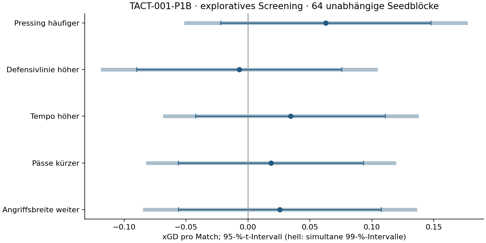
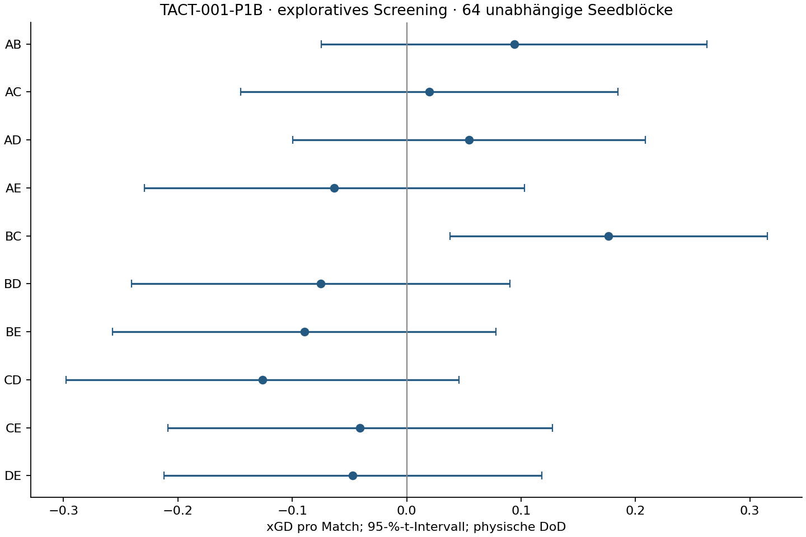

# TACT-001-P1B – Ergebnis des Fünffaktor-Screenings

**14.11.2026 · FM27 27.0.1+2503222 · explorative Discovery · keine Siegerbestätigung.**

Alle **2.048 Hauptmatches** und **72 technischen Vollmatches** akzeptiert; eine erwartete Negativabweisung. **64 vollständige unabhängige Seedblöcke**, 32 je Gegner. Keine Ausfälle, Ausschlüsse, Retries, Ersatzseeds oder Holdoutmatches. Der Auftrag endet nach diesem Screening.

**Keiner der fünf Haupteffekte, zehn explorativen Zweifachkontraste oder 25 Sekundärtests erreicht die jeweilige Holm-Schwelle.** Die Hauptschätzungen liegen zwischen −0,007 und +0,063 xGD. Alle marginalen 95-%-Intervallbreiten liegen zwischen 0,150 und 0,170 und damit unter dem vorab gewünschten Maximum 0,30. Auch sämtliche simultanen Hauptintervalle enthalten null; ihre positiven Obergrenzen liegen unter 0,20. Dies begrenzt große positive Faktor-Mittelwerte im getesteten Halbfraction-Kontext, beweist aber keine allgemeine Wirkungslosigkeit oder formale Äquivalenz.

## Vorregistrierung und Designintegrität

Vorregistrierung/Code/Inputs/Seeds vor jedem Prüfmatch gepusht in `e0b63bdc5578862a6c94e5d8f67405b3cc7debc4`; technische Freigabe vor dem Hauptstart in `9831b2a91bc7e76a1fdf955196589c9014748f43`. Alle 64 nativen Zellen und acht exakte Wiederholungen bestanden, neue C/D/E-Bits 47/3/51 zurückgelesen. Die negative Binärprobe lieferte Exit 108.

Explizit **E=−ABCD**, D00 all-standard und binäridentisch zur P0-Baseline. `fractional_design(...,fraction=-1)` wird durch Matrix/Vertrag/Binärdifferenzen/native Readbacks/Analyse geprüft; historischer Default +1 blieb unverändert. Keine stillschweigende Umstellung. Hauptkontraste X/8 (high-minus-low), Paar-DoDs XiXj/4. Die negative Hälfte identifiziert Haupt- und Zweifachspalten getrennt voneinander, aber aliasiert sie negativ mit Vierfach-/Dreifachinteraktionen.

## Fünf Haupteffekte

| Faktor | xGD | 95-%-KI | simultanes KI | Holm-p | ≥0,20 und Holm? |
|---|---:|---|---|---:|---|
| A: Pressing häufiger | +0,063 | [-0,022; +0,148] | [-0,050; +0,176] | 0.72052 | nein |
| B: Defensivlinie höher | -0,007 | [-0,090; +0,076] | [-0,117; +0,103] | 1.00000 | nein |
| C: Tempo höher | +0,034 | [-0,042; +0,111] | [-0,067; +0,136] | 1.00000 | nein |
| D: Pässe kürzer | +0,018 | [-0,056; +0,093] | [-0,081; +0,118] | 1.00000 | nein |
| E: Angriffsbreite weiter | +0,026 | [-0,056; +0,108] | [-0,083; +0,135] | 1.00000 | nein |

Marginale 95-%-t-Intervalle; simultane Bonferroni 99-%-Intervalle je Hauptkontrast, gemeinsame nominelle Abdeckung mindestens 95 % unter den Modellannahmen. Holm über genau 5 Tests. Seitenmittel im Seed, beide Gegner je ½; Welch-Satterthwaite-df und 20.000 stratifizierte vollständige Seedblock-Bootstrapziehungen. Bootstrapintervalle, Roh-p und alle Kontrast-SDs stehen im Effektarchiv. 2.048 Matches sind keine 2.048 unabhängigen Replikate.



Die Spalte ≥0,20/Holm ist die eingefrorene Regel für vorläufige Einstellungshinweise; sie bestätigt weder ein zusammengestelltes Paket noch eine universelle Verbesserung. Ein signifikanter Effekt unter 0,20 ist kein praktisch ausreichender Einstellungshinweis. Ein unklares Intervall belegt keine Abwesenheit eines Effekts.

## Gegnerrobustheit und erreichte Präzision

| Faktor | high_press: Mittel / SD | deep_block: Mittel / SD | 95-%-Breite ≤0,30? |
|---|---:|---:|---|
| A | +0,105 / 0.357 | +0,021 / 0.321 | ja |
| B | +0,009 / 0.333 | -0,024 / 0.330 | ja |
| C | +0,002 / 0.340 | +0,067 / 0.267 | ja |
| D | +0,068 / 0.304 | -0,031 / 0.294 | ja |
| E | +0,066 / 0.348 | -0,014 / 0.307 | ja |

Die zwei Gegner sind feste Stilbündel und keine Zufallsstichprobe aller FM-Taktiken. Unterschiede der Kontextmittel sind deskriptiv; daraus werden keine nachträglichen weiteren Haupttests. Gegenläufige Richtungen begrenzen die Übertragbarkeit des Mittelwerts. Seitenmittel/-SD/Kovarianzen und volle 16×16-Armkovarianzmatrizen sind im JSON vollständig erhalten.

## Zehn explorative Zweifachinteraktionen

| Paar | physische xGD-DoD | 95-%-KI | Holm-p (10) |
|---|---:|---|---:|
| AB | +0,094 | [-0,075; +0,263] | 1.00000 |
| AC | +0,020 | [-0,145; +0,185] | 1.00000 |
| AD | +0,055 | [-0,099; +0,208] | 1.00000 |
| AE | -0,063 | [-0,229; +0,103] | 1.00000 |
| BC | +0,177 | [+0,038; +0,315] | 0.13440 |
| BD | -0,075 | [-0,241; +0,090] | 1.00000 |
| BE | -0,089 | [-0,257; +0,078] | 1.00000 |
| CD | -0,126 | [-0,298; +0,046] | 1.00000 |
| CE | -0,041 | [-0,209; +0,127] | 1.00000 |
| DE | -0,047 | [-0,212; +0,118] | 1.00000 |

Separate Holm-10-Familie, physische Differenz-von-Differenzen. Höhere Interaktionen können diese Aliaskontraste verursachen. Kein Nachweis ihrer Abwesenheit und keine automatische neue 2×2-/Foldover-Serie.

Der größte positive Paar-Schätzwert ist B×C (Linie×Tempo): +0,177 xGD-DoD, marginales 95-%-KI [+0,038; +0,315], aber Holm-p=0,134. Das marginale Intervall allein ist kein korrigierter Nachweis. B, D und E haben deskriptiv unterschiedliche Vorzeichen zwischen Gegnern; auch das begründet keine nachträglichen Kontexttests.



## Tatsächliche Resultate und sekundäre Familie

Punkte 3/1/0 aus dem tatsächlichen Endstand; GF/GA nicht durch xG ersetzt. Separate vorregistrierte Holm-25-Familie, alle 25 Kontraste vollständig berichtet. Positive GA bedeutet mehr Gegentore. Diese Werte sind jeweilige Faktor-Hauptkontraste, keine Bestätigung der ausgewählten Zellen.

| Hauptkontrast | Endpunkt | Effekt | 95-%-KI | Holm-p (25) |
|---|---|---:|---|---:|
| A | points | +0,053 | [-0,046; +0,151] | 1.00000 |
| A | gf | +0,040 | [-0,051; +0,132] | 1.00000 |
| A | ga | +0,005 | [-0,089; +0,099] | 1.00000 |
| A | xgf | +0,028 | [-0,032; +0,089] | 1.00000 |
| A | xga | -0,034 | [-0,087; +0,018] | 1.00000 |
| B | points | -0,037 | [-0,152; +0,078] | 1.00000 |
| B | gf | +0,017 | [-0,074; +0,107] | 1.00000 |
| B | ga | +0,087 | [-0,022; +0,196] | 1.00000 |
| B | xgf | +0,031 | [-0,024; +0,086] | 1.00000 |
| B | xga | +0,038 | [-0,020; +0,097] | 1.00000 |
| C | points | +0,049 | [-0,067; +0,165] | 1.00000 |
| C | gf | +0,011 | [-0,096; +0,118] | 1.00000 |
| C | ga | -0,077 | [-0,175; +0,021] | 1.00000 |
| C | xgf | +0,023 | [-0,035; +0,081] | 1.00000 |
| C | xga | -0,011 | [-0,063; +0,040] | 1.00000 |
| D | points | +0,033 | [-0,092; +0,158] | 1.00000 |
| D | gf | +0,013 | [-0,093; +0,118] | 1.00000 |
| D | ga | -0,028 | [-0,118; +0,061] | 1.00000 |
| D | xgf | +0,028 | [-0,031; +0,087] | 1.00000 |
| D | xga | +0,010 | [-0,040; +0,059] | 1.00000 |
| E | points | -0,029 | [-0,118; +0,060] | 1.00000 |
| E | gf | -0,062 | [-0,159; +0,035] | 1.00000 |
| E | ga | -0,017 | [-0,113; +0,079] | 1.00000 |
| E | xgf | -0,001 | [-0,063; +0,061] | 1.00000 |
| E | xga | -0,027 | [-0,082; +0,029] | 1.00000 |

Alle 16 Zellmittel je Gegner, rein deskriptiv, jeweils 64 tatsächliche Matches pro Zelle und Gegner:

| Zelle | high_press xGD / Punkte / GF / GA | deep_block xGD / Punkte / GF / GA |
|---|---|---|
| D00 | -0,132 / +1,406 / +1,422 / +1,375 | +0,092 / +1,531 / +1,281 / +1,078 |
| D01 | -0,084 / +1,281 / +1,469 / +1,469 | +0,473 / +1,438 / +1,219 / +1,062 |
| D02 | -0,154 / +1,359 / +1,125 / +1,250 | +0,364 / +1,656 / +1,672 / +1,281 |
| D03 | -0,350 / +1,297 / +1,125 / +1,250 | +0,328 / +1,484 / +1,188 / +1,094 |
| D04 | -0,241 / +1,297 / +1,359 / +1,484 | +0,194 / +1,094 / +1,141 / +1,422 |
| D05 | -0,332 / +1,203 / +1,125 / +1,516 | +0,253 / +1,609 / +1,516 / +1,406 |
| D06 | -0,243 / +1,391 / +1,547 / +1,328 | +0,475 / +1,484 / +1,500 / +1,125 |
| D07 | -0,200 / +1,438 / +1,219 / +1,234 | +0,198 / +1,562 / +1,312 / +1,016 |
| D08 | -0,226 / +1,344 / +1,203 / +1,328 | +0,372 / +1,656 / +1,375 / +1,047 |
| D09 | +0,003 / +1,375 / +1,406 / +1,438 | +0,317 / +1,656 / +1,656 / +1,125 |
| D10 | -0,295 / +1,188 / +1,188 / +1,328 | +0,354 / +1,531 / +1,406 / +1,250 |
| D11 | -0,116 / +1,609 / +1,391 / +1,203 | +0,254 / +1,438 / +1,281 / +1,156 |
| D12 | -0,288 / +1,125 / +1,062 / +1,516 | +0,337 / +1,812 / +1,547 / +1,141 |
| D13 | -0,024 / +1,266 / +1,375 / +1,438 | +0,154 / +1,469 / +1,297 / +1,203 |
| D14 | -0,007 / +1,234 / +1,297 / +1,469 | +0,393 / +1,578 / +1,312 / +1,234 |
| D15 | +0,057 / +1,422 / +1,359 / +1,219 | +0,360 / +1,672 / +1,703 / +1,375 |

Native Schüsse/SOT/Ballbesitz bleiben deskriptive Plausibilitätsendpunkte ohne zusätzliche Leistungs-p-Werte. Alle Endstände und Messwerte stehen in `main.jsonl`; alle technischen Messungen getrennt. xGD ist ein Screeningmaß und erfasst Abschlussqualität sowie den tatsächlichen Punktgewinn nicht vollständig.

## Varianztransfer, Abhängigkeit und Seed-Einfluss

| Faktor | Beobachtete / prognostizierte Blockvarianz H | Beobachtete / prognostizierte Blockvarianz D | Größter LOO-Einfluss |
|---|---:|---:|---:|
| A | 0.68 | 1.17 | 0.016 |
| B | 0.59 | 1.23 | 0.015 |
| C | 0.62 | 0.81 | 0.015 |
| D | 0.49 | 0.98 | 0.013 |
| E | 0.65 | 1.07 | 0.013 |

Verhältnisse beziehen sich auf die P1A-Annahme τ²/4 für jeden neuen Hauptkontrast; Wert 1 entspräche deren Varianzprognose. Die Planungspower 94,6 % war bedingt, keine nachträglich gemessene Power. Relevant sind die jetzt tatsächlich erreichten Intervalle. LOO entfernt je einen Seed nur in der Sensitivität, behält die Kontextgewichte ½ und ändert keine Hauptergebnisse. Vollständige 960 xGD-Blockkontraste erlauben unabhängige Rekonstruktion.

## Höchstens zwei explorative Vorschläge

- **D15 (A+ B+ C+ D+ E−)**: xGD-Abstand zu D00 gegen high_press +0,190, gegen deep_block +0,268, gleichgewichtet +0,229. Schlechterer Kontext +0,190.
  Tatsächlicher Punkteabstand rein deskriptiv: high_press +0,016, deep_block +0,141, gleichgewichtet +0,078 Punkte pro Match. Kein unabhängiger Nachweis und kein Auswahlkriterium.
- **D09 (A+ B− C− D+ E−)**: xGD-Abstand zu D00 gegen high_press +0,135, gegen deep_block +0,225, gleichgewichtet +0,180. Schlechterer Kontext +0,135.
  Tatsächlicher Punkteabstand rein deskriptiv: high_press -0,031, deep_block +0,125, gleichgewichtet +0,047 Punkte pro Match. Kein unabhängiger Nachweis und kein Auswahlkriterium.

Angewandt wurde ausschließlich die eingefrorene Auswahlregel: positiver xGD-Abstand in beiden Kontexten; Sortierung nach kleinerem Kontextabstand, dann gleichgewichtetem Abstand, dann Design-ID. Die Auswahl verwendet dieselben Discoverydaten und unterliegt Winner's Curse. Deshalb keine konfirmatorischen Gewinnerintervalle und keine Behauptung einer optimalen Taktik. Faktor+ bedeutet bei D ausdrücklich kürzere Pässe. Alle übrigen Rollen, Phasen, PI, Profile, Standards und das Management bleiben die kontrollierten P0-Eingaben. [Konkrete Kandidaten mit Optionen und allen vier Setup-Hashes](../data/tact-001-p1b/candidates.json).

## Ressourcen, Vollständigkeit und Grenzen

Kumulierte beaufsichtigte Child-Wall-Time **1119.500/2.400 Sekunden**, Zeitfenster vom ersten nativen Vorbereitungsstart bis Hauptabschluss **1474.665/2.400 Sekunden**. Unveränderte Deadline `2026-11-14T14:09:26.985220+00:00`, innerhalb eingehalten. Maximal 4 Worker, 90 s ohne Fortschritt, keine Budgetneustarts. Drei beaufsichtigte Phasen (prepare/technical/main). Alle 2.121 Matchversuchsplätze abgerechnet: 2.120 akzeptierte Vollmatches plus eine erwartete Abweisung, keine unbegonnenen Jobs.

Zusätzliche native Prüfprozesse: 5 (drei --check-image, zwei Capabilities-Abfragen), alle innerhalb derselben Zeitreservation. Warmworkerprozesse laut vollständigen Sessionbelegen: Technik 8, Hauptserie 128. Dies sind wiederverwendete Hosts, keine zusätzlichen Matches. Private Rohartefakte etwa 911.7 MiB, unter 4 GiB. [Ressourcenabrechnung](../data/tact-001-p1b/resource-summary.json).

Grenzen: synthetische gleich starke, positionsübergreifend geeignete Profile; ein gebündeltes Fixture, nur zwei Gegner und feste Managementpolitik; Halbfraction-Aliase; explorative Kandidatenselektion. Keine Aussage über echte Kaderstreuung, neue Builds, andere Mannschaftsstärken, Karriereverläufe oder Live-Coaching. Karriere-PKM bleiben gesperrt. Die bestehenden Holdoutprofile und Holdoutseeds bleiben unbenutzt.

Nächster Vorschlag ausschließlich separat: maximal einen jetzt eingefrorenen Kandidaten gegen D00 an neuen Seeds und unbenutzten Gegner-/Stärkeprofilen bestätigen, tatsächliche Punkte primär und eigene Relevanz-/Powerplanung. Vor realen Karriere-Replays den Adapter separat validieren. Hier keine weitere Simulation, Optimierung oder automatische Bestätigung.

## Reproduktion und veröffentlichte Belege

```powershell
.venv/Scripts/python.exe analysis/analyse_tact001p1b.py
.venv/Scripts/python.exe analysis/verify_tact001p1b.py
.venv/Scripts/python.exe -m unittest discover -s tests -v
```

Der unabhängige Verifier liest ausschließlich öffentliche Messungen und den Vertrag, ohne Analyse-/Runnerimporte: 40 Effekt-/t-/Bootstrapintervalle, fünf simultane Intervalle, Holm-5/10/25, 960 Blockkontraste, Kandidatenregel und vollständige Jobabrechnung. Die 124 geschützten historischen Forschungsdateien werden gegen den Ausgangscommit gehasht. Rohspielmaterial bleibt privat; Export nur über die vorregistrierte Feld-Whitelist.

[Vorregistrierung](TACT-001-P1B-preregistration.md) · [technischer Gate](TACT-001-P1B-validation.md) · [Daten/Provenienz](../data/tact-001-p1b/README.md) · [Effekte](../data/tact-001-p1b/effects.json) · [Rohmessungen](../data/tact-001-p1b/main.jsonl) · [Budget](../data/tact-001-p1b/budget.json).
