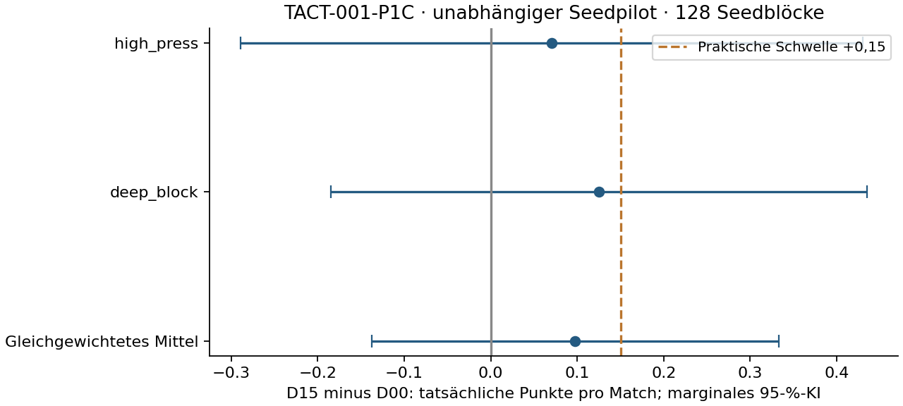

# TACT-001-P1C – unabhängiger D15-Kandidatenpilot

**14.11.2026 · FM27 27.0.1+2503222 · unabhängige neue Seeds im bisherigen synthetischen Kontext.**

**512/512 Hauptmatches, 128 vollständige unabhängige Seedblöcke**,64 je Gegner.
16/16 technische Vollmatches,8 exakte A/A-Wiederholungen und eine erwartete
Exit108-Abweisung. Keine Ausfälle, Ausschlüsse, Retries, Ersatzseeds,
Holdoutmatches oder Karriereausführung. Alle529 Versuchsplätze abgerechnet.

## Primär: tatsächliche Punkte pro Match

D15−D00: **+0,098 Punkte/Match**,95-%-t-KI **[-0,137; +0,333]**,
Bootstrap95-%-KI [-0,133; +0,324], zweiseitiges p=0.41246.
SE=0.1188, Welch-df=123.33, gepoolte innerhalb-Kontext-SD=1.344.
Volle t-KI-Breite=0.470; Ziel≤0,30.

**Die vorregistrierte Hinweisschwelle ist nicht erfüllt. Wir empfehlen ausdrücklich den Wechsel zu neuen Rollen und OOP-Strukturen statt unbegrenzter Wiederholung dieses Instruktionspakets.**

Die Regel war vorab eingefroren: Mittel≥+0,15, untere95-%-Grenze>0,
Breite≤0,30 und positives Mittel in beiden Kontexten. Nichtsignifikanz beweist
keine Äquivalenz. Keine Kandidatenneuwahl; D09 bleibt unverändert archiviert.
Keine finale Sieger-, Optimalitäts- oder Karrierebehauptung.

| Kontext | Punkteffekt | Kontrast-SD | Seite0-Mittel | Seite1-Mittel | Seitenkovarianz |
|---|---:|---:|---:|---:|---:|
| high_press | +0,070 | 1.439 | -0,016 | +0,156 | 0.828 |
| deep_block | +0,125 | 1.241 | +0,031 | +0,219 | -0.197 |

Seitenmittel im vollständigen Seedblock, dann Gegnergewichte je½.
512 Matches sind keine512 unabhängigen Replikate. Seiten sind native Fixtureplätze,
kein isolierter Heimvorteil. Kontexte sind feste Stilbündel, keine Stichprobe aller Gegner.
Leave-one-seed-out-Bereich [0.0744047619047619, 0.1224578373015873], maximale Verschiebung
0.0248; keine Löschung aus der Hauptanalyse.

## Sekundäre Endpunkte

Genau fünf sekundäre Tests, Holm5; marginale Intervalle. GA positiv heißt mehr
Gegentore. xGD ersetzt weder Tore noch tatsächlichen Punktgewinn.

| Endpunkt | Effekt | 95-%-t-KI | Bootstrap95-%-KI | Holm-p |
|---|---:|---|---|---:|
| xgd | +0,196 | [+0,027; +0,365] | [+0,027; +0,361] | 0.09322 |
| gf | -0,027 | [-0,218; +0,163] | [-0,215; +0,160] | 1.00000 |
| ga | -0,180 | [-0,387; +0,028] | [-0,379; +0,027] | 0.26643 |
| xgf | +0,035 | [-0,074; +0,145] | [-0,071; +0,146] | 1.00000 |
| xga | -0,161 | [-0,273; -0,048] | [-0,271; -0,049] | 0.02735 |

| Kontext | Arm | Punkte/Match | GF | GA | xGF | xGA |
|---|---|---:|---:|---:|---:|---:|
| high_press | D00 | 1.211 | 1.219 | 1.484 | 1.150 | 1.448 |
| high_press | D15 | 1.281 | 1.219 | 1.406 | 1.228 | 1.340 |
| deep_block | D00 | 1.430 | 1.500 | 1.375 | 1.485 | 1.337 |
| deep_block | D15 | 1.555 | 1.445 | 1.094 | 1.478 | 1.124 |

Vollständige Endstände und native Schüsse/SOT/Besitz bleiben im Messarchiv;
zusätzliche Leistungs-p-Werte wurden nicht erzeugt.

## Spätere neue Bestätigung: bedingte Power- und Präzisionsplanung

Feste Zielverbesserungen0,10/0,15/0,20 Punkte,90% Power, zweiseitigα0,05.
Gleiche neue n pro Kontext;128 hier beobachtete Blöcke werden nicht wiederverwendet.
Vier Matches pro Seed, insgesamt8n. Diese Zahlen sind **kein Ausführungsauftrag**.
Nichtzentrale Welch-t-Näherung bei unveränderter Streuung, keine beobachtete Power
für den ausgewählten Effektschätzer. In neuen Kontexten muss die SD neu pilotiert werden.

| SD-Annahme | Zielpunkteffekt | Neue Seeds/Gegner | Neue unabhängige Blöcke | Neue Hauptmatches |
|---|---:|---:|---:|---:|
| observed | +0.10 | 950 | 1900 | 7600 |
| observed | +0.15 | 423 | 846 | 3384 |
| observed | +0.20 | 239 | 478 | 1912 |
| simultaneous95_normal_model_upper | +0.10 | 1392 | 2784 | 11136 |
| simultaneous95_normal_model_upper | +0.15 | 620 | 1240 | 4960 |
| simultaneous95_normal_model_upper | +0.20 | 349 | 698 | 2792 |
| bounded_points_sd3 | +0.10 | 4730 | 9460 | 37840 |
| bounded_points_sd3 | +0.15 | 2103 | 4206 | 16824 |
| bounded_points_sd3 | +0.20 | 1184 | 2368 | 9472 |

| SD-Annahme | Gewünschte volle95-%-Breite | Neue Seeds/Gegner | Neue Hauptmatches |
|---|---:|---:|---:|
| observed | 0.20 | 348 | 2784 |
| observed | 0.30 | 156 | 1248 |
| simultaneous95_normal_model_upper | 0.20 | 510 | 4080 |
| simultaneous95_normal_model_upper | 0.30 | 228 | 1824 |
| bounded_points_sd3 | 0.20 | 1730 | 13840 |
| bounded_points_sd3 | 0.30 | 770 | 6160 |

`simultaneous95_normal_model_upper`: Bonferroni für zwei einseitige97,5-%-SD-Grenzen,
Normalmodell/χ² mit63df. Diskrete Punktekontraste sind nicht exakt normal; diese
Grenzen und t-Power sind Näherungen, keine Verteilungsgarantie.
`bounded_points_sd3`: Varianzgrenze aus Kontrastbereich[−3,+3], konservative
Streuungssensitivität, weiterhin modellbasierte t-Power. Keine künstliche Präzision.
Vorab aus P1B prognostiziert: SD1,317/1,587, Breite0,510 und21,1% Power für+0,15.
Der neue Pilot war ausdrücklich nicht für90% Power dimensioniert.

## Technische Freigabe, Provenienz und Ressourcen

Vorregistrierung/Code/131Seedreservierungen vor dem ersten Vollmatch auf GitHub:
`bd3d9baa04b0a66ce8b80d37eb0b3c8f305849a5`. Technischer Gate vor jedem Hauptmatch:
`44d6a97fcff612ed785e75786301051128647a79`. D15/D00 sämtlicher acht Kontexte/Seiten bytegleich
zu P1B, vollständige native Audits nach Originalvorbereitung für jedes Match.
Phasen/Positionen/Rollen/Duties/PI, alle69 Attribute,1.058 Profilfelder,
sämtliche Instruktionsgruppen, effektiver Seed, Naturabschluss/Statistik geprüft.
Engine/Host/Fixture/Ressourcen/Adapter/Katalog/Runtimequellen entsprechen VALID-002/P1B.
Alle SHA256 im öffentlichen Eingabe-/Registrymanifest; Rohspielmaterial bleibt privat.

Kumulierte beaufsichtigte Child-Wall-Time **320.441/900s**;
festes Studienzeitfenster **661.419/1800s**,
UTC-Deadline `2026-11-14T14:48:16.844148+00:00`. Zähler nie zurückgesetzt,
maximal4Worker und90s ohne Fortschritt. Probes/Audits/Publikationspausen im
jeweiligen Budget enthalten. Native Rohartefakte bleiben unter2GiB.

## Gültigkeitsbereich und nächste Forschungsrichtung

Neue Seedblöcke beseitigen die Wiederverwendung der P1B-Selektionsdaten, erweitern
aber weder Gegnerdiversität noch Profilrealismus. Ein Fixture, gleiche synthetische
Kaderstärke, konstante Rollen/PI/Management. Allgemeine Karriereübertragbarkeit
bleibt unbestätigt. D09 wird unabhängig vom Ergebnis nicht als Ersatz nachgeschoben.

[VALID-003](VALID-003-plan.md) plant positionsabhängige Profile, getrennte
Stärkekontexte und kapazitätsgerechte Karriere-PKM-Adapter. Keine dieser Gates
wurde hier ausgeführt. Karriere-Replays bleiben bis separater Abnahme gesperrt.
Neue Rollen-/OOP-Fragen brauchen neue native Readbacks, eigene Vorregistrierung,
neue Discoveryseeds und später unabhängige Bestätigung. Keine weitere automatische
Simulation, Holdoutstudie oder Optimierungsrunde. **Nach P1C gestoppt.**

## Reproduktion und Archivschutz

48 Plattformtests plus5 historische Analysetests, unabhängige P0/P1B/P1C-Verifier.
Zusätzlich hat ein separater Codex-Subagent P1C ohne Analyse-/Runnerimporte
[nachgerechnet und zur kontextgebundenen Publikation freigegeben](../docs/program-2026-11-14/P1C-review.md).
Der unabhängige P1C-Verifier rekonstruiert sechs Kontraste/t-/Bootstrapintervalle,
Holm5, SD-/Fallzahlminima,128 Seedkontraste und529 Versuchsplätze.
Alle151 historischen versionierten Analyse-/Daten-/Experiment-/Vertragsdateien
bleiben gegenüber Ausgangscommit317dec75 unverändert. Code/Vertrag/Eingaben und
Seedplan seit Vorregistrierung unverändert; nur zulässige Whitelist-JSONL publiziert.

[Vorregistrierung](TACT-001-P1C-preregistration.md) ·
[Freigabe](TACT-001-P1C-validation.md) · [Daten](../data/tact-001-p1c/README.md) ·
[Effekte/Planung](../data/tact-001-p1c/effects.json) ·
[Rohmessungen](../data/tact-001-p1c/main.jsonl) ·
[Abrechnung](../data/tact-001-p1c/job-accounting.jsonl).
