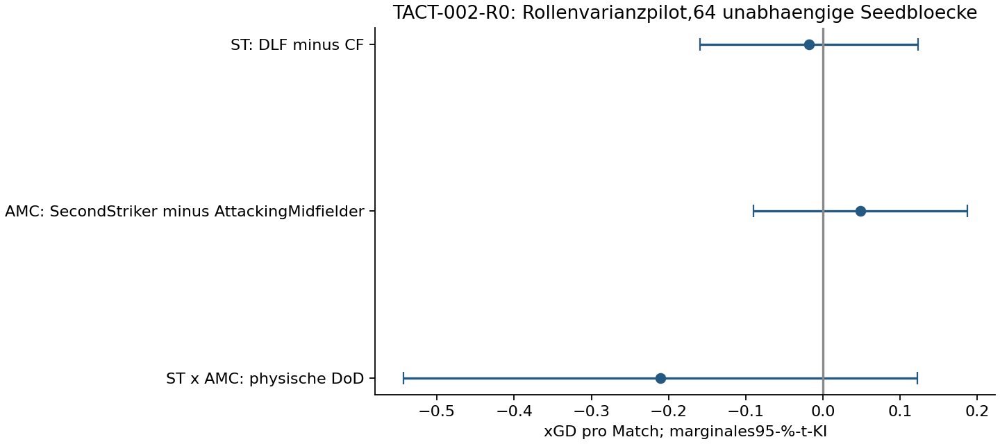

# TACT-002-R0 – Ergebnis des ST/AMC-Rollenvarianzpiloten

**FM27 27.0.1+2503222 · vorregistrierter synthetischer Discoverykontext.**
Alle512Hauptmatches und32technischen Vollmatches akzeptiert,16exakteA/A-Paare
und eine erwarteteExit108-Negativabweisung.64vollständige unabhängige Seedblöcke,
32je Gegner. Alle545Versuchsplätze abgerechnet; keine Ausfälle/Ausschlüsse,
Retries,Ersatzseeds,Holdoutmatches oder Karriereausführung.

## Primär: marginaler ST-Rolleneffekt

DeepLyingForward minus CentreForward, gemittelt über die zwei eingefrorenen
AMC-Rollen: **-0,018xGD**,95-%-t-KI **[-0,160; +0,124]**,
Bootstrap95-%-KI[-0,155; +0,117],zweiseitigp=0.80072.
SE=0.0708; volle95-%-Breite=0.283,Pilotziel≤0,50.
Praktische Screeninggröße0,30xGD,keine garantierte90-%-Power.

R00=CentreForward/AttackingMidfielder,R10=DeepLyingForward/AttackingMidfielder,
R01=CentreForward/SecondStriker,R11=DeepLyingForward/SecondStriker.
R00ist für jeden Gegner und jede Seite bytegleich D00 aus P1B; sämtliche
Team Instructions,Profile,OOP-Phasen,Rollen der anderen Spieler,Duties und
expliziten PI bleiben konstant. Rolleninterne Vorgaben sind Teil der Rollenwirkung;
PI0 behauptet nicht die Abwesenheit intrinsischen Rollenverhaltens.

Physische Primärkoeffizienten(−½,+½,−½,+½),Seitenmittel im Seed,dann beide
Gegner je½. Welch-Satterthwaite und20000stratifizierte vollständige Seedblöcke.
512Matches sind keine512unabhängigen Replikate. Keine Äquivalenzbehauptung bei
unklarem Intervall und keine universelle Rollengewichtung.

| Primärkontext | xGD-Effekt | Kontrast-SD | Seite0 | Seite1 | Seitenkovarianz |
|---|---:|---:|---:|---:|---:|
| high_press | +0,033 | 0.505 | +0,060 | +0,007 | -0.268 |
| deep_block | -0,069 | 0.621 | -0,020 | -0,119 | -0.064 |

LOO-Bereich[-0.036911696787134546, 0.0022566137289944718],maximale Verschiebung
0.0202;keine Ergebnisexklusion.

## Sieben vorab vollständig benannte Sekundärtests

Eine gemeinsame Holm7-Familie;marginale95-%-Intervalle. STxAMCist physische
DoD(+1,−1,−1,+1),kein Faktor2-Fehler. Punkte3/1/0aus tatsächlichem Endstand.
GA/xGApositiv bedeutet mehr Gegentore/Chancenabgabe.

| Kontrast:Endpunkt | Effekt |95-%-t-KI|Bootstrap95-%-KI|Holm7-p|
|---|---:|---|---|---:|
| AMC:xgd | +0,049 | [-0,090; +0,187] | [-0,084; +0,183] | 1.00000 |
| STxAMC:xgd | -0,211 | [-0,544; +0,122] | [-0,535; +0,108] | 1.00000 |
| ST:points | -0,098 | [-0,283; +0,088] | [-0,281; +0,078] | 1.00000 |
| ST:gf | -0,074 | [-0,266; +0,118] | [-0,262; +0,109] | 1.00000 |
| ST:ga | +0,020 | [-0,171; +0,211] | [-0,164; +0,203] | 1.00000 |
| ST:xgf | -0,042 | [-0,153; +0,068] | [-0,150; +0,062] | 1.00000 |
| ST:xga | -0,024 | [-0,135; +0,086] | [-0,128; +0,083] | 1.00000 |

## Tatsächliche Armmittel, rein deskriptiv

| Gegner | Arm | xGD | Punkte | GF | GA | xGF | xGA |
|---|---|---:|---:|---:|---:|---:|---:|
| high_press | R00 | -0.412 | 1.000 | 1.125 | 1.656 | 1.077 | 1.489 |
| high_press | R10 | -0.235 | 1.406 | 1.328 | 1.375 | 1.159 | 1.394 |
| high_press | R01 | -0.133 | 1.672 | 1.484 | 1.156 | 1.208 | 1.341 |
| high_press | R11 | -0.244 | 1.234 | 1.094 | 1.203 | 1.128 | 1.372 |
| deep_block | R00 | 0.248 | 1.344 | 1.281 | 1.297 | 1.492 | 1.244 |
| deep_block | R10 | 0.245 | 1.391 | 1.359 | 1.266 | 1.414 | 1.169 |
| deep_block | R01 | 0.276 | 1.453 | 1.344 | 1.125 | 1.371 | 1.095 |
| deep_block | R11 | 0.141 | 1.047 | 1.156 | 1.469 | 1.277 | 1.136 |

Keine neue Kandidatenauswahl oder optimale Taktik aus diesen Daten. Keine
D15-Optimierung. Die32techMatches gehen nicht in diese Leistungsanalyse ein.

## Bedingte neue Bestätigungsplanung

Zweiseitigα0,05,90%Power gegen Null,gleiche neue n je Kontext. Kein Poolen
mit diesen Daten,keine automatische weitere Ausführung. Die Normalmodell-
Obergrenzen sind je97,5-%-einseitigeχ²-SD-Grenzen;gemeinsame nominelle95-%-
Abdeckung nur unter Normalannahme. Andere Rollen/Gegner/Kader können anders streuen.

| SD-Annahme | ZielxGD | Neue Seeds/Gegner | Neue unabhängige Blöcke | Neue Vollmatches |
|---|---:|---:|---:|---:|
| observed | 0.20 | 44 | 88 | 704 |
| observed | 0.30 | 20 | 40 | 320 |
| simultaneous95_normal_model_upper | 0.20 | 76 | 152 | 1216 |
| simultaneous95_normal_model_upper | 0.30 | 35 | 70 | 560 |

Die Fallzahlen beziehen sich auf den gleichen marginalen ST-Kontrast im vollen
2×2,keine Garantie für Interaktions-/Holm7-Nachweise oder Karriereübertragung.

## Technische Provenienz und Ressourcen

Vorregistrierung/Code/Seeds vor Vollmatches:`1667463286cdcb4c8d139d6d71c496799281882e`.
Technische Freigabe vor Hauptmatches:`71886871fb5531ba480751a67a745a35f664f964`.
Native Readbacks für alle kodierten Records,beide Teams/Phasen,44Rollen-/Duty-
Zellen,748PI-Gruppen/Targets,69Attribute und1058Profilfelder sowie effektiven
Seed und natürlichen Abschluss bestanden. Nur deklarierte IP-ST/AMC-Rollenrecords
weichen von D00ab. Version/Katalog/Runtimequellen stimmen mit VALID-002/P1B überein.

Ein zentraler NativeLease-Supervisor,je höchstens4Engine-Worker,90s ohne
Fortschritt. Kumulierte Child-Wall-Time **295.737/900s**,
festes Studienfenster **851.954/1800s**,
unverrückbareUTC-Deadline`2026-11-14T16:03:01.170046+00:00`. Keine Zählerneustarts.
Die zusätzliche Exklusivlease ist in diesem neuen Runner integriert;historische
Runner unverändert. Vollständige Sanitized-Lease-/Budget-/Jobbelege im Datenarchiv.

## Grenzen und Abschluss

Ein gebündeltes Fixture,zwei bekannte synthetische Gegner,gleiche omnipotente
Profile und feste Managementpolitik. Rollen können über intrinsische Vorgaben,
Laufwege und Kontextinteraktionen wirken;dieser Pilot isoliert keine einzelne
solche Komponente. Kein allgemeiner Karriere- oder echter Kadernachweis.
Historische Daten und Vorregistrierungen unverändert,geschütztes Rohspielmaterial
privat. Offline-Verifier rekonstruiert achtKontraste,Holm7,192Blockwerte und545Jobs.
Nach diesem512-Match-Pilot gestoppt;keine1024-Erweiterung,Holdouts oder weitere
Optimierungsrunde.

[Vorregistrierung](TACT-002-R0-preregistration.md) ·
[Vertrag](../research/specs/TACT-002-R0.json) ·
[Rohmessungen](../data/tact-002-r0/main.jsonl) ·
[Effekte](../data/tact-002-r0/effects.json) ·
[Jobabrechnung](../data/tact-002-r0/job-accounting.jsonl).

[Separater unabhängiger Ergebnisreview](../docs/round2/RESULTS-REVIEW.md).
