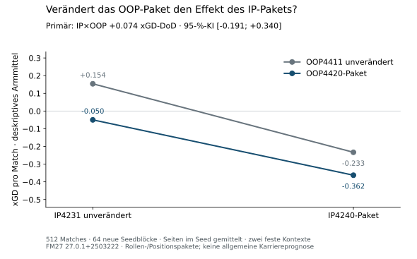

# TACT-003-STLESS-R0 – Ergebnisse des IP/OOP-Paketpiloten

15.11.2026 ·512 gültige Hauptmatches,64 unabhängige neue Seedblöcke.
**Vollständig und unabhängig aus den Rohdaten nachgerechnet.**

Das getestete stürmerlose **IP-Paket** verschlechtert xGD im festen synthetischen
Kontext marginal über beide OOP-Pakete um **−0,350 pro Match**,95-%-KI
**[−0,502;−0,198]**,Holm7-p=0,000162. Das ist ein vorregistrierter korrigierter
Sekundärbefund eines konkreten Positions-/Rollenpakets, keine allgemeine Aussage
gegen stürmerlose Taktiken. Der primäre IP×OOP-Kontrast bleibt unklar:
**+0,074 xGD-DoD**,95-%-KI **[−0,191;+0,340]**,p=0,577.

## Gegenstand und kontrollierter Kontext

[Vorregistrierung](TACT-003-stless-preregistration.md),
[Manifest](../data/night-002-stless003/manifest.json) und
[unabhängiger Neuheitsreview](../docs/night-002/STLESS003-NOVELTY-REVIEW.md).
`NOVEL_HYPOTHESIS` innerhalb der geprüften Literatur: MAC-06/07/07B/19 und FMAX
vergleichen vollständige Taktiken; TACT-002 verändert Rollen in fester Formation.
Dieser Versuch kreuzt eng deklarierte IP- und OOP-Pakete. Weitere Originalquellen
zu Effectiveness und einer3-4-3-0-Kreatortaktik wurden vor Seeds geprüft;
sie beantworten den gekreuzten kontrollierten Kontrast nicht.

FM27 `27.0.1+2503222`, DLL8c6971ce…340, unveränderter Observerhost58e05a46…d32,
Tactics Lab v1114.6/Commit91f2eba57fac0b7fbd3dff616056907e3ce461be.
Vollständige Engine-/Host-/Fixture-/Katalog-/Ressourcenhashes und tatsächliche
Python-/NumPy-/SciPy-Versionen stehen im [Inputmanifest](../data/night-002-stless003/inputs.json).
Zwei bekannte feste Discoverygegner, identische synthetische Stärke,
omnipotente Feldpositionsratings20 und deklarierte Rohattribute60; keine
UI12-Kalibrierung, natürlichen realistischen Profile oder Karriereübertragung.

IP4240 verschiebt den ursprünglichen AMC nach AMCL mit gleicher AM-Rolle und
den ursprünglichen ST nach AMCR mit SecondStriker statt CentreForward.
OOP4420 verschiebt dieselben Akteure nach AMCL/AMCR, beide OPAttackingMidfielder.
Spielerzahl, Identitäten,69Attribute/23Profilfelder, Eignungswerte, Keeper/Bank,
explizite PI und sonstige Instructions bleiben gleich. Intrinsische Rollenwirkung
und laterale Neuordnung gehören zum Paket; tatsächliche Laufwege wurden nicht gemessen.

## Primärtest, Unsicherheit und praktische Bedeutung

`IP×OOP = (I1-O1 − I0-O1) − (I1-O0 − I0-O0)`.
32 neue Seeds je Gegner, jeder mit vier Armen auf beiden Seiten. Seitenmittel
innerhalb des Seeds, gleiche Kontextgewichte.512 Matches sind64 unabhängige
Seedblöcke. Zweiseitiger Welch-Test,20.000 stratifizierte Seedblock-Bootstraps.

Primär +0,074282, Welch-KI[−0,190999;+0,339563],p=0,577429;
Bootstrap[−0,185630;+0,328572]. Volle Intervallbreite0,530562 verfehlt das
gewünschte Pilotziel≤0,50. Eine praktisch positive Moderation von+0,20 bleibt
mit den Daten vereinbar.−0,20 liegt knapp außerhalb des marginalen95-%-Intervalls;
unter dem Modell reichen dessen Grenzen von−0,191 bis+0,340.
**Keine Wirkungslosigkeits- oder formale Äquivalenzbehauptung.**

Ein positives DoD könnte auch aus zwei negativen IP-Effekten entstehen. Hier
sind die deskriptiven IP-Abstände in beiden OOP-Stellungen negativ; die
Interaktion weist keine gesicherte Kompensation durch das OOP-Paket nach.
Eine nicht signifikante Interaktion beweist zugleich keine OOP-Unabhängigkeit.

Die vier Punkte sind deskriptive Armmittel. Das gezeigte Intervall gehört allein
zum vorregistrierten primären DoD, nicht zu vier zusätzlichen Armpaar-Tests.

## Alle vorregistrierten Kontraste

Alle Intervalle marginal95%, nicht simultan. Ein Primärtest; sämtliche sieben
Sekundärtests gemeinsam Holm-korrigiert. Physische Kontrastskalierung ohne
irrtümliche Halbierung der Interaktion.

| Kontrast | Schätzer |95-%-Welch-KI |p / Holm7-p |
| --- | ---: | --- | ---: |
| IP×OOP:xGD, primär |+0,074 |[−0,191;+0,340] |0,577429 |
| IP:xGD, marginal |−0,350 |[−0,502;−0,198] |0,000162 |
| OOP:xGD, marginal |−0,167 |[−0,300;−0,033] |0,091433 |
| IP×OOP:tatsächliche Punkte |+0,273 |[−0,122;+0,669] |0,860592 |
| IP×OOP:erzielte Tore |+0,109 |[−0,223;+0,442] |1,000000 |
| IP×OOP:Gegentore |−0,188 |[−0,516;+0,141] |1,000000 |
| IP×OOP:xGF |+0,002 |[−0,202;+0,206] |1,000000 |
| IP×OOP:xGA |−0,072 |[−0,298;+0,154] |1,000000 |

Nur IP:xGD besteht Holm7. Sein Intervall endet bei−0,197784; eine garantierte
Mindestverschlechterung von0,20 wäre deshalb ebenfalls zu stark formuliert.
OOP:xGD hat trotz unadjustiert negativem Intervall keinen korrigierten Nachweis.
Die Punkte-/Torinteraktionen bleiben unklar; xGD ist kein Punktesiegbeweis.

| Deskriptiver Arm, je128 Matches |xGD/Match |tatsächliche Punkte |Tore |Gegentore |xGF |xGA |
| --- | ---: | ---: | ---: | ---: | ---: | ---: |
| I0-O0, ursprüngliche Pakete |+0,154 |1,508 |1,484 |1,383 |1,401 |1,247 |
| I1-O0, nur neues IP-Paket |−0,233 |1,102 |1,164 |1,469 |1,130 |1,363 |
| I0-O1, nur neues OOP-Paket |−0,050 |1,227 |1,180 |1,430 |1,219 |1,269 |
| I1-O1, beide neuen Pakete |−0,362 |1,094 |0,969 |1,328 |0,951 |1,314 |

Diese Tabelle fügt keine unregistrierten Signifikanztests hinzu. Insbesondere
wurde kein nachträglicher marginaler IP-Punktetest zur Gewinnerbehauptung verwendet.

## Robustheit und bedingte Planung

Explorative primäre Kontextmittel: high_press+0,264 (Block-SD1,167),
deep_block−0,116 (SD0,942). Das sind zwei feste Gegner, keine repräsentative
Population. Leave-one-seed-out-Mittel0,0396–0,1157; maximale Änderung0,0414.
Alle15 deskriptiven Felder vorhanden:0 Missing Values,0 Nullimputation.

Neue unabhängige Wiederholung im **selben** Kontext, zweiseitigα0,05/90%Power,
nichtzentrale Welchapproximation; keine neue Ausführung oder garantierte Übertragung:

| Varianzannahme |Zieleffekt DoD |neue Seeds je Kontext |neue Blöcke |Matches |
| --- | ---: | ---: | ---: | ---: |
| beobachtete SD |0,20 |149 |298 |2384 |
| beobachtete SD |0,30 |67 |134 |1072 |
| simultane95-%-SD-Obergrenzen, Normalmodell |0,20 |263 |526 |4208 |
| simultane95-%-SD-Obergrenzen, Normalmodell |0,30 |118 |236 |1888 |

Schon die optimistische0,30-Planung überschreitet mit1072 Matches die verbleibenden
1024 Mainreservierungen. Bei beobachteten1609,884/512=3,1443s je Maincall wären
bedingt etwa3371 Callsekunden zu erwarten; übrig sind1046,910s. Keine Erweiterung,
weil der Pilot knapp das Präzisionsziel verfehlt oder ein p-Wert nicht klein ist.
Neue Profile/Transferfragen haben größeren Informationswert als dieselbe Wiederholung.

## Vollständige Abrechnung und unabhängige Prüfung

TECH32+1 war unabhängig freigegeben inbae2e15 mit erfolgreicher
[CI43655940573](https://github.com/Matchekk/FM-27-Research/actions/runs/43655940573)
vor allen Hauptmatches. Eigener erster Mainaufruf prüfte unmittelbar767,628s
verfügbare eigene/globale Restzeit, mehr als die verpflichtenden600s.

545/545 Jobs:544 gültige Vollmatches (32Technik/512Main),1 erwartete Abweisung.
0 unerwartete Ausfälle,0 Ausschlüsse,0 unbegonnene oder ungelöste Jobs,
0 Retry/Ersatz/Holdout/Karrierematches. Sämtliche512 Mainbereinigungen bestätigt.
Vier Callplätze maximal; kein gemessener PID-Peak. Alle Eingabe-/Quellhashes unverändert.

Eigene Phasenchildzeit658,0032682/900s; global1310,2193456/3600s einschließlich
vollständig erhaltener alter589,7353507s. Zusätzlich separat1715,026s eigene
Native-Callzeit, kumuliert mit altem terminalem Versuch2553,090/3600s.
Alle545 neuen Claim-/Call-Envelope-Belege liegen innerhalb der zusätzlichen
40s-Reservierung und30s-Absolute-Timeout-Policy. Global1090 reservierte Plätze,
einschließlich aller545 alten; alter eigener MECH-Etat unverändert `halted`.
445.429.523 neue private Missionsbytes am Abschlussmesspunkt, unter4GiB.
Beide unveränderten UTC-Fristen eingehalten; keine Livearchivierung, Pendingmarker oder Lease.

Der [unabhängige Ergebnisreview](../docs/night-002/STLESS003-RESULTS-REVIEW.md)
rekonstruiert alle512 Originalresultate,64Blöcke, Welch-/Bootstrapintervalle,
Holm7,512 abgeleitete Kontrastzeilen und bedingte Planung. Er prüft sämtliche
512 Kernelbereinigungen und tatsächlichen Ein-/Ausgabebelege. Die öffentliche
[Nachrechnung](../analysis/review_stless003.py) benötigt keine privaten Spielressourcen.

Ergebnisse veröffentlicht auf `origin/main` im Commit
`307d36734ad81d26c8b22067215e7473a0b8906a`;
[CI43659699133 erfolgreich](https://github.com/Matchekk/FM-27-Research/actions/runs/43659699133).
[Publikations-/Artefaktbeleg](../data/night-002-publication.json). Lokal432 Tests
ohne Fehler (2 übersprungen) plus5 Analysetests; Analyse und Grafik bytegleich
reproduziert. Historische Archive unverändert.

## Praktische Konsequenz

Das konkret getestete IP-Paket verschlechtert hier die marginale xGD gegenüber
dem ursprünglichen IP-Paket. Vollständige öffentliche Spitzentaktiken wurden
nicht repliziert. Das Label einer Formation ersetzt keine Prüfung des gesamten
Rollen-/IP-/OOP-Pakets.
Dies erklärt nicht, warum andere vollständige stürmerlose Taktiken stark sind.
Eine isolierte ST-Abwesenheits-, Rollen-, Laufweg- oder universelle OOP-Regel
folgt daraus ebenso wenig wie eine veränderte Scoutinggewichtung.

Meta-Scorev0.1 bleibt unverändert; die Attribute wurden hier nicht variiert.
Reale positionsspezifische Profile, andere Gegner/Stärken, natürliche Effectiveness,
Staff-/Karrieredynamik und gehaltene Leistungsbestätigung fehlen weiterhin.
Der Befund ist ein vollständig vorregistrierter Seedpilot im synthetischen
Testkontext, keine externe oder allgemeine Karrierebestätigung.
